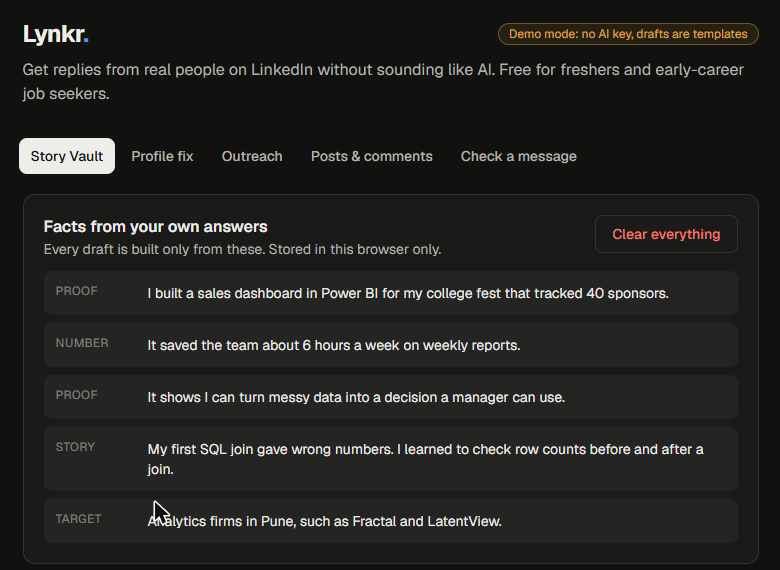

# Lynkr

A free "get-noticed" coach for Indian freshers and early-career job seekers. It interviews you (voice or typing), builds a private Story Vault of your real facts, then drafts a profile fix, outreach and referral messages, connection notes, 3 posts and 2 comments with fill-in-the-blank gaps. You copy and send everything yourself in LinkedIn. Nothing is posted for you.

Full product spec, feature matrix and decisions: [`CONTEXT.md`](CONTEXT.md). Reddit evidence: [`research/reddit-pain-points.md`](research/reddit-pain-points.md). Build plan: [`research/build-plan.md`](research/build-plan.md).

## Status
Phase 1 works end to end in demo mode (no AI key): setup, interview, Story Vault, profile fix, outreach drafts, posts and comments, and the message checker. Tested by clicking through in Chrome at desktop and phone widths; typecheck, lint and production build are clean. Real-AI mode is wired but has not been run against a real provider yet. See `CONTEXT.md` for details.

**Connect Coach:** the Connect tab suggests kinds of people to look for (with LinkedIn search links; it never names anyone), writes a connection note of 200 characters or fewer from text you paste (or a screenshot, with an AI key), tracks your monthly note budget, and tracks each person from "To find" to "Replied", one at a time.

**Ask ladder:** the Outreach tab asks who you are messaging and gives the right first message: one specific question for a stranger, a 15-minute chat ask for alumni, a referral ask (job ID, resume, fit, easy out) for someone who knows you.

**This week:** your weekly actions (default 3 messages, 2 comments, 1 post) on a Mon–Fri calendar in IST, each linked to one of your drafts and tagged by type. Move items through Draft → Scheduled → Posted/Sent, change the plan by typing ("2 posts, no comments", "posts at 8am"), get reminders via `.ics`, Google Calendar or an in-tab notification, and see when a follow-up is due. Nothing is posted for you. Spec, evidence and test results are in `research/`.

| Story Vault | Copy stays locked until you fill the blanks | Message checker |
|---|---|---|
|  |  |  |

| This week | Month view |
|---|---|
|  |  |

## Stack
Mirrors UpLinked's published stack where phase 1 allows: Next.js 16 (App Router), TypeScript, Tailwind v4, Vercel. The LLM layer takes either the Anthropic SDK or any OpenAI-compatible endpoint. Convex, WorkOS and Capacitor are phase 2.

## Run
```bash
npm install
npm run dev
```
Open http://localhost:3000.

## Tests
```bash
npm test            # unit tests (weekly plan, calendar files, chat parser)
npm run test:e2e    # browser tests (flow + accessibility); needs `npm run dev` running and Google Chrome
LYNKR_BROWSER=msedge npm run test:e2e   # same, on Microsoft Edge
```

## Environment
Copy `.env.example` to `.env.local` (never commit it) and fill in one option:

- **Anthropic:** `ANTHROPIC_API_KEY` (model `claude-opus-5-5`, override with `LYNKR_MODEL`).
- **Any OpenAI-compatible endpoint** (OpenRouter, a local server, etc.): `LLM_BASE_URL`, `LLM_API_KEY`, `LLM_MODEL`.

With neither set, or `LYNKR_MOCK=1`, the app runs in demo mode: the whole flow works using the user's own answers and blanks, with no AI calls. Set a spend limit with your provider; the in-app limits (`LYNKR_DAILY_CAP`) are best-effort only.

## Layout
```
app/api/interview   next interview question
app/api/generate    all drafts
app/api/status      demo mode / provider / model
app/api/plan        adjust the weekly plan by chat
lib/                schemas, prompts, llm wrapper, mock engine, checker, store, limits, slots, specificity
components/         UI: setup, interview (with voice), results tabs, draft card, checker, weekly plan + calendar
tests/              unit tests and the browser test
docs/               screenshots
```

## Demo
A 3-minute walkthrough with a fictional test profile: [`research/demo-script.md`](research/demo-script.md).

## Rules
- No LinkedIn login, scraping, auto-posting or automated sending.
- Drafts use only facts the user gave; gaps are blanks, never invented.
