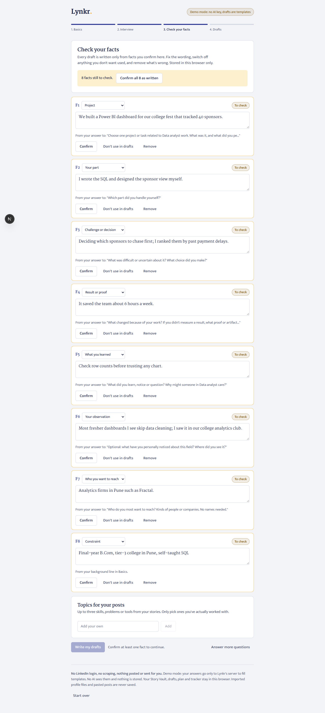
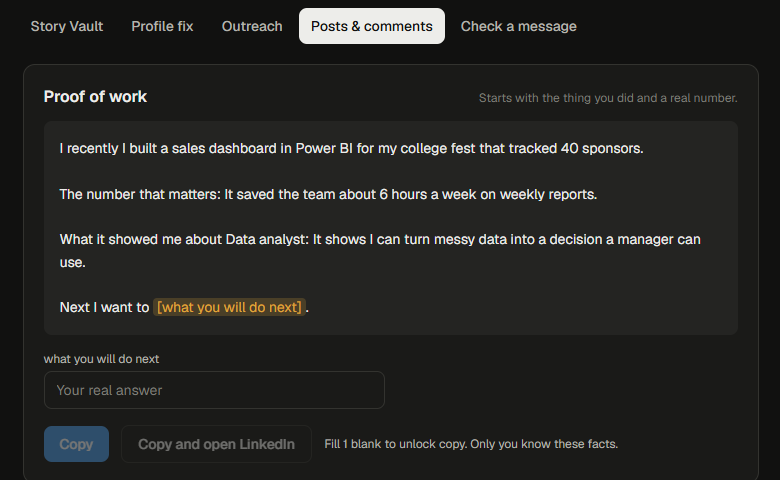
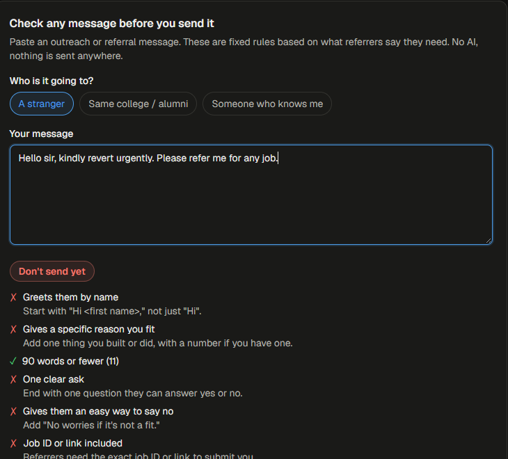
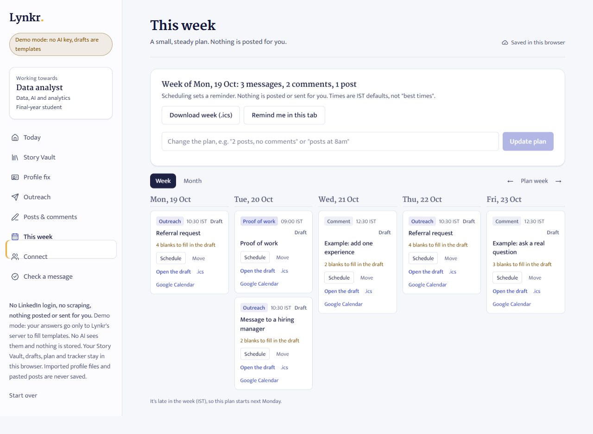
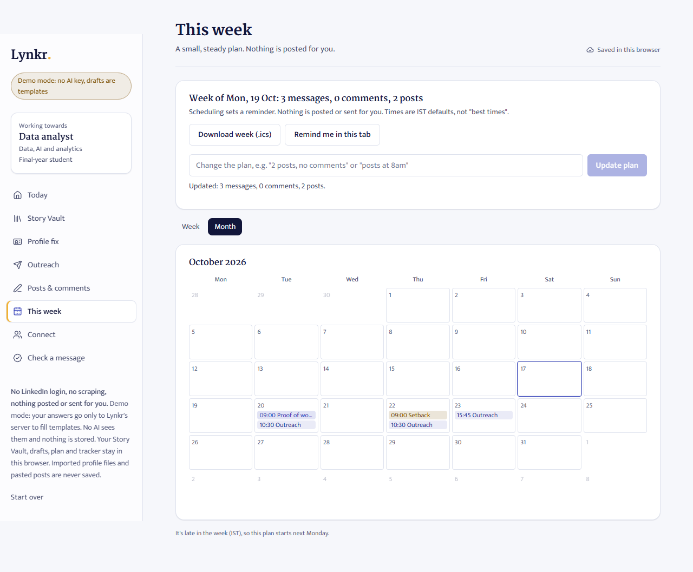

# Lynkr

A LinkedIn co-pilot (₹499 a month, taxes included) for freshers, experienced job seekers and networkers. It interviews you (voice or typing), builds a private Story Vault of your real facts, then drafts a profile fix, outreach and referral messages, connection notes, 3 posts and 2 comments with fill-in-the-blank gaps. You copy and send everything yourself in LinkedIn. Nothing is posted for you.

Full product spec, feature matrix and decisions: [`CONTEXT.md`](CONTEXT.md). Reddit evidence: [`research/reddit-pain-points.md`](research/reddit-pain-points.md). Build plan: [`research/build-plan.md`](research/build-plan.md).

## Status
Phase 1 works end to end in demo mode (no AI key): setup, interview, Story Vault, profile fix, outreach drafts, posts and comments, and the message checker. Tested by clicking through in Chrome at desktop and phone widths; typecheck, lint and production build are clean. Real-AI mode is wired but has not been run against a real provider yet. See `CONTEXT.md` for details.

**Connect Coach:** the Connect tab suggests kinds of people to look for (with LinkedIn search links; it never names anyone), writes a connection note of 200 characters or fewer from text you paste (or a screenshot, with an AI key), tracks your monthly note budget, and tracks each person from "To find" to "Replied", one at a time.

**Ask ladder:** the Outreach tab asks who you are messaging and gives the right first message: one specific question for a stranger, a 15-minute chat ask for alumni, a referral ask (job ID, resume, fit, easy out) for someone who knows you.

**This week:** your weekly actions (default 3 messages, 2 comments, 1 post) on a Mon–Fri calendar in IST, each linked to one of your drafts and tagged by type. Move items through Draft → Scheduled → Posted/Sent, change the plan by typing ("2 posts, no comments", "posts at 8am"), get reminders via `.ics`, Google Calendar or an in-tab notification, and see when a follow-up is due. Nothing is posted for you. Spec, evidence and test results are in `research/`.

**Prod plans (October 2026):** a reviewable Story Vault (no draft uses a fact you haven't confirmed), an evidence-first interview, full-text draft editing, a comment helper for posts you found, checker v2 (contact decision first, channel limits, exact-span edits), a one-person relevance packet, a funnel tracker with honest denominators, a role-specific profile diagnosis, and an in-browser LinkedIn export import. Details and what's still open: [`research/prod-implementation.md`](research/prod-implementation.md).

| Check your facts | Posts and the comment helper | Message checker |
|---|---|---|
|  |  |  |

| This week | Month view |
|---|---|
|  |  |

**Interview v2 (Vertical 1, branch `feat/interview-v2`, behind a switch):** a question bank per goal (fresher, experienced job seeker, networker) instead of a model-led interview. The server picks every question; the model only writes a one-line reflection, judges whether an answer is vague and phrases at most two follow-ups. It starts with an import step (LinkedIn's "Save to PDF", read in the browser and never uploaded; a structured paste for phones; the data archive; optional Sign in with LinkedIn), saves the context brief, Story Vault and answers to the person's account after every answer, and ends with a read-back card and a first draft (a headline plus one referral message). Plan: [`research/build-plan-interview.md`](research/build-plan-interview.md); progress: [`research/progress-vertical1.md`](research/progress-vertical1.md).

- **Switch:** `LYNKR_INTERVIEW=v1|v2`. When unset, Vercel preview builds use v2; production and local runs keep v1.
- **Free vs paid (v2):** the interview, Story Vault and first-win draft are free with a signed-in account (with per-person daily caps stored in Postgres). Everything else (full drafts, outreach, Connect Coach, comments, the checker's AI edits and the weekly plan) needs the subscription. The Terms change for this is drafted in `research/terms-draft.md` and not published yet.
- **Account storage:** Neon Postgres tables `context_brief` (versioned), `facts`, `interview_answers`, `drafts`, `plan_items`, `usage_daily` and `metric_counts` (counts only), every query scoped to the signed-in user. Without an account (license-key users) everything stays in the browser as before. People can download their data as JSON or delete it in the app; a Vercel Cron job (`/api/cron/cleanup`, protected by `CRON_SECRET`, with a dry-run mode) removes data after 12 months of inactivity.
- **Migrations:** `npm run db:migrate` applies Better Auth's tables plus the versioned SQL in `scripts/migrations/` (safe to run again; `-- --print` shows the SQL). It uses `DATABASE_URL_UNPOOLED` when set; the app uses the pooled `DATABASE_URL`. Never run it against production without approval.

## Stack
Mirrors UpLinked's published stack where phase 1 allows: Next.js 16 (App Router), TypeScript, Tailwind v4, Vercel. The LLM layer takes either the Anthropic SDK or any OpenAI-compatible endpoint. Convex, WorkOS and Capacitor are phase 2.

## Run
```bash
npm install
npm run dev
```
Open http://localhost:3000.

## Tests
```bash
npm test            # unit tests, including the interview engine, PDF parser, personas and account-storage authorization (in-process Postgres via PGlite)
npm run test:e2e    # browser tests (flow + accessibility); needs `npm run dev` running and Google Chrome
LYNKR_BROWSER=msedge npm run test:e2e   # same, on Microsoft Edge

# Interview v2 persona evaluation with the real model, against a running server (re-run whenever a prompt changes):
node --no-warnings --import ./tests/register.mjs scripts/eval-personas.mts   # LYNKR_URL, LYNKR_COOKIE optional
```

## Environment
Copy `.env.example` to `.env.local` (never commit it) and fill in one option:

- **OpenAI:** `OPENAI_API_KEY` and `LLM_MODEL` (default `gpt-5-mini`).
- **Anthropic:** `ANTHROPIC_API_KEY` (model `claude-opus-5-5`, override with `LYNKR_MODEL`).
- **Any OpenAI-compatible endpoint** (OpenRouter, a local server, etc.): `LLM_BASE_URL`, `LLM_API_KEY`, `LLM_MODEL`.

With no key set, or `LYNKR_MOCK=1`, the app runs in demo mode: the whole flow works using the user's own answers and blanks, with no AI calls. Set a spend limit with your provider; the in-app limits (`LYNKR_DAILY_CAP`) are best-effort only.

On Vercel, add the same variables under Project, Settings, Environment Variables. `/api/status` shows whether the deployed site is in AI or demo mode.

### Import a job posting (optional, Apify)
Profile fix can read one public job posting from Greenhouse, Lever or Ashby and turn it into a short list of role requirements the user reviews before anything uses them. Plan: [`docs/plans/2026-10-17-1516-feat-apify-allowed-source-enrichment-plan.md`](docs/plans/2026-10-17-1516-feat-apify-allowed-source-enrichment-plan.md).

- `APIFY_API_KEY` (or `APIFY_TOKEN`): server-only. Runs the fixed `apify/cheerio-scraper` configuration on exactly one page.
- `APIFY_ENABLED=0`: kill switch. Turns the import off without removing the key; users get the paste box.
- `APIFY_DAILY_CAP` (default 100) and `APIFY_PER_VISITOR_DAILY` (default 5): best-effort daily limits. Also set a monthly spend limit in the Apify console (agreed cap: $5/month).
- Demo mode uses a built-in fictional page and makes no Apify call.

What it will and won't do: the allowlist is code (`lib/sourcePolicy.ts`), not user input. LinkedIn, social sites, other job sites, private addresses and pages that redirect off the list are refused before or during the fetch. Names, emails, phone numbers, links and text addressed to an AI are removed. The page itself is never stored, logged, returned to the browser or sent to the AI; only the reviewed requirements are, and only after the user approves them. Pasting a job description always works as a fallback.

## Layout
```
app/api/interview   next interview question (v1)
app/api/interview2  interview v2: save one answer, return the next step from the question bank
app/api/first-win   headline + one referral message after the read-back
app/api/me/*        account context: brief, facts, settings, export, delete, move browser data, continue-on-laptop link
app/api/metrics     count-only interview events
app/api/cron/cleanup  12-month inactivity cleanup (Vercel Cron)
app/api/vault       candidate Story Vault facts for review
app/api/generate    all drafts, from confirmed facts only
app/api/connect     one-person note or message (contact decision first)
app/api/comment     comment on a post the user pasted
app/api/review      optional AI edits for the checker
app/api/enrich      import one allowlisted job posting (Apify), returns reviewed-field packet only
app/api/status      demo mode / provider / model
app/api/plan        adjust the weekly plan by chat
lib/                schemas, prompts, llm wrapper, mock engine, checker, store, limits, slots, specificity
lib/interview/      v2 question bank, engine, judge, flags
lib/db.ts           account storage (user-scoped queries); lib/pdf/ LinkedIn PDF parser
scripts/migrations/ versioned SQL migrations
components/         UI: setup, interview (with voice), results tabs, draft card, checker, weekly plan + calendar
tests/              unit tests and the browser test
docs/               screenshots
```

## Demo
A 3-minute walkthrough with a fictional test profile: [`research/demo-script.md`](research/demo-script.md).

## Rules
- No LinkedIn password, scraping, third-party profile APIs, auto-posting or automated sending. Sign in with LinkedIn (when switched on) only reads name, email and photo.
- Drafts use only facts the user gave; gaps are blanks, never invented.
