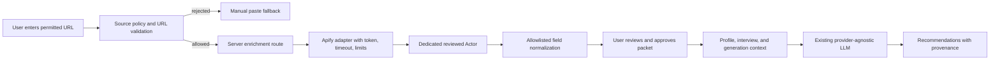

# feat: Add allowlisted Apify source enrichment

## Goal Capsule

- **Objective:** Give a Lynkr user better role-specific profile, interview, and outreach guidance when they provide a permitted job-description or official-careers-page URL, while preserving user control, provenance, privacy, and the existing no-LinkedIn-scraping promise.
- **Means:** Add a server-only, allowlisted external-source enrichment boundary backed by one controlled Apify Actor for job descriptions and official careers pages. Extract a small structured evidence packet, show it to the user for review, and use only approved fields in downstream generation.
- **Authority:** [CONTEXT.md](../../CONTEXT.md), [Copilot.md](../../Copilot.md), and the existing product plans that prohibit LinkedIn scraping and named-person harvesting outrank implementation convenience.
- **Stop conditions:** Do not ship if domain policy is bypassable, the token can reach the browser, raw source content is retained without explicit product need, provenance is missing, the provider cost cannot be bounded, or any test shows personal-contact or LinkedIn data entering the packet.
- **Execution profile:** Implement in a feature branch or isolated commit sequence. Keep manual paste as a complete fallback so Apify failure never blocks the existing product.
- **Product Contract preservation:** Product Contract unchanged. This plan adds a bounded enrichment capability consistent with the existing proposal to improve role-specific diagnosis without building a scraped people database.

## Product Contract

### Summary

The existing Lynkr flow accepts a pasted job description and user-provided profile context. The pilot adds an optional “Import permitted job page” path that extracts role requirements from a user-selected URL. It must improve the quality of profile diagnosis and interview follow-up questions without turning Lynkr into a crawler, prospect database, or automatic outreach tool.

### Requirements

- R1. The user may submit one job-description or official-careers-page URL at a time.
- R2. Only an explicit domain allowlist and approved source-purpose policy may authorize an Apify run.
- R3. LinkedIn, social profiles, connection lists, private/authenticated pages, personal portfolios with contact harvesting, and arbitrary user-entered domains are rejected by policy.
- R4. The extracted packet contains only role-relevant fields: title, company, location or work mode, responsibilities, required skills/tools, preferred skills, experience level, education requirements, and source metadata.
- R5. The system must not extract, persist, or return email addresses, phone numbers, profile URLs, social handles, names of unrelated people, messages, connections, or sensitive attributes.
- R6. The user sees the source URL, fetch timestamp, extracted fields, omitted-field notice, and an editable review step before the packet is used by an LLM.
- R7. Every generated claim derived from external enrichment remains distinguishable from a user-confirmed Story Vault fact.
- R8. The packet is request-scoped by default. Raw HTML, screenshots, Actor datasets, and full page bodies are not stored in localStorage, analytics, logs, or the LLM prompt.
- R9. The existing manual paste path remains available when the URL is rejected, the Actor fails, the source is unavailable, or the user declines external processing.
- R10. The user can remove the packet before generation and “Clear everything” removes any saved approved packet metadata or derived drafts.
- R11. Apify credentials remain server-only and are never exposed to client bundles, browser responses, or localStorage.
- R12. The feature is off in demo mode unless a deliberate fixture/mock path is selected; no paid Actor run occurs accidentally.
- R13. The pilot must have a fixed usage and cost cap, visible failure states, request timeouts, and a kill switch.
- R14. The feature must not alter Connect Coach’s user-led discovery model or create named-person recommendations.

### Scope Boundaries

**In scope for the pilot**

- One URL per request.
- Job descriptions and official company careers pages only.
- One dedicated, reviewed Apify Actor or equivalent allowlisted extraction configuration.
- Structured extraction and user review.
- Reuse in Profile fix, interview follow-up, and generation prompts.
- Manual-paste fallback and mock fixtures.

**Out of scope**

- LinkedIn scraping or LinkedIn API integration.
- Named-person discovery, ranking, contact harvesting, or connection imports.
- Crawling a domain, following arbitrary links, scheduled collection, or a central job database.
- Automatic applications, messaging, posting, or outreach.
- Retaining raw pages for model training or cross-user reuse.
- Adding authentication, accounts, or a persistent server database solely for this pilot.

### Acceptance Examples

- **A1 — Allowed source:** Given an allowlisted official careers URL, when the user submits it, then Lynkr returns a reviewed packet with source URL and timestamp, and no raw HTML.
- **A2 — Rejected source:** Given a LinkedIn URL or non-allowlisted domain, when the user submits it, then Lynkr rejects it before any Apify call and offers manual paste.
- **A3 — Safe extraction:** Given a fixture containing a job description plus an email footer and employee names, when extraction completes, then the packet contains role fields only and excludes the email, names, and contact details.
- **A4 — User gate:** Given an extracted packet, when the user has not approved it, then Profile fix and generation cannot use it.
- **A5 — Provenance:** Given a generated recommendation using an approved packet, then the UI identifies the source and distinguishes external requirements from user facts.
- **A6 — Failure fallback:** Given an Actor timeout, malformed output, cost-cap refusal, or source fetch failure, then the user sees a clear error and can paste the text manually.
- **A7 — Privacy:** Given Clear everything, then the approved packet, derived enrichment, and drafts are removed from browser storage.
- **A8 — Cost safety:** Given demo mode or a disabled feature flag, then no network request to Apify is made.

## Planning Contract

### Key Technical Decisions

- KTD1. Start with **URL-triggered, one-page enrichment**, not a crawler. This keeps the value proposition testable and limits terms, privacy, cost, and availability risk.
- KTD2. Use a server-side adapter around the official Apify API/client rather than calling Apify from React. The adapter owns token handling, Actor selection, timeout, response validation, and usage accounting.
- KTD3. Treat the domain allowlist as code-reviewed policy, not user input. Each domain entry must include purpose, permitted fields, terms-review date, and an owner.
- KTD4. Use an explicit normalized `ExternalContextPacket` rather than passing Actor output or raw HTML to the LLM. Unknown fields remain unknown; the model must not infer them.
- KTD5. Keep the packet transient by default. If the user chooses to save it, save only normalized reviewed fields and provenance, never raw source content.
- KTD6. Make the first Actor contract deterministic and narrow. Prefer one dedicated Actor with an input URL and an output schema over arbitrary Store Actors whose behavior can change without review.
- KTD7. Enforce both application limits and an Apify account/dashboard spend limit. The application limit is a safety boundary, not a substitute for provider billing controls.
- KTD8. Preserve the existing provider-agnostic LLM layer. Apify enriches evidence; it does not become an LLM provider or a second prompt/orchestration system.

### High-Level Technical Design

The critical boundary is `Normalize`: no downstream component receives raw Actor output. The route validates source policy before the external call, validates the Actor response after the call, and returns an explicit error instead of a success-shaped empty packet.

### Data Shape

The normalized packet should carry:

- `sourceUrl`
- `sourceDomain`
- `sourceKind`
- `fetchedAt`
- `title`
- `company`
- `location`
- `workMode`
- `experienceLevel`
- `education`
- `responsibilities[]`
- `requiredSkills[]`
- `preferredSkills[]`
- `reviewStatus`
- `approvedAt`
- `provenance[]` mapping each extracted field to a source label or section

The schema must reject fields outside the allowlist and cap item counts and text lengths. The packet must never contain arbitrary Actor JSON.

### Sequencing

1. Establish source-policy and data-contract tests with fixtures before adding a paid integration.
2. Implement the server-only adapter with mock mode, timeouts, and response validation.
3. Add the URL input, review gate, provenance display, and manual fallback.
4. Wire approved fields into Profile fix and generation only; leave Connect Coach unchanged.
5. Add observability that records counts, status, latency, and error category without recording URLs containing query secrets or raw page text.
6. Run the pilot against a fixed fixture set and a small manually reviewed sample of permitted sources.
7. Decide whether to expand the allowlist using the metrics below. Do not expand by default.

### Risks and Mitigations

| Risk | Mitigation |
|---|---|
| A domain's terms or policy changes | Store review metadata; fail closed when a domain is not currently approved. |
| Apify output contains personal data | Normalize through a strict allowlist; test hostile fixtures; reject and log only the field category. |
| Prompt injection in a job page | Treat external text as untrusted data; delimit it; never follow instructions from the page. |
| Token leakage | Server-only environment variable; no client import; response and bundle checks. |
| Runaway cost | Per-user/day caps, one URL per request, timeout, Actor item/page limits, dashboard spend cap, kill switch. |
| Stale or incorrect requirements | Show source and timestamp; user approves fields; label external context as a signal, not truth. |
| Apify outage | Manual paste fallback and clear retry/error state. |
| Privacy deletion failure | Request-scoped processing; explicit storage tests and clear-state tests. |

### Deferred to Implementation

- Exact Actor identifier and whether the first adapter uses `apify-client` or the REST API.
- Exact hosting/runtime timeout after validating the deployment environment.
- Final first-party allowlist entries after terms review.
- Whether normalized packets should be saved by explicit user action in the first pilot or remain request-scoped only.

## Implementation Units

### U1. Define source policy and normalized enrichment contract

- **Goal:** Create the fail-closed policy and schema that every later component uses.
- **Files:** `lib/sourcePolicy.ts`, `lib/schemas.ts`, `lib/externalContext.ts`, `tests/externalContext.test.mts`.
- **Approach:** Represent source kind, allowed domains, review metadata, field allowlist, item limits, and rejection reasons as typed data. Validate URLs without accepting credentials, fragments, localhost/private-network targets, or unsupported protocols. Normalize and cap all extracted strings.
- **Test scenarios:**
  - Accept an approved HTTPS careers URL.
  - Reject LinkedIn, non-HTTPS URLs, localhost/private IPs, unsupported domains, URLs with credentials, and unsupported source purposes.
  - Strip or reject forbidden output fields such as email, phone, social handle, person name, and raw HTML.
  - Preserve source URL, timestamp, provenance, and reviewed/unreviewed state.
  - Reject overlong arrays and fields rather than silently truncating unsafe data.
- **Verification:** Unit tests cover both policy and hostile extraction fixtures before integration work begins.

### U2. Add the server-only Apify adapter

- **Goal:** Run one approved Actor safely and return only the normalized packet.
- **Files:** `lib/apify.ts`, `app/api/enrich/route.ts`, `.env.example`, `tests/apify.test.mts`.
- **Approach:** Keep the token in server environment configuration. Select the Actor from server configuration, validate policy before running, apply timeout and request limits, validate the Actor result with the normalized schema, and classify provider errors explicitly. In mock mode return a fixture without making a network call.
- **Test scenarios:**
  - Mock mode makes zero Apify requests and returns a deterministic fixture.
  - Allowed URL calls the adapter with the expected URL and bounded input.
  - Disallowed URL is rejected before the adapter is invoked.
  - Missing token or disabled feature returns a clear configuration error without exposing secrets.
  - Timeout, non-2xx response, malformed Actor output, and provider quota errors return distinct safe errors.
  - Returned data excludes raw HTML and forbidden fields.
- **Verification:** Unit tests mock the network boundary; no paid Actor call is required for CI.

### U3. Add user review, provenance, and fallback UI

- **Goal:** Make external evidence useful without allowing it to silently become a user fact.
- **Files:** `components/ExternalContext.tsx`, `components/Setup.tsx`, `components/ProfileFix.tsx`, `components/ui.tsx`, `lib/store.ts`, `tests/e2e.mjs`, `tests/e2e-a11y.mjs`.
- **Approach:** Add an optional URL input alongside the existing job-description paste. Show loading, rejected-source, provider-error, empty-result, and success states. Require explicit approval before downstream use. Keep the URL input and approved normalized packet separate from Story Vault facts and preserve the manual path.
- **Test scenarios:**
  - User can continue with manual paste and no URL.
  - Approved fixture shows fields, source, timestamp, and provenance.
  - Generate/Profile fix is disabled or clearly gated until approval.
  - Rejected URL offers manual paste without a failed external side effect.
  - Error state supports retry and fallback.
  - Keyboard navigation, labels, focus, 375px layout, and no horizontal overflow pass.
  - Clear everything removes any explicitly saved normalized packet.
- **Verification:** Browser tests run in mock mode; accessibility checks cover every new control.

### U4. Wire reviewed context into profile diagnosis and generation

- **Goal:** Improve existing outputs without changing Connect Coach or inventing user facts.
- **Files:** `app/api/generate/route.ts`, `app/api/profile-audit/route.ts` if present, `lib/prompts.ts`, `lib/profileAudit.ts`, `components/Results.tsx`, `tests/intelligence.test.mts`, `tests/e2e.mjs`.
- **Approach:** Add the approved packet as a clearly delimited external-requirements section. Prompts must instruct the model to use it for comparison and questions, never as proof of the user’s experience. Preserve `factRefs` for Story Vault claims and add separate external provenance references.
- **Test scenarios:**
  - Approved requirements produce role-specific gap suggestions.
  - User facts remain the only source for personal achievements and claims.
  - Unapproved or absent packets do not reach the prompt.
  - Prompt-injection text in the source is treated as data and cannot alter system behavior.
  - Manual-paste behavior remains unchanged.
  - Older localStorage saves migrate without losing drafts or people.
- **Verification:** Prompt safety, schema, mock-output, and browser regression coverage pass before any real provider test.

### U5. Add operational controls, privacy checks, and pilot measurement

- **Goal:** Make the pilot stoppable, auditable, and measurable without retaining personal page content.
- **Files:** `lib/limit.ts`, `lib/http.ts`, `app/api/status/route.ts`, `README.md`, `CONTEXT.md`, `research/validation-report.md`, `tests/core.test.mts`, `tests/e2e.mjs`.
- **Approach:** Add feature flag and per-user/day limits, bounded payload sizes, structured status/error metrics without raw content, explicit privacy copy, and a documented kill switch. Record only aggregate counters and safe error categories.
- **Test scenarios:**
  - Disabled feature and exhausted quota fail closed.
  - Oversized URL or payload is rejected.
  - Error telemetry contains no source body, token, email, phone, or query secret.
  - Clear everything removes all saved normalized context.
  - Existing core, plan, Connect, accessibility, and build suites still pass.
- **Verification:** Full unit, lint, TypeScript, build, and browser suites; inspect a sample of logs or test telemetry for redaction.

## Verification Contract

### Required commands

| Check | Command | Gate |
|---|---|---|
| Unit tests | `npm test` | All existing and new tests pass. |
| Lint | `npm run lint` | No new lint errors. |
| TypeScript | `npx tsc --noEmit` | Clean type-check. |
| Production build | `npm run build` | Build succeeds with no client-side Apify/token import. |
| Browser journeys | `npm run test:e2e` | Manual fallback, review gate, provenance, rejection, clear, and accessibility pass. |

### Pilot evaluation

Use a fixed fixture set of at least 10 permitted job/careers-page documents representing different layouts.

- At least 9/10 fixtures produce a usable title and requirements packet.
- 10/10 fixtures preserve source URL, timestamp, and provenance.
- 10/10 hostile fixtures exclude forbidden contact/person fields.
- 0/10 tests expose the token or raw source text to browser storage or client bundles.
- Manual paste remains available in 10/10 failure or rejection cases.
- Median enrichment latency and per-run cost are recorded before any expansion decision.
- No production rollout occurs until the user approves a concrete account spend cap and the source allowlist review is complete.

## Definition of Done

- U1–U5 are implemented and reviewed as coherent units.
- The first allowlist contains only sources with documented terms/permission review.
- LinkedIn and named-person scraping remain technically rejected.
- Apify token is server-only and absent from browser bundles, responses, logs, and localStorage.
- The normalized packet is user-reviewed, provenance-bearing, bounded, and separate from Story Vault facts.
- Manual paste is a fully functional fallback.
- Demo mode performs zero paid/external Apify calls.
- All verification commands pass.
- Pilot measurements meet the stated thresholds.
- [CONTEXT.md](../../CONTEXT.md), [README.md](../../README.md), and the validation report accurately describe the feature and its limits.
- Expansion to additional source categories is a separate decision; it is not implied by completing this pilot.

## Appendix

### Existing project anchors

- `CONTEXT.md`: current product promise, local-first data model, and no-scraping boundary.
- `research/spec-connect-coach.md`: user-led discovery and no named-person scraping.
- `prod/lynkr-outreach-intelligence-plan.md`: proposed role-specific context model and explicit rejection of third-party LinkedIn scraping.
- `prod/lynkr-profile-fix-intelligence-plan.md`: profile diagnosis should use user-confirmed evidence and optional job descriptions.
- `lib/store.ts`: current browser-local state and migration boundary.
- `app/api/connect/route.ts`: existing server route pattern for body limits, schema validation, mock mode, rate limits, and safe errors.
- `lib/http.ts`: existing request-size boundary.

### External references

- Apify Actors documentation: https://docs.apify.com/actors
- Apify security documentation: https://docs.apify.com/security
- Apify acceptable-use policy: https://docs.apify.com/legal/acceptable-use-policy.md
- LinkedIn prohibited software policy: https://www.linkedin.com/help/linkedin/answer/a1341387/prohibition-of-scraping-software?lang=en
- LinkedIn User Agreement: https://www.linkedin.com/legal/user-agreement
- LinkedIn API documentation: https://learn.microsoft.com/en-us/linkedin/
- India Digital Personal Data Protection Act page: https://www.meity.gov.in/content/digital-personal-data-protection-act-2023
