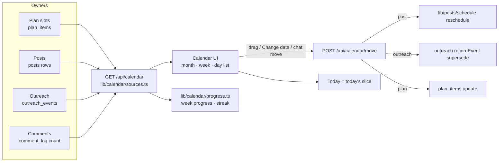

# Calendar (V4) - Plan

## Goal Capsule

- **Objective:** Any Lynkr user with an account opens one calendar and sees their whole LinkedIn week (KD6: the Calendar is free, what fills it is paid):
  - posts that will publish themselves
  - comment slots
  - outreach messages, follow-ups and meetings

  The week is sized to their goals and the time they said they have. They move things by dragging or by "Change date", see why the week looks the way it does, and keep a weekly streak by doing the work themselves.
- **Means:** an UpLinked-style calendar (KD1). Each week is calculated by fixed rules from the user's goals and weekly time (KD2). Each item stays owned by the feature that made it (KD4).
- **Authority, highest first:**
  1. Aryan's decisions: the Key Decisions in this file, plus anything he says later.
  2. The R-IDs.
  3. The KTDs.
  4. The unit text.
- **Background only:**
  - `research/feature-spec.md` and `research/validation-report.md` (the 2026-10-16 weekly plan, 19/19 tests)
  - `research/feature-evidence-calendar.md` (UpLinked)
- **Scope boundary:** this plan owns the calendar's views, the week's generation, moving items, the week's progress and streak, and reminders. Posts (`build-plan-posts.md`), outreach (`build-plan-outreach.md`) and comments (`build-plan-commenter.md`) own their own items and rules.

---

## Product Contract

### Summary
The "This week" tab becomes the Calendar:
- **Views:** a month grid and a week grid, Monday to Sunday, plus a day list on phones.
- **Contents:** every post, comment slot, outreach message, follow-up and meeting, each showing its type, time, status and goal.
- **How a week is made:** calculated from the user's goals and weekly time by fixed rules. A "Why this week" line explains it, and chat or drag adjusts it.
- **Moving an item:** the move is sent to the feature that owns the item. A post reschedules its publish job, and a follow-up updates the contact's timeline.
- **Habit:** Mondays open with the outreach to-do. The week's progress ("7 of 9 done") feeds a streak, which counts a week when at least 70% of its planned actions were done by the user.

### Problem Frame
Today the week is a fixed list, and posts, outreach and comments are each planned separately:
- **The current plan:** 1 post, 2 comments and 3 messages for everyone (`lib/plan.ts` lines 35–37). It ignores the interview's goals and its weekly-time answer (`lib/schemas.ts` line 70 `weeklyTime`; `lib/plan.ts` reads neither). It is placed Mon–Fri only, moved with a day picker (`components/WeekPlan.tsx` lines 183–217), and kept only in browser storage (`lib/store.ts` lines 28, 35). The server table `plan_items` exists, but nothing calls it (`lib/db.ts` lines 245–257; grep found no caller).
- **Posts** will publish from server rows on a schedule (`build-plan-posts.md` KD3, KTD1).
- **Outreach** next steps will live on each contact's timeline (`build-plan-outreach.md` KD10, KTD17).
- **Comments** will live in a log (`build-plan-commenter.md` R13).

Nothing shows the whole week, and nothing gives a reason to come back each week.

UpLinked shows the shape that works:
- one calendar of typed items, each with a time, a status and a campaign label (`feature-evidence-calendar.md` #2, #3)
- weeks calculated by rules, with the AI only explaining them (#5)
- drag to edit (#4), with id-keyed changes and undo (#7)
- a Monday to-do with a streak (#12)

### Key Decisions
- KD1. **The Calendar follows UpLinked's style and features:**
  - a month and week grid of typed items
  - drag to reschedule, and changes by chat
  - a timeline per item, with superseded schedules struck through
  - id-keyed changes
  - a Monday to-do with a weekly streak

  (session-settled: user-directed — Aryan, 2026-10-30: "keep it like uplinked. similar style and features for V4", chosen over keeping today's "This week" list; recorded as `build-plan-outreach.md` KD11.) Governs R1–R5, R14–R19.
- KD2. **Each week is calculated by fixed rules from the user's goals and weekly time; the AI only explains it.** (session-settled: user-approved — "Goal-based rules" chosen over "keep today's default" and "full 12-week strategy", 2026-10-30.) Governs R10–R13.
- KD3. **A week counts toward the streak when the user completed at least 70% of its planned actions themselves.** Answering the Monday to-do alone doesn't count. (session-settled: user-approved — "Real actions done" chosen over "Monday to-do cleared" and "no streak", 2026-10-30. The 70% figure is a lead default, D-K2.) Governs R18, R19.
- KD4. **Every item stays owned by the feature that made it. The Calendar shows items and sends edits back to their owner.**
  - Posts: `build-plan-posts.md`.
  - Outreach steps: `build-plan-outreach.md`.
  - Comment logging: `build-plan-commenter.md`.
  - Plan slots: this plan.

  Lead decision (reversible). Governs R6–R9, R14.
- KD5. **Nothing is posted or sent by the Calendar.** Posts publish themselves only through the Posts plan's own path (`build-plan-posts.md` KD3, with its production gate KD4). Outreach and comments never send (`memory.md` 2026-10-29). Carried. Governs R20.
- KD6. **The Calendar is free for every user; what fills it stays paid.** (session-settled: user-directed — Aryan, 2026-10-30: "the calendar is a inbuilt feature", clarified as "Free for every user", chosen over paywalling the tab.) This amends "keep today's split" (`research/context-brief.md` §8) for the Calendar only.
  - **Free, with an account:** viewing the calendar, the goal-based week, moving plan slots, progress and the streak, and reminders.
  - **Paid:** drafting and publishing posts, outreach steps and their drafts, comment generation, and the AI plan chat.
  - Governs R25.

### Requirements

**Views (KD1)**
- R1. **The month view:** Monday to Sunday, IST.
  - Each day shows up to 3 chips, then "+N more". The "+N more" and the day number both open that day in the week view.
  - Clicking a chip opens its owner's screen (R16). Dragging moves it (R14). A small menu button on the chip, keyboard-focusable and at least 44 px on touch, holds "Change date".
  - When space is short, a chip keeps its time and type and drops the goal label. The goal label always shows in the week view. Previous and next month buttons cover one month back and five ahead, the same window as UpLinked (#8) and the outreach feed (`build-plan-outreach.md` KTD17).
- R2. **The week view:** seven columns, Monday to Sunday, each item showing its time.
  - It's the default view. A Week / Month toggle switches views, and the choice is remembered for the session.
  - **The page, top to bottom:**
    1. the Monday to-do (Mondays only, R17)
    2. a header with "Why this week" (R11), the progress (R18) and the streak (R19)
    3. a toolbar with the chat box (R12), Undo (R15) and Reminders (R20)
    4. the grid
- R3. **On phones,** a week strip with dots under days that have items, previous and next week arrows, and a list of the chosen day's items. This is UpLinked's phone calendar (#14). The Month toggle shows a month of days with dots, and tapping a day opens it in the list.
- R4. **Each chip shows:**
  - **Type:** post (with its proof, setback or observation tag), comment, message, follow-up, meeting, thank-you, check-in, second person, referral ask, withdraw, or close.
  - **Time.**
  - **Status** as text and colour.
  - **Label:** the goal it serves. For outreach that's the contact's goal; for plan slots, the week's goal.
- R5. **Statuses shown:**
  - **Draft**
  - **Scheduled:** for a post, "publishes itself at <time>"; otherwise a reminder is set.
  - **Due**
  - **Done:** Published, Posted or Sent.
  - **Replaced:** struck through, with "Replaced by <date>".
  - **The post-only statuses** `build-plan-posts.md` R25 defines: Failed, Overdue, Check LinkedIn.

  Each status is text, not only a colour or a strike-through.

**What's on the calendar (KD4)**
- R6. **Posts:** every post with a day and time, from the posts plan's server rows, with its live status (`build-plan-posts.md` R25). Opening one opens the post editor.
- R7. **Outreach:** every due, done and replaced outreach step from the outreach feed (`build-plan-outreach.md` KTD17, R44). Opening one opens the person card.
- R8. **Comments:**
  - the week's comment slots
  - a slot is marked done by the number of comments the user marked Posted that week (`build-plan-commenter.md` R16), in date order
  - opening one opens the comment helper, or explains "Right-click a post on LinkedIn"
- R9. **Message slots are filled from Outreach first.**
  - A message slot shows the outreach step due that day, if there is one.
  - An empty slot reads "Pick someone to contact" and opens Outreach.
  - A follow-up, thank-you or check-in fills the message slot on its due day, as above. If there are more due steps than slots, the extra ones appear beside the slots. A meeting always appears as an extra item on its own date.

**The week's plan (KD2)**
- R10. **The week's mix is calculated by fixed rules from three inputs:**
  - **The goal family:**
    - Job seeker: interview goals job, internship or referral, or Outreach goals job or referral.
    - Visibility builder: the networker bucket, or goals network or mentor.
    - Freelancer: the Outreach goal `clients`.

    If several apply, the first Outreach goal the user picked wins. Without any, the interview bucket decides: fresher, experienced and switcher map to Job seeker; networker to Visibility builder; founder to Freelancer (`lib/schemas.ts` line 15 `BUCKETS`).
  - **The weekly time** from the interview: 15 minutes, 30 minutes, 1 hour, or 2 hours or more (`lib/schemas.ts` line 70; default 30 minutes).
  - **The caps already in `lib/plan.ts`:** 5 posts, 10 comments, 10 messages (line 37).

  The default table (lead defaults, D-K1):

  | Weekly time | Job seeker (posts / comments / messages) | Visibility builder | Freelancer |
  |---|---|---|---|
  | 15 min | 0 / 1 / 2 | 1 / 2 / 0 | 0 / 2 / 1 |
  | 30 min | 1 / 2 / 3 | 2 / 3 / 1 | 1 / 3 / 2 |
  | 1 hour | 1 / 3 / 5 | 3 / 4 / 2 | 2 / 4 / 3 |
  | 2 hours+ | 2 / 4 / 7 | 4 / 6 / 3 | 3 / 5 / 5 |

  Days and times follow today's rules: Mon–Fri spread, default times 09:00, 12:30 and 10:30 (`lib/plan.ts` lines 36, 51, 59–61).
- R11. **A "Why this week" line** names the inputs and the rule, for example: "Job seeker, 30 minutes a week: outreach first, 2 comments to warm your targets, 1 proof post." The line is built from a fixed template from the goal family, weekly time and counts, with no model call. That also keeps the free Calendar free of AI cost (R25).
- R12. **Chat changes the week,** as today (`lib/plan.ts` `parsePlanChat`, `app/api/plan`). It can change counts and default times, and now also move one item ("move Thursday's post to Friday"). A chat change overrides the rule for that week only, and the "Why" line says "Changed by you".
- R13. **Recalculating never touches what's in progress.** When goals or weekly time change, future plan slots are recalculated. Anything scheduled, publishing, published, done, or owned by another feature is left as it is (the same rule as `build-plan-posts.md` R2).

**Moving and editing (KD1, KD4)**
- R14. **Moving an item.** Drag it on the month or week grid (desktop), or use "Change date" on any item (all sizes and the keyboard). The move goes to the item's owner:
  - **A post** is rescheduled through the posts plan (R26 there). The move is refused once publishing has started, with that plan's message.
  - **An outreach step** is moved with the feed's id-keyed PATCH (`build-plan-outreach.md` KTD17).
  - **A plan slot** gets a new day and time.

  The old date stays visible, struck through ("Replaced by <date>"). A retried move never makes a duplicate.
  - **Dropping onto a day changes the day only and keeps the item's time.** Neither grid has hour rows. The chip shows the resulting time right after the drop. To change the time, use "Change date".
  - **While dragging,** valid days are marked, and past days are invalid. Chips that can't move show no drag handle; their reason (for example "Publishing now") replaces "Change date" in the menu.
  - **After a drop,** the chip shows "Moving…" until the owner answers. A refusal or failure returns it to its cell, with an inline message naming the reason.
- R15. **Undo** is offered for the last move or chat change, for as long as the page is open (UpLinked #7). Undoing a post move goes through the posts plan's reschedule rules.
- R16. **Opening an item** goes to its owner's screen: the post editor, the person card, or the comment helper. Plan slots open the matching draft, as today (`WeekPlan.tsx` lines 219–231).

**The week and the streak (KD3)**
- R17. **On Mondays** (IST), the week view opens with the outreach to-do (`build-plan-outreach.md` R45) above the grid. Users with no outreach contacts, such as free users, don't see the to-do. Their page starts with the week header.
- R18. **The week's progress,** "7 of 9 done". Planned actions are the week's plan slots plus any outreach steps that fill no slot. A message slot filled by an outreach step counts once. Replaced and dismissed items aren't counted. Done means:
  - a plan slot the user marked done with "Mark posted" or "Mark sent", for something they did on LinkedIn themselves. This is today's control (`WeekPlan.tsx` line 174), available to free and paid users. It counts as a real action under KD3, the same way outreach steps are recorded by the user's own tap (`build-plan-outreach.md` KD13)
  - a post published by Lynkr, or marked published in the fallback path
  - a comment the user marked Posted
  - a message, follow-up, thank-you or check-in marked sent
  - a meeting answered as happened
- R19. **The streak:** the last 6 finished weeks plus the current week, with a flame on each week that reached 70% (D-K2). Each flame has a text label ("Week 45: 7 of 9, streak kept"). A new user with no finished week sees "Your first week" and no flame. A week below 70% resets the streak. The current week shows its progress without a flame until it reaches 70%. The copy never shames: "4 of 9 — keep going".

**Reminders (KD5)**
- R20. **Reminders stay as today:**
  - an .ics for each item and for the week
  - a Google Calendar link
  - in-tab reminders (`lib/ics.ts`; `WeekPlan.tsx` lines 77–94, 332, 336)

  A post scheduled to publish itself is labelled "publishes itself", not "reminder". No email or push (`build-plan-outreach.md` D-O5).
- R21. **A calendar subscription link** that updates by itself is out of this release (D-K3).

**Storage, Today and data rights**
- R22. **For signed-in users the plan is kept in the account,** so it shows next to posts and outreach on any device. On a user's first signed-in load, the browser's current plan moves to the account once. License-key-only users with no account keep today's browser-only plan, without posts, outreach or comment items.
- R23. **Today** shows today's slice of the Calendar: items due or scheduled today, overdue items, and the Monday to-do. This replaces the interim view in `build-plan-outreach.md` U20.
- R24. **Plan items** are in Download my data and removed by Delete my data and the 12-month cleanup (`plan_items` is in `lib/db.ts` `TABLES`, line 279).

**Access**
- R25. **Free and paid inside the Calendar (KD6):**
  - **What a free user sees:**
    - their goal-based week (from the interview's goals and weekly time): post, comment and message slots. Opening a post slot shows the paywall card.
    - "Mark posted" and "Mark sent" on every plan slot, so they can do the work by hand on LinkedIn and see it count (R18)
    - their first-win message as an item
    - reminders, and moving plan slots
    - the progress and the streak
  - **What a free user can't do:**
    - Opening a post, outreach or comment item that needs a paid feature shows the existing paywall card in place of that screen.
    - Plan chat (it calls OpenAI) shows the paywall card, led by "Change your week by chat". The rule-based demo parser (`lib/plan.ts` `parsePlanChat`) isn't offered to free users, so the paid boundary stays simple.
  - **Lapsed paid users** keep everything a free user has, plus read-only views of their past posts and outreach items.

### Acceptance Examples
- AE1. Covers R10, R11. A fresher with interview goal "job" and weekly time 30 minutes gets 1 post, 2 comments and 3 messages, Mon–Fri, with "Why this week: Job seeker, 30 minutes a week…". Changing weekly time to 1 hour recalculates next week's slots to 1 / 3 / 5. Today's scheduled post doesn't move.
- AE2. Covers R9.
  - **Setup:** Priya's follow-up is due Wednesday, and there are three message slots.
  - **Expected:** Wednesday's slot shows "Follow-up · Priya". The other two read "Pick someone to contact". A meeting on Thursday appears as an extra item.
- AE3. Covers R14.
  - **Dragging Tuesday's 09:00 scheduled post to Wednesday** keeps the time and reschedules it through the posts plan: Tuesday is struck through, and Wednesday shows "publishes itself at 09:00".
  - **Dragging it while it's publishing** is refused with "Publishing now".
  - **The same move with the keyboard** ("Change date") gives the same result.
- AE4. Covers R18, R19.
  - **Week 45:** 9 actions planned, 7 done, so the flame shows.
  - **Week 46:** 4 of 9 done. The streak resets at the week's end, and the copy reads "4 of 9 — keep going" during the week.
  - **Not counted:** a week where the user only answered the Monday to-do and did nothing else.
- AE5. Covers R22. A signed-in user with a browser plan opens the Calendar on a second device and sees the same week. The browser plan was moved once; reloading doesn't duplicate it.
- AE6. Covers R12. "Move Thursday's post to Friday" in chat moves it, reschedules it through the posts plan, and shows "Changed by you" in the Why line.
- AE7. Covers R25.
  - A free user sees their week with 2 comment and 3 message slots, and can drag a slot.
  - Opening a message slot's "Pick someone to contact" shows the paywall card.
  - A lapsed user also sees their past posts read-only.

### Success Criteria
These are lead defaults (D-K4):
- **Coming back:** at least 3 of 5 testers open the Calendar in their second week without being prompted.
- **Completion (paid testers):** the median tester completes at least 60% of planned actions in week two.
- **The rules feel right (paid testers):** at least 2 of 5 keep the calculated mix without changing it by chat in week two.
- **The free Calendar earns its place (free testers):** at least 2 of 5 open a gated item from the Calendar and reach checkout within two weeks. A lead default; Aryan picks the numbers under D-K4.

### Scope Boundaries
- **Out, considered:**
  - **UpLinked's 12-week strategy engine,** funnel labels and 18 post types. The Posts plan already left it out (`build-plan-posts.md` Scope Boundaries). The goal rules (KD2) are the small version.
  - **Analytics on calendar items** (UpLinked #3, #15). Lynkr can't read posts back.
  - **Team calendars and a shared undo history** (UpLinked #7). Lynkr has one user per account.
  - **Email or push reminders** (`build-plan-outreach.md` D-O5).
  - **Carrying unfinished plan slots into the next week.** Today's spec says no (`feature-spec.md` line 43). Outreach steps and posts keep their own dates.
- **Deferred:**
  - **A calendar subscription link** (D-K3).
  - **Two-way Google Calendar sync** (`build-plan-outreach.md` Scope).

### Conflicts found
- **CL-1.** Settled by Aryan, 2026-10-30 (KD6). The tab already shows without a paywall (`components/Results.tsx` line 276), while `app/api/plan` (chat) checks for a subscription (route lines 14–16). This matches the new rule: the tab is free, and chat is paid. The free/paid split recorded in `context-brief.md` §8 and `memory.md` gains this exception.
- **CL-2.** `research/feature-spec.md` line 40 puts drag-and-drop out of scope and keeps the plan Mon–Fri (line 34). KD1 (Aryan, 2026-10-30) brings in drag and seven-day grids. The 2026-10-16 spec lines are superseded for V4.
- **CL-3.** `build-plan-commenter.md` R16 has `WeekPlan.tsx` fetch the comment count itself. Here, the Calendar takes that over (R8). The route and helper are the same, but the owning component changes.
- **CL-4.** `build-plan-outreach.md` U20 builds an interim Today and Monday to-do. R23 replaces that view; the outreach feed stays.

### Payments and access changes
- **The offer, for this part:** the Calendar itself is free with an account (KD6). Everything that fills it with paid work keeps the ₹499/month gate.
- **Gated routes and screens:**
  - `GET /api/calendar`, `GET/PUT /api/calendar/plan`, and moves of plan slots need only a signed-in session. They aren't gated by `requireLicense`.
  - **Moves of posts and outreach items** call their owners, which keep `requireLicense` (`lib/billing.ts` lines 186–194). The move route returns the owner's 402.
  - **Plan chat** (`app/api/plan`) keeps `requireLicense`, as today.
  - **Gated items show the existing paywall card** (`components/Paywall.tsx`) when opened.
- **What "active" means:**
  - **Lynkr:** `subscriptionActive` lists Dodo subscriptions with `status: "active"` (`lib/billing.ts` line 168).
  - **Dodo:** `past_due` keeps "full access" during the grace period, and `on_hold` revokes it (https://docs.dodopayments.com/features/subscription, "Subscription States"; webhook events at https://docs.dodopayments.com/developer-resources/webhooks/intents/webhook-events-guide).
  - **The rule:** the combined plan settles one rule for every part (`build-plan-interview.md` D-I5).
- **Dodo product, checkout, webhooks, license keys:** no change. Same "Lynkr Monthly" product (`CONTEXT.md` line 17).
- **Cancellation and refunds:**
  - When access ends, post and outreach items become read-only. Plan slots, "Mark done", progress, the streak and reminders stay usable, as for any free user.
  - Scheduled posts follow the posts plan's lapsed rule: Failed (subscription) (`build-plan-posts.md` R30).
  - Calendar entries already exported stay in the user's own calendar.
- **Copy that must change:**
  - Today's note "Scheduling sets a reminder. Nothing is posted or sent for you" (`WeekPlan.tsx` lines 323–328) becomes untrue for posts once auto-publish is on. It changes with `build-plan-posts.md` D-P1, in the same release [VISIBLE].
  - Today's card "Three messages, two comments and one post, with reminders" (`components/Today.tsx` line 51) becomes the calculated mix [VISIBLE].

### Decisions for Aryan (A5)
- **D-K1 [DECISION]. The mix table in R10.** These are the lead's numbers; no outside source gives them. Confirm or edit.
- **D-K2 [DECISION]. The streak threshold.** 70% (recommended), 60%, or 80%.
- **D-K3 [DECISION]. A calendar subscription link.**
  - **A. Not now (recommended).** Downloads and Google links only.
  - **B. A private, revocable link per user** that Google Calendar or Outlook can subscribe to, updating by itself. It needs a secret token in the URL, and revoking it in My data.
- **D-K4 [DECISION]. Tester targets:**
  - 3 of 5 come back unprompted in week two
  - a median completion of 60%
  - 2 of 5 keep the calculated mix

  Confirm or change.
- **D-K5. Settled:** the Calendar is free for every user, and its contents stay paid (KD6, Aryan 2026-10-30).
- **D-K6 [DECISION]. Self-reported "Mark done" counts toward progress and the streak.**
  - **Yes (recommended).** Free users can keep a streak by doing the work by hand on LinkedIn. This matches how outreach steps are recorded.
  - **No.** Only actions Lynkr can see count. Free users would then always show "0 of N".

---

## Working Agreement

### When to stop and ask Aryan (S1–S8)
These are the same as `research/build-plan-posts.md` and `research/build-plan-outreach.md`:
- S1. **Anything outward-facing or hard to undo:** merging to `master`, Production variables, production migrations, and publishing copy.
- S2. **Spending money.**
- S3. **Changing a Key Decision (KD1–KD6),** or adding anything that posts, sends or reads LinkedIn.
- S4. **Third-party terms and accounts.**
- S5. **A settled decision can't work.** Stop with two or three options and a recommendation.
- S6. **Aryan says "stop".**
- S7. **A secret is needed.** Name the Vercel variable; never ask for the value.
- S8. **An existing test breaks** outside the unit that broke it.

### How to ask
- **Batch questions** in `research/progress-calendar.md` (three lines per unit: done, evidence, next). The build runs on the lead defaults until Aryan answers.
- **Commands for Aryan** are single PowerShell lines.
- **Redeploy after any variable change.**
- **The preview uses `LYNKR_DATABASE_URL`.**
- **Never mention a deadline** (`C:\OS\memory.md`, 2026-10-16).

---

## Aryan's part

| ID | What | When | Until it's done |
|---|---|---|---|
| A1 | Answer D-K1 to D-K4 and D-K6 | Start | The lead defaults are used |
| A2 | Approve the copy changes in U10 | Release | Nothing is published |
| A3 | Production: merge, then set `LYNKR_CALENDAR=v2` | Release, after the Posts, Outreach and Commenter switches it reads from | Production keeps today's "This week" plan |

---

## Planning Contract

> **Product Contract preservation:**
> - written by `ce-brainstorm` 2026-10-30
> - amended by Aryan 2026-10-30: KD6 (the free Calendar), with R25 and D-K5 following from it
> - revised by `ce-doc-review` 2026-10-30: R1–R3, R9, R11, R14, R17–R19 and R25 (see the Review log)
> - enriched here by `ce-plan`
>
> **Research:**
> - a grounding scout over `lib/plan.ts`, `lib/ics.ts`, `components/WeekPlan.tsx`, `components/Today.tsx`, `app/api/plan/route.ts`, `lib/db.ts`, `lib/store.ts` and `lib/outreach/calendar.ts`, and over the Posts, Outreach and Commenter plans
> - `research/feature-evidence-calendar.md`
>
> **Not used:** no `docs/solutions/` store exists.

### Keep / Change / Replace (checked against code)

| Existing | Verdict | Why and how |
|---|---|---|
| `lib/plan.ts` types, `layoutItems`, `spread`, `planWeekStart`, `withCounts`, `setStatus` | KEEP | Slot layout, the Mon–Wed / Thu–Sun week start, and default times all hold (lines 51–111) |
| `lib/plan.ts` `DEFAULT_COUNTS` (line 35) | CHANGE | Becomes the fallback when no goal or weekly time is known. `weekMix` (KTD4) gives the counts |
| `lib/plan.ts` `followUpDue`, `addFollowUp` (lines 114–136) | KEEP for v1 only | Under v2, follow-ups come from the outreach timeline (`build-plan-outreach.md` CO-2, U20) |
| `lib/plan.ts` `parsePlanChat` (lines 138–210), `app/api/plan/route.ts`, `PlanChatReply` (`lib/schemas.ts` line 241) | CHANGE | Adds one optional `move` (an item and a new day and time) for R12. The demo parser learns "move <day>'s <kind> to <day>" |
| `lib/ics.ts` | KEEP | `buildIcs`, `googleCalendarUrl` and `downloadIcs` serve every item type. The title says "publishes itself" for auto-published posts (R20) |
| `lib/outreach/calendar.ts` | KEEP | Its .ics and Google helpers for meetings stay. Items come from the outreach feed |
| `components/WeekPlan.tsx` | CHANGE (review: build on it) | It keeps its week/month toggle, chat form (`sendChat`), reminders and notifications, .ics wiring and the "Mark posted / Mark sent" control. It renders `CalendarItem`s from the feed under v2. New files only for what has no equivalent today: the item chip, the "Change date" dialog, the phone day list, the streak and the undo bar (U5) |
| `components/Today.tsx` | CHANGE | Reads today's slice of the calendar feed (R23). It replaces the interim outreach view (`build-plan-outreach.md` U20) |
| `lib/store.ts` plan in localStorage (lines 28, 35) | CHANGE | For signed-in users it's a cache, and the server is the source (R22). License-key-only users keep it as the source |
| `plan_items` table and `savePlanItems` (`001_vertical1.sql` lines 65–71; `lib/db.ts` lines 245–257) | KEEP, finally used | Stores the week's plan and frozen weekly progress (KTD3). No new migration |
| Posts' `app/api/posts/slots`, `lib/posts/schedule.ts` (`build-plan-posts.md` U2, U9) | Depend on | Post slots are created by Posts from the week's post count. Moves of posts go through Posts' reschedule |
| Outreach `GET/PATCH /api/outreach/calendar` (`build-plan-outreach.md` KTD17) | Depend on | Outreach items and their moves |
| Commenter `GET /api/comments?since` (`build-plan-commenter.md` R16, U4b) | Depend on | The count of comments marked posted |

### Key Technical Decisions
- KTD1. **One item shape for every source.** `lib/calendar/types.ts` `CalendarItem`:
  - `id`, unique per owner
  - `owner`: plan, post, outreach or comment
  - `kind`
  - `day` and `time`, both IST
  - `status`
  - `label`: the goal
  - `why`: the rule or reason
  - `href`: the owner's screen
  - `movable`: false while publishing, for done items, and for post and outreach items of free or lapsed users. Plan slots stay movable for everyone with an account
  - `replacedBy`

  Each owner gets a small adapter in `lib/calendar/sources.ts`.
- KTD2. **One server route collects the window.** `GET /api/calendar?from&to` (`app/api/calendar/route.ts`) calls the owners' library functions directly, not their HTTP routes:
  - plan items from `plan_items`
  - posts from Posts' database helpers
  - outreach items from the KTD17 query function
  - the comment count from the Commenter's log helper

  **If one source throws,** the others are still returned, with `sources: {posts: "unavailable"}`. The grid shows "Posts couldn't load". Without this, a failed source would look like an empty week. The window is clamped to one month back and five months ahead.

  **Access:** reads and plan-slot writes need only a signed-in session (R25). Post and outreach moves are licence-gated in the move route (KTD5).
- KTD3. **Plan storage in `plan_items`, with no new migration.**
  - **Week plans:** the key `week:<YYYY-MM-DD>` (the Monday) holds that week's `Plan` as today's JSON, plus each item's moves, for the strike-through.
  - **Frozen progress:** the key `progress:<Monday>` holds that week's `{planned, done}`. It's written the first time the week is read after it ends.
  - **Ownership:** writes go through new helpers in `lib/calendar/plan-store.ts`.
  - **One key per write:** each write is `insert ... on conflict (user_id, item_key) do update` on a single key. `progress:` freezes and the first-load import use `do nothing`. The primary key `(user_id, item_key)` already exists (`001_vertical1.sql` lines 65–71). Calendar code never calls `savePlanItems`, which deletes every key not in its list (`lib/db.ts` lines 245–254). Calling it would make overlapping writes delete each other.
  - **Creating weeks:** `GET /api/calendar` creates any missing `week:` key for the current and next week from `weekMix` (insert if absent). A finished week with no key is skipped by `streak()`, not counted as a reset.
  - **Recalculating:** each `week:` key stores the brief version it was made from. On the next calendar read after a newer brief version, future Draft plan slots are recalculated (R13).
  - **Posts:** Posts' slots unit reads the week's post count from `plan-store` on the server, not from the browser.
  - **The one-time move:** the browser plan is copied to the account the first time a signed-in user opens the calendar. An existing `week:` key is never overwritten, so a reload doesn't duplicate anything (AE5).
- KTD4. **The mix rule is pure.** `lib/plan.ts` `goalFamily(brief, outreachGoals)` and `weekMix(family, weeklyTime)` implement R10's table as named constants (the D-K1 defaults), clamped to `LIMITS`.
  - **Inputs:** the saved brief (`lib/db.ts` `getBrief`), which holds the bucket, the interview goals, `weeklyTime`, and the Outreach goals under `brief.data.outreach.goals` (`app/api/outreach/goals/route.ts` lines 11–13).
  - **The why line:** `whyThisWeek(family, weeklyTime, changedByUser)` is deterministic. The model is never asked for numbers.
  - **Posts slots:** Posts' slots unit (`build-plan-posts.md` U2) reads the post count from the week's plan, unchanged.
- KTD5. **Every move goes through one route.** `POST /api/calendar/move {op_id, owner, id, day, time}` (`app/api/calendar/move/route.ts`) needs a session.
  - **The paywall:** for a post or outreach move, the route itself calls `requireLicense(req)` before calling the owner's library function, and returns its 402. Owner library functions have no request to check. Plan moves skip the check.
  - **Ownership:** every owner call carries the session user's id and must match the item on `(user_id, id)`. No match returns 404 and changes nothing.
  - **Retries:** `op_id` is remembered per user.

  It sends each move to its owner:
  - **post:** Posts' reschedule function (`lib/posts/schedule.ts`; the reschedule rules in `build-plan-posts.md` R26). "Publishing now" is returned as a 409.
  - **outreach:** the outreach supersede op (`build-plan-outreach.md` KTD15, KTD17), with the same `op_id`.
  - **plan:** the item's day and time are updated in `plan_items`, the old position is added to its moves, and `op_id` is remembered so a repeated op is a no-op.
  - **comment counts** aren't movable; comment slots are plan items.
- KTD6. **Undo is the reverse move.** The client keeps the last change, a move or a chat change, and sends its reverse with a new `op_id`. A post goes through Posts' rules, so undoing into the past is refused there. Undo is gone after a reload, matching R15's "while the page is open".
- KTD7. **Drag uses the browser's own drag events, with no new dependency.** Grid cells are drop targets; a drop keeps the item's time (R14). "Change date" is the only way on touch and keyboard. Both call KTD5.
  - **"Change date" is a modal dialog** with date and time fields (IST).
  - **Focus:** it starts on the date. Esc closes the dialog, and focus returns to the chip.
  - **Limits:** dates are limited to the calendar window, and past times are rejected inline before anything is sent.
  - **Save** is disabled while the request is pending.
- KTD8. **Progress and streak are calculated.** `lib/calendar/progress.ts` `weekProgress(items)` counts R18's planned and done items. `streak(progressByWeek, 0.7)` counts back from the last finished week. The threshold is a named constant (D-K2). A week is frozen into `progress:<Monday>` once it ends (KTD3), so the streak doesn't change when old items are later edited or deleted. A week is frozen only on a read where every enabled source returned "ok"; otherwise the computed value is shown but not saved.
- KTD9. **The switch:** `LYNKR_CALENDAR=v1|v2` in `lib/calendar/flags.ts`, the `lib/outreach/flags.ts` pattern, reported by `/api/status`.
  - **v1:** today's `WeekPlan`.
  - **v2:** the Calendar, on preview first.

  v2 shows a source's items only when that source's own switch is on (`LYNKR_POSTS=v2`, `LYNKR_OUTREACH=v2`, `LYNKR_COMMENTER=on`).
- KTD10. **Metrics stay count-only** through `bumpMetric`: `calendar_opened`, `calendar_moved:<owner>`, `calendar_week_complete`. No item text or names.

### High-Level Technical Design
*Directional, not a specification.*

How a week is made: the brief and the Outreach goals feed `goalFamily`, which feeds `weekMix(family, weeklyTime)`. That gives the counts, then `layoutItems` places them Mon–Fri, and Posts' slots unit creates the post rows. The "Why this week" line comes from `whyThisWeek`.

### Risks & Dependencies
- **Each source's own unit has to land first:** Posts U2 and U9, Outreach U16, and Commenter U4b. Until each source's switch is on, the Calendar shows only the sources that are ready (KTD9).
- **Native drag isn't great on all browsers.** "Change date" is always there (KTD7).
- **The mix numbers have no outside source** (D-K1). The tester round checks them (Success Criteria).

### Sources
- `research/feature-evidence-calendar.md`.
- Repo:
  - `lib/plan.ts` (lines 35–37, 51–136, 138–210), `lib/ics.ts`, `lib/store.ts` (lines 28, 35), `lib/db.ts` (lines 245–257, 279)
  - `scripts/migrations/001_vertical1.sql` (lines 65–71)
  - `components/WeekPlan.tsx` (lines 77–94, 183–243, 323–336), `components/Today.tsx` (line 51), `components/Results.tsx` (line 276)
  - `app/api/plan/route.ts`, `app/api/outreach/goals/route.ts`, `lib/schemas.ts` (lines 70, 241)
- Plans: `build-plan-posts.md` (R2, R25, R26, U2, U9), `build-plan-outreach.md` (KD11, KTD15, KTD17, R44, R45, U20), `build-plan-commenter.md` (R16, U4b).
- Dodo: https://docs.dodopayments.com/features/subscription; https://docs.dodopayments.com/developer-resources/webhooks/intents/webhook-events-guide.

---

## Implementation Units

### Unit Index

| U | Title | Main files | Depends on |
|---|---|---|---|
| U1 | Goal mix rules and the why line | `lib/plan.ts` | — |
| U2 | Plan in the account | `lib/calendar/plan-store.ts`, `app/api/calendar/plan/route.ts`, `lib/store.ts` | — |
| U3 | Calendar feed | `lib/calendar/types.ts`, `lib/calendar/sources.ts`, `app/api/calendar/route.ts` | U2; Posts U2, Outreach U16, Commenter U4b (each optional by switch) |
| U4 | Moves and undo | `app/api/calendar/move/route.ts`, `lib/calendar/move.ts` | U3 |
| U5 | Calendar screens | `components/calendar/*`, `components/Results.tsx` | U3, U4 |
| U6 | Progress and streak | `lib/calendar/progress.ts`, `components/calendar/Streak.tsx` | U3 |
| U7 | Chat moves | `lib/plan.ts`, `app/api/plan/route.ts`, `lib/schemas.ts`, `lib/prompts.ts` | U1, U4 |
| U8 | Today | `components/Today.tsx` | U3, U6 |
| U9 | Reminders | `lib/ics.ts`, `components/WeekPlan.tsx` (existing reminders) | U5 |
| U10 | Copy, paywall, switch | `lib/calendar/flags.ts`, `app/api/status/route.ts`, `components/Paywall.tsx` | U5 |
| U11 | Release | `tests/e2e-calendar*.mjs`, `research/progress-calendar.md` | all |

**Waves:**
- **Wave 1:** U1, U2.
- **Wave 2:** U3.
- **Wave 3:** U4, U6.
- **Wave 4:** U5, U7.
- **Wave 5:** U8, U9, U10.
- **Wave 6:** U11.

`lib/plan.ts` is touched by U1 and then U7, and `components/WeekPlan.tsx` by U5 and then U9, never in the same wave. Across plans, `lib/plan.ts` is also edited by Posts U2 and Commenter R16. Their order is set in `build-plan-combined.md` X5.

### U1. Goal mix rules and the why line
- **Goal:** each week's counts come from the user's goals and weekly time (KD2).
- **Requirements:** R10, R11, R13; AE1; KTD4.
- **Dependencies:** none.
- **Files:** `lib/plan.ts`, `lib/db.ts` (`saveBrief` merge helper), `app/api/me/brief/route.ts`, `app/api/interview2/route.ts`, `tests/plan.test.mts`.
- **Approach:**
  1. Add `goalFamily` and `weekMix` with R10's table as constants.
  2. Add `whyThisWeek`.
  3. A new week takes `weekMix` unless that week was changed by chat.
  4. Recalculation only touches slots that are still Draft and owned by the plan (R13).
  5. Brief saves keep the Outreach goals: `/api/me/brief` and `app/api/interview2` merge `outreach` forward when they save.
- **Test scenarios:**
  - **Covers AE1:** job seeker on 30 minutes gives 1 / 2 / 3. On 1 hour it gives 1 / 3 / 5.
  - A user whose first Outreach goal is `clients` and whose bucket is fresher gets the Freelancer row.
  - A networker bucket with no Outreach goals gets the Visibility row.
  - Nothing known gives `DEFAULT_COUNTS` and "Why: the standard week".
  - A 2 hours+ Visibility row stays within `LIMITS`.
  - Recalculating after a weekly-time change keeps a Scheduled item's day and time.
  - The why line for a chat-changed week says "Changed by you".
  - Saving the profile (`/api/me/brief`) or re-answering the interview (`app/api/interview2`) keeps `outreach.goals` in the brief. Today they save the parsed `ProfileInput`, which drops it.
- **Verification:** `npm test` passes, including the existing plan tests.

### U2. Plan in the account
- **Goal:** the week's plan lives in the account for signed-in users (R22).
- **Requirements:** R22, R24; AE5; KTD3.
- **Dependencies:** none.
- **Files:** `lib/calendar/plan-store.ts`, `app/api/calendar/plan/route.ts` (GET a week, PUT a week), `lib/store.ts` (server first when signed in), `tests/calendar-plan-store.test.mts`.
- **Approach:**
  1. Add helpers over `plan_items` with `week:` and `progress:` keys.
  2. Write one key at a time with an upsert (KTD3).
  3. On the first signed-in load, copy the browser plan if no `week:` key exists.
  4. GET and PUT need a session; neither uses `requireLicense`.
- **Patterns to follow:** `tests/vault-db.test.mts` (PGlite).
- **Test scenarios:**
  - **Covers AE5:** the browser plan moves once, and a second load and a second device show the same week.
  - Two overlapping writes, a move and a progress freeze, both survive.
  - Saving week 46 keeps week 45's key and its `progress:` key.
  - User B can't read user A's weeks.
  - Delete my data removes every `week:` and `progress:` key. Export includes them.
  - A license-key-only request gets 401 from the route, and the client keeps the browser plan.
  - A free (unpaid) session can GET and PUT its own plan.
- **Verification:** the unit tests pass.

### U3. Calendar feed
- **Goal:** one list of items for any window (R1–R9, R25).
- **Requirements:** R1, R4–R9, R25; AE2; KTD1, KTD2, KTD9.
- **Dependencies:** U2. Each source's own unit, used only when that source's switch is on.
- **Files:** `lib/calendar/types.ts`, `lib/calendar/sources.ts`, `app/api/calendar/route.ts`, `tests/calendar-feed.test.mts`.
- **Approach:**
  1. Build the adapters.
  2. Add the message-slot fill (R9): outreach steps due that day fill the day's message slots in time order, and the rest show "Pick someone to contact".
  3. Mark comment slots done in date order from the posted count (R8).
  4. Return the per-source status.
  5. Clamp the window.
- **Test scenarios:**
  - **Covers AE2:** Wednesday's message slot shows "Follow-up · Priya", the other two read "Pick someone to contact", and Thursday's meeting is an extra item.
  - Two comments marked posted this week mark 2 of 2 comment slots done.
  - A posts source that throws gives the other items plus `posts: "unavailable"`.
  - With `LYNKR_POSTS=v1`, no post items are returned and the plan's post slots show as today's drafts.
  - A request for a 9-month window is clamped.
  - A lapsed session gets post and outreach items with `movable: false`, and its plan slots stay movable.
  - A week that doesn't exist yet is created from `weekMix` on the first read, and a second read doesn't create it again.
- **Verification:** the unit tests pass with stubbed sources.

### U4. Moves and undo
- **Goal:** every move goes to its owner, once (R14, R15).
- **Requirements:** R14, R15; AE3; KTD5, KTD6.
- **Dependencies:** U3.
- **Files:** `app/api/calendar/move/route.ts`, `lib/calendar/move.ts`, `tests/calendar-move.test.mts`.
- **Test scenarios:**
  - **Covers AE3:** moving a scheduled post calls Posts' reschedule with the new time, and the item shows the old date replaced.
  - Moving a publishing post returns 409 "Publishing now".
  - Moving an outreach step sends one supersede op, and the same `op_id` twice gives one move.
  - Moving a plan slot records the old position in its moves.
  - User B moving user A's post, outreach step or plan slot gets 404, and nothing changes.
  - Against the real owner functions, not stubs: a free session moving a post gets 402, and the post row is unchanged.
  - The reverse move restores the original day and time.
  - A free session can move a plan slot, but gets the owner's 402 for a post or outreach move, and nothing changes.
- **Verification:** the unit tests pass with the owners stubbed.

### U5. Calendar screens
- **Goal:** month, week and phone views with drag and "Change date" (R1–R5, R14, R16, R17).
- **Requirements:** R1–R5, R14, R16, R17; AE3, AE7; KTD7.
- **Dependencies:** U3, U4.
- **Files:** `components/calendar/CalendarView.tsx`, `MonthGrid.tsx`, `WeekGrid.tsx`, `DayList.tsx`, `ItemChip.tsx`, `ChangeDate.tsx`, `UndoBar.tsx` ("Moved. Undo", gone after reload), `Streak.tsx`, and `components/WeekPlan.tsx` (CHANGE: renders feed items; its chat form gains the states idle, sending, "I couldn't find that item" and applied; its reminders are reused), `components/Results.tsx` (v2 passes the feed to `WeekPlan`), `tests/e2e-calendar.mjs`, `tests/e2e-calendar-a11y.mjs`.
- **Approach:**
  1. Chips show type, time, status text and the goal label.
  2. A replaced item is struck through, with its status text.
  3. On Mondays the week view shows the outreach to-do above the grid.
  4. On phones (under 640 px), a week strip with dots and the chosen day's list.
  5. Opening a chip goes to its `href`.
  6. A source marked unavailable shows a one-line notice.
  7. While loading, a grid placeholder shows. An empty week reads "Nothing planned. Change the plan by chat or add a post."
- **Test scenarios:**
  - **Covers AE3 (UI):** dragging the post chip to Wednesday shows "publishes itself at 09:00" there and the Tuesday chip struck through. "Change date" with the keyboard does the same.
  - **Covers AE7:** a free user drags a comment slot, and opening a message slot shows the paywall card. A lapsed user sees past post items with no drag handle.
  - At 375 px the day list shows the chosen day's items, and the page doesn't scroll sideways (validation P17's rule).
  - Keyboard only: every chip, "Change date" and the month arrows can be reached. Axe finds no violations at 1280 and 375 px.
  - Each status is announced as text by the accessibility tree.
  - A refused drop (a publishing post, or a past day) returns the chip to its cell with the reason shown, and nothing is sent for a past day.
  - A month cell with 7 items shows 3 chips and "+4 more", which opens that day in the week view.
  - "Change date" opens with focus on the date, rejects a past time inline, and returns focus to the chip on Esc.
- **Verification:** the e2e and accessibility suites pass in demo mode.

### U6. Progress and streak
- **Goal:** "7 of 9 done" and the flame (R18, R19).
- **Requirements:** R18, R19; AE4; KTD8.
- **Dependencies:** U3.
- **Files:** `lib/calendar/progress.ts`, `components/calendar/Streak.tsx`, `tests/calendar-progress.test.mts`.
- **Test scenarios:**
  - **Covers AE4:** 7 of 9 gives a flame, and 4 of 9 resets the streak at week end and shows "4 of 9 — keep going" during the week.
  - A week with only the Monday to-do answered counts 0 done.
  - Replaced and dismissed items don't count as planned.
  - A published post, a posted comment, a sent follow-up and a meeting answered as happened each count as done.
  - Deleting an item after the week ended doesn't change the frozen week.
  - A free user's 4 slots marked done with "Mark sent" and "Mark posted" out of 6 give "4 of 6".
  - A message slot filled by a follow-up counts once.
  - A week read while outreach is unavailable isn't frozen.
  - A skipped week with no plan doesn't reset the streak.
- **Verification:** the unit tests pass.

### U7. Chat moves
- **Goal:** "move Thursday's post to Friday" works (R12).
- **Requirements:** R12; AE6.
- **Dependencies:** U1, U4.
- **Files:** `lib/plan.ts` (`parsePlanChat`), `lib/schemas.ts` (`PlanChatReply.move`, optional), `lib/prompts.ts` (`PLAN_CHAT_SYSTEM`), `app/api/plan/route.ts`, `tests/plan.test.mts`.
- **Approach:** the model gets only each item's day and kind: no names, labels or ids. The model, or the demo parser, returns at most one move as `{from_day, kind, to_day, time}`. The server matches it to the session user's own item and sends it through KTD5. Counts and times work as today.
- **Test scenarios:**
  - **Covers AE6:** the move reaches Posts' reschedule, and the why line says "Changed by you".
  - "Move my meeting to Saturday" moves the outreach meeting.
  - A move that names a day with no such item replies "I couldn't find that item" and changes nothing.
  - Text with an instruction to "publish now" doesn't publish anything.
  - The prompt sent to the model contains no contact name.
- **Verification:** the unit tests pass in demo mode and with stubbed model output.

### U8. Today
- **Goal:** Today is today's slice of the calendar (R23).
- **Requirements:** R23; CL-4.
- **Dependencies:** U3, U6.
- **Files:** `components/Today.tsx`, `tests/e2e-calendar.mjs`.
- **Test scenarios:**
  - Today shows today's items, overdue items, and on Mondays the to-do.
  - The ring shows the week's "N of M".
  - The "Plan this week" card shows the calculated mix, not "Three messages, two comments and one post".
- **Verification:** the e2e passes; with v1, Today is unchanged.

### U9. Reminders
- **Goal:** reminders for every item type, and honest labels (R20).
- **Requirements:** R20.
- **Dependencies:** U5.
- **Files:** `lib/ics.ts`, `components/WeekPlan.tsx` (existing reminder and notification code, extended to every owner), `tests/ics.test.mts`.
- **Test scenarios:**
  - The week .ics has one event per open item of every owner.
  - An auto-published post's event title says "publishes itself".
  - A meeting's Google link has no attendee unless one was entered.
  - In-tab reminders fire for due items only.
- **Verification:** the unit tests pass.

### U10. Copy, paywall, switch
- **Goal:** the free/paid line inside the Calendar is right, and the copy is true (R25, KD6).
- **Requirements:** R25; CL-1; KTD9.
- **Dependencies:** U5.
- **Files:** `lib/calendar/flags.ts`, `app/api/status/route.ts`, `components/calendar/ItemChip.tsx` (paywall card on gated items), `components/Paywall.tsx` (writes the combined paid list exactly as `build-plan-combined.md` §2 gives it, with the posts line following `LYNKR_AUTOPUBLISH`) [VISIBLE], `components/Landing.tsx` (free list adds "Your weekly LinkedIn calendar") [VISIBLE], `tests/calendar-flags.test.mts`.
- **Test scenarios:**
  - A free user on v2 sees the Calendar tab, and the paywall card only on gated items and on chat.
  - `/api/status` reports `calendar`.
  - The note "Nothing is posted or sent for you" changes only in the same release as Posts' D-P1.
- **Verification:** the unit tests pass, and the copy table maps each claim to an R-ID.

### U11. Release
- **Goal:** a tested preview and Aryan's checklist.
- **Dependencies:** all.
- **Files:** `tests/e2e-calendar.mjs`, `tests/e2e-calendar-a11y.mjs`, `package.json` (`test:e2e:calendar`), `research/progress-calendar.md`, `README.md`, `.env.example`.
- **Approach:**
  1. Run the e2e at 1280 and 375 px in demo mode.
  2. Run v1 regression with `LYNKR_CALENDAR=v1`.
  3. Deploy the preview.
  4. Send Aryan A2 and A3.
- **Verification:** the Verification Contract is green.

---

## Verification Contract

**Quality gates:**
- `npx tsc --noEmit` is clean, and `npm run lint` has 0 errors.
- `npm test` passes, including `tests/plan.test.mts` and every `tests/calendar-*.test.mts`.
- `npm run build` compiles.
- **Regression:** `npm run test:e2e` passes with `LYNKR_CALENDAR=v1`, and the existing suites are unchanged.
- **New e2e:** `npm run test:e2e:calendar` passes at 1280 and 375 px, including accessibility.
- **Preview:** `/api/status` reports `calendar: "v2"`.

**Environment variables:**

| Name | Where | Purpose |
|---|---|---|
| `LYNKR_CALENDAR` | Production (A3), optional elsewhere | `v1` or `v2` (KTD9) |
| `LYNKR_DATABASE_URL` | Preview, already set | Preview database branch |

---

## Definition of Done
- Every R-ID maps to a passing test or a checked step.
- The Verification Contract is green on the preview.
- With `LYNKR_CALENDAR=v1`, production behaviour is unchanged.
- No calendar path posts, sends, or reads LinkedIn. Posts publish only through the Posts plan's own path.
- Every move goes through `app/api/calendar/move`. A grep finds no other caller of the owners' reschedule or supersede functions from calendar code.
- Dead code from abandoned attempts is removed.
- `research/progress-calendar.md` is complete, with "Decided by the lead (reversible)".
- Production is unchanged until A3.

---

## Review log (A5)
`ce-doc-review`, non-interactive, 2026-10-30. All 7 personas returned: design-lens first, and the other six after the usage-limit reset.

**Applied:**
- **design-lens:**
  - the drop keeps the item's time
  - the move states
  - the page order and default view
  - month overflow and the chip actions
  - the chat, undo and streak states
  - the "Change date" dialog
- **security-lens and feasibility:** the move route checks `requireLicense` for post and outreach moves itself, and checks ownership (KTD5).
- **coherence and feasibility:**
  - plan writes need only a session, and lapsed users keep the free Calendar
  - `movable` applies only to post and outreach items
- **feasibility:**
  - single-key upserts instead of `savePlanItems`
  - week creation and recalculation
  - no freeze during a source outage
  - brief saves keep the Outreach goals
- **product-lens and adversarial:** free "Mark posted / Mark sent" counts toward progress (R18). A lead decision, listed as D-K6.
- **adversarial:**
  - no Monday to-do for users without contacts
  - the why line is a template, with no model call
- **coherence:**
  - follow-ups fill slots, and meetings are extras
  - no double counting
  - the bucket-to-family mapping
  - the waves note, A1, and the preservation note
- **security-lens:** chat moves send only day and kind to the model.
- **scope-guardian:** `WeekPlan.tsx` is CHANGE, not REPLACE; its chat and reminders are reused.
- **product-lens:** the success criteria are split into paid and free testers.

**Not applied:**
- "Drop undo" (scope, confidence 50). Kept: UpLinked's undo (#7) is part of KD1's model, and the cost is small.

**Open for Aryan:**
- **D-K6:** whether self-reported "Mark done" counts toward the streak.
- **KD6's "every user":** a licence-key holder with no account keeps today's browser-only plan (R22). Under the lead's reading, "free for every user" means every user with an account.

The cross-model pass was skipped, because sending the plan to an outside model wasn't approved.
