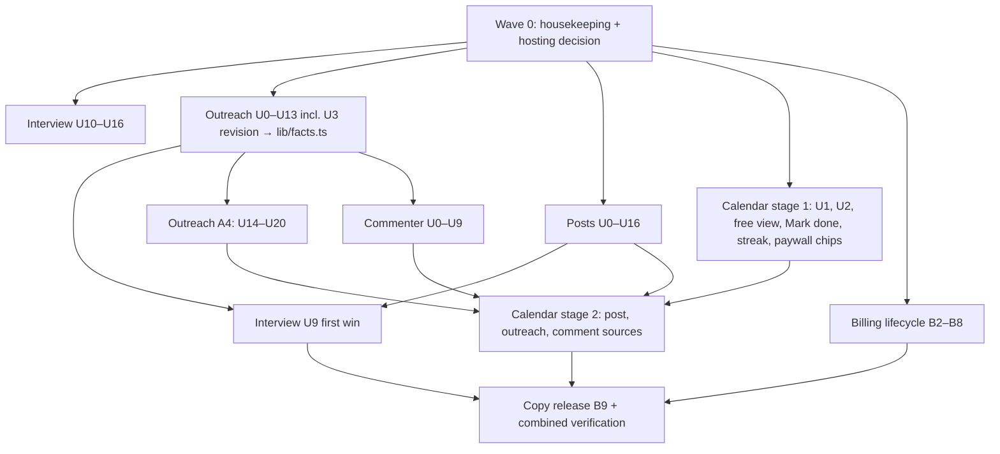

# Lynkr combined build plan

> **Status, 2026-10-30:** every decision in `research/decisions.md` is now decided. The build follows those decisions. Only five actions are Aryan's: Vercel Pro (D-X1), the Dodo message (D-X4), the OpenAI budget (D-X8), a legal check for the Commenter's tracking slice (D-C8), and the production steps B10–B12.

## Goal Capsule
- **Objective:** an Indian fresher (D-X9; experienced job seekers and networkers are supported too) signs up and gets a free first win from the interview. They also see their LinkedIn week on a free calendar. They pay ₹499 a month to fill it:
  - posts that are ready on schedule (and published for them once LinkedIn allows it, Posts KD4)
  - comments written from their own experience
  - outreach whose every step, from invite to meeting to next step, is tracked and scheduled

  The aim is replies from real people (`CONTEXT.md` line 86). Lynkr never sends a message, comment or connection request for them.
- **Means:** the five part plans, joined by:
  - one shared user context (the Story Vault and goals)
  - one extension
  - one Calendar
  - one grounding and AI-tell check
  - one paywall rule

  Each part plan stays the authority for its own build. This plan owns only what crosses parts.
- **Authority, highest first:**
  1. Aryan's decisions (`research/decisions.md`).
  2. Each part plan's Key Decisions and R-IDs.
  3. This plan's cross-part rules (X-IDs).
  4. The unit text.
- **Stop conditions:** each part plan's S1–S8. Across parts:
  - Nothing reaches production, live Dodo, Vercel Production variables or the production database without Aryan's explicit yes (`build-plan-outreach.md` S1).
  - No secrets in code or chat (`build-plan-outreach.md` S7).
  - No deadlines mentioned (`memory.md` 2026-10-16).
  - Raising any spend cap is S2.
- **Who finishes:**
  - **One lead agent** owns git and runs the parts in §4's order. Each part keeps its own branch, progress file and switch.
  - **Aryan** does the steps marked "Aryan" in §5.

---

## 1. One user journey, with the free and paid line

| Step | What the user sees | Free or paid | Owner plan |
|---|---|---|---|
| 1. Visit | The landing page, listing honestly what's free and what's paid | — | X6 copy release |
| 2. Sign up | An account with email or Google. LinkedIn sign-in only after Interview U16 (§5, B10 gate) | Free | Interview |
| 3. Interview | One question per screen, voice or typing, "Later" for anything skipped | **Free** | Interview |
| 4. Story Vault | Facts from the answers, which the user confirms | **Free** | Interview |
| 5. First win | A headline and one complete referral message, with "Got a reply" once sent (D-X6) | **Free** | Interview |
| 6. Calendar | Their goal-based week: post, comment and message slots, plus the first-win message. "Mark posted" and "Mark sent" for work done by hand, progress and the streak (Calendar R18, R25) | **Free** (Calendar KD6) | Calendar |
| 7. The upgrade moment | Opening a post slot, "Pick someone to contact", a comment slot, or plan chat shows the paywall card (§2) | Upgrade | Calendar R25 + each owner |
| 8. Posts | A per-post interview, three versions, the editor and a visual. Then publish or schedule (auto-publish), or copy / open / remind when auto-publish is off | Paid | Posts |
| 9. Outreach | Goals, people with a reason each, complete drafts, and the contact timeline | Paid | Outreach |
| 10. Extension | Pair it, then right-click "Write with Lynkr" and choose Comment or Message. Insert at the cursor; the user presses Post or Send | Paid | Outreach (pairing, messages), Commenter (comments, chooser) |
| 11. Daily use | Opens on Today, which is today's slice of the Calendar. Monday opens with the to-do (for users with contacts), and the week's progress builds the streak | Free view, paid contents | Calendar |

**Navigation:**
- **Landing screen:** a returning user (free or paid) lands on Today.
- **Tabs:** the Calendar is the first tab. The workspaces (Posts, Outreach) open from a Calendar item or their own tab. Leaving a workspace returns to the item the user came from.
- **The interim Outreach Today view** (Outreach U20) is hidden once Calendar U8 ships.

**The free/paid line in one sentence:** the interview, Story Vault, first win and the Calendar itself are free with an account. Everything that writes, publishes or tracks with AI is paid. (`memory.md` 2026-10-30: "Keep today's split"; and "the calendar is a inbuilt feature", which Aryan clarified as "Free for every user".)

---

## 2. The free and paid split

### What's gated

| Area | Free (with an account; license-key-only users get the browser-only versions noted) | Paid (₹499/month, no trial) |
|---|---|---|
| Interview | Everything: `app/api/interview2`, `app/api/first-win` (`requireAccountForFree`), or a valid license key without an account (Interview KD8, D-I9) | — |
| Story Vault | Viewing and confirming facts | Facts used in posts, comments and outreach |
| Calendar | Free for every user (D-K5): viewing it, the goal-based week, moving plan slots, Mark done, reminders, progress and streak. License-key-only users see the browser-only plan (Calendar R22) | Plan chat (`app/api/plan`, which shows the paywall card), plus every item owned by a paid part |
| Posts | — | Every `app/api/posts/*` route (Posts R33) |
| Outreach | — | Every `app/api/outreach/*` write route and draft (Outreach R34). Lapsed users keep reads (Outreach R47) |
| Commenter | — | `app/api/comment` and `app/api/ext/comment*` (Commenter KD6) |
| Extension | — | Pairing needs a paid session; every call re-checks (`lib/outreach/ext-auth.ts` line 47) |

**License keys:**
- A valid key unlocks paid routes without an account (`lib/billing.ts` lines 186–194).
- Features that need an account (publishing, the extension, the Calendar sync, logs) ask key-only payers to create an account and link the key (B6b, D-X7).
- Until they do, they get each plan's browser-only path: Posts R33, Commenter R15, Calendar R22.

### How limits work
**Per-user guards** (Lynkr-side, not Dodo meters), using `takeDaily` and `checkLimits` (`lib/db.ts` line 267, `lib/limit.ts`):
- **Posts:** 30 AI pictures a month, 40 interview turns, 6 "Write new" and 20 refines a day (Posts KTD10).
- **Commenter:** 10 generations and 60 log writes a day (Commenter KTD6).
- **Outreach:** about 15 new people a month, 3 notes (Outreach KD7), and search and AI caps (R32).
- **First win:** 5 a day (Interview U9).

**AI budget** (review: adversarial and scope):
- **One OpenAI account limit** covers every part. It's $10 a month today, set by Aryan.
- **Free routes get their own share.** A Lynkr-side monthly counter caps free model calls (`interview2` and `first-win`) for all users together. When it's spent, free AI pauses with "The free interview is busy; try again tomorrow", and paid routes keep working.
- **Budget exhausted:** when OpenAI returns `insufficient_quota`, every AI route shows "Writing is paused for a short while", not a raw error.
- **Sizing (D-X8):** the OpenAI account limit is (expected paid users × $0.50) + $3 for free use, reviewed monthly. Aryan sets it (S2).

### The upgrade moment
1. **When:** every time a free user opens a paid item from the Calendar, or opens a paid tab. These are feature gates the user chose to open. There are no unprompted upgrade pop-ups during the interview, the Calendar or onboarding (D-X6; `paywalls` skill: "When NOT to show: during onboarding … when they're in a flow").
2. **The card** (`components/Paywall.tsx`):
   - It leads with the line matching what they tapped, then the rest of the paid list:
     - **Posts line:** "Posts that publish on schedule" when `LYNKR_AUTOPUBLISH=on`; "Posts written for you, ready at your time with a reminder" when off.
     - "Comments on any post you're reading"
     - "Track every contact from invite to meeting"
     - "Fill your calendar"
   - **The card's order:**
     1. a headline for the tapped feature ("Write this week's post with Lynkr")
     2. a one-line preview
     3. the reply proof, if any
     4. the paid list
     5. "₹499/month, no trial"
     6. a value-led button ("Start writing")
     7. "Maybe later", which returns to the Calendar
   - No countdowns or guilt copy [VISIBLE].
   - If the first-win message has a recorded reply (D-X6), the card says so.
3. **Lapsed users** see a resubscribe version: "Pick up where you left off", which names their scheduled posts and open contacts.
4. **Checkout:** Dodo checkout for "Lynkr Monthly" (`CONTEXT.md` line 17). The paywall passes the item the user opened. A successful checkout returns to the Calendar with that item open; a cancelled one returns with the item still locked.

### What a user keeps after they stop paying
These are settled together (Commenter D-C7, Outreach R47, Calendar R25):
- **Everything free:** the interview, Story Vault, first win, and the Calendar with plan slots, Mark done, progress and the streak.
- **Read, export and delete** of everything they made.
- **Not kept:** drafting, publishing, recording new outreach steps, and the extension (402).
- **Scheduled posts at lapse:** when the `subscription.on_hold` or `subscription.cancelled` webhook arrives (or when D-I6's access end is reached), the user's pending scheduled posts show "At risk: subscription ended" on the Calendar, with a count notice. If they reach their time unpaid, they become Failed (subscription) (Posts R30), and the Posts failure email goes out (Posts R37, D-P10).

---

## 3. How the parts connect

### X1. One user context
- **Story Vault facts** feed every part.
  - **Where a fact may go is decided by its kind:**
    - outreach-only kinds never go in posts (Posts R12)
    - comments use only facts that are safe in public (Commenter KTD4)
    - private-search facts stay in drafts to that contact
  - **One filter:** `lib/facts.ts` `factsFor("post" | "comment" | "outreach" | "first_win")`. It is a new file, created by the **Outreach U3 revision**, with a test per use. **Amendments:** Posts U4, Commenter U3 and Interview U9 add `lib/facts.ts` to their Files and replace any local filtering. No part plan names this file yet; this paragraph is the amendment (review: feasibility).
- **Goals:**
  - **Where they live:** the brief (`lib/db.ts` `getBrief`) holds the bucket, the interview goals, `weeklyTime`, and the Outreach goals (`app/api/outreach/goals/route.ts`).
  - **One resolver:** `lib/plan.ts` `goalFamily` (Calendar KTD4) feeds both the Commenter's default goal (Commenter R7) and the Calendar's mix (Calendar R10).
  - **Brief saves keep the Outreach goals** (Calendar U1).

### X2. One extension
- **One MV3 extension** (`extension/`), with no linkedin.com host permission and no content script (`extension/manifest.json`).
- **Who owns what:**
  - **Outreach:** pairing, auth, the contact picker, message insert, and the outcome taps (Outreach U9, U10, U19).
  - **Commenter:** the chooser and the Comment view (Commenter U5).
  - **Posts:** inserting post text is deferred (Posts R32).
- **One menu item,** "Write with Lynkr", limited to linkedin.com. It reads only the selection (Commenter R1).
- **One state table for the side panel:** Commenter U5's table (unpaired, unpaid or lapsed, switch off, chooser, refused selection, generating, error, cap). Outreach U10 and U19 use the same unpaired, unpaid and error states. The lapsed state links to resubscribing.
- **Token scope:** extension tokens carry no scope (`ext_tokens`). A paired token reaches every `app/api/ext/*` route, comments included. Scoping is by route, and that is the intended model.

### X3. One Calendar
- **The Calendar shows every source** through one feed (Calendar KTD2).
- **Every move goes through one route** (Calendar KTD5), which checks the subscription and ownership itself.
- **Owners:**
  - Posts: reschedule (`lib/posts/schedule.ts`)
  - Outreach: `recordEvent` (Outreach KTD15)
  - Plan slots: `plan_items` (Calendar KTD3)

### X4. One grounding and AI-tell check
- **`lib/grounding.ts`:**
  - **`groundingProblem(body, sources)`,** extracted from `lib/outreach/draft.ts` `draftProblem` (Posts U4).
  - **An AI-tell check `aiTells(body)`,** built from the banned phrases already used by `lib/checker.ts` and the Commenter's banned openers (Commenter KTD3). It runs on post versions, comments, outreach drafts and the first win (review: product).
  - **`unsupportedSentences`** stays the soft flag users see.
- **Evals:** each part's eval has an injection fixture and an AI-tell fixture (Outreach U12, Commenter U9a, Posts U14, Interview U9).

### X5. Shared tables, routes and components, and who owns each file

| Shared item | Owner (creates it) | Then edited by, in order |
|---|---|---|
| `lib/db.ts` (`TABLES`, `exportAll`, `deleteAll`, `transaction`) | Existing file. Outreach U14 adds `transaction` | Posts U1/U12, Commenter U1, Calendar U2 (each adds its tables), in build order |
| `lib/grounding.ts` | Posts U4 | Interview U9, Commenter U3 |
| `lib/facts.ts` | The Outreach U3 revision | Posts U4, Commenter U3, Interview U9 |
| `lib/plan.ts` | Existing file | Posts U2 (slot counts), then Commenter U7 (`commentsDone`), then Calendar U1 (`goalFamily`, `weekMix`), then Calendar U7 (chat moves) |
| `components/WeekPlan.tsx` | Existing file | Outreach U20 (v2 follow-up gate), then Commenter U7 (comment count), then Calendar U5 (renders feed items), then Calendar U9 (reminders) |
| `components/Today.tsx` | Existing file | Outreach U20 (interim), then Calendar U8 (final) |
| `lib/metrics.ts` `EVENTS` | Existing file | Each part adds its events, in build order |
| `components/Paywall.tsx` paid list | Calendar U10 writes the final list (§2) | Posts U13, Commenter U8 and Outreach U11 send their lines to Calendar U10 |
| `extension/src/sidepanel.ts`, `background.ts` | Outreach U10 | Commenter U5, then Outreach U19 |
| `app/privacy/*`, `research/terms-draft-v4.md`, `components/Landing.tsx`, `app/refunds/page.tsx` | The X6 copy release (B9) | Each part drafts its lines |
| `scripts/migrations/` | Numbered by apply order (§4) | 002 Outreach, 003 Posts, 004 Commenter, 005 Outreach timeline, 006 billing grace |

**X6. One copy owner.** Every [VISIBLE] line from all plans goes into one copy release (B9), written for Indian freshers (D-X9):
- **"Nothing posted for you"** (`components/Landing.tsx` line 263) and **"cannot post, comment or send messages for you"** (`app/privacy/page.tsx` lines 22–23) are rewritten only when auto-publish turns on (Posts D-P1). The comment and message halves stay true (Commenter C3).
- **The paywall's posts line** follows `LYNKR_AUTOPUBLISH` (§2).
- **"Blanks, never guesses"** (Landing lines 263, 361, 482) changes with Interview D-I1.

---

## 4. Build order across all parts

### Wave 0: housekeeping (before anything else)
1. **Commit the V3 Outreach work** on `feat/outreach-v2`. That's:
   - the untracked `app/api/ext/`, `app/api/outreach/`, `components/outreach/`, `extension/`, `lib/outreach/`
   - `scripts/migrations/002_outreach.sql`, `scripts/eval-outreach.mts`, and the untracked `tests/outreach-*` and `tests/ext-*` files and fixtures
   - the V3 changes to tracked files: `lib/db.ts`, `components/Today.tsx`, `components/Paywall.tsx`, `components/Landing.tsx`, `app/privacy/page.tsx`

   **Exclude** `scripts/migrations/003_posts.sql`. Use an explicit file list, not `git add -A` (Outreach CO-3).
2. **Rewrite `research/progress-vertical3.md`** from the committed code.
3. **The stray `003_posts.sql`:**
   1. Run `npm run db:migrate -- --print` against the preview branch, and check `lynkr_migrations` for `003_posts.sql`. The runner skips a filename it has already recorded.
   2. If it's recorded, drop the stray's tables and delete that row on the preview branch, with Aryan's yes.
   3. Then delete the file, with Aryan's yes (D-X2).
4. **Hosting (D-X1, decided):** Aryan moves the project to Vercel Pro before more paying users, because Hobby is "non-commercial, personal use only" (https://vercel.com/docs/plans/hobby). The posts timer stays cron-job.org (Posts KTD1), because a per-minute Vercel cron would keep the database awake. The Posts plan needs no change.

### Then, in parallel
- **Interview U10–U16.** Interview U9, the first win, waits for the Outreach U3 revision (`lib/facts.ts`, the draft engine) and Posts U4 (`lib/grounding.ts`).
- **Outreach U0–U13,** including the U3 revision.
- **Posts U0–U16.** The LinkedIn keys wait for Interview U16 (§5, B10 gate), so Posts U0 and U7 use the stubbed client until then.
- **Calendar stage 1:** U1, U2, the free plan-slot view, Mark done, progress, streak, and the paywall card on locked slots, behind `LYNKR_CALENDAR`. This lets the free Calendar's conversion test (D-K4, free testers) run early, before the costly parts finish (review: product).
- **The billing lifecycle,** B2–B8. It touches only `lib/billing.ts`, `lib/auth.ts`, the webhook and the account screen.

### After that
- **After Outreach U9 and U10:** the Commenter. In parallel, Outreach's A4 units (U14–U20).
- **Calendar stage 2:** the post, outreach and comment sources (Calendar U3 adapters, U4 moves, U7, U8, U9), as Posts U2/U9, Outreach U16 and Commenter U4b land behind their switches (Calendar KTD9).
- **Last:** the copy release (B9) and the combined verification (§7).

**Shared files** in X5 are edited one part at a time, in the order the table gives.

### Migrations in order
- `002_outreach.sql` (Outreach U1, already written)
- `003_posts.sql` (Posts U1)
- `004_comments.sql` (Commenter U1)
- `005_outreach_timeline.sql` (Outreach U14)
- `006_billing_grace.sql` (B3)

The Calendar adds none. Each one is re-runnable, and each runs twice on the preview branch.

---

## 5. Every Dodo and access change, in order

Test Mode comes first. Test and live modes have "separate API keys, products, and webhooks" (https://docs.dodopayments.com/miscellaneous/test-mode-vs-live-mode).

| # | Step | Who | Mode | Source |
|---|---|---|---|---|
| B1 | **Tell Dodo about the free interview and the free Calendar.** Update `research/dodo-message-draft.md`, send it, and record the sent date in `research/progress-combined.md`. **This must happen before `LYNKR_CALENDAR=v2` is set in Production (B10).** Sent status: **sent 2026-10-31** | Aryan | — | Interview A2; `context-brief.md` §6 conflict 3 |
| B2 | **Send a Test Mode webhook event** to `/api/auth/dodopayments/webhooks`. The cache clear reaches only the instance that receives it, because the caches are in-memory (`lib/billing.ts`). So the check that access changed is made **after the 10-minute revalidation** (VALID_TTL), not straight after the webhook | Aryan sends; the builder verifies | Test | Interview A5; https://docs.dodopayments.com/developer-resources/better-auth-adaptor |
| B3 | **Past-due grace (D-I5),** behind its own switch, `LYNKR_PAST_DUE_GRACE`: • Migration `006_billing_grace.sql` stores `past_due_ends_at` per Dodo subscription id, which covers key-only subscribers too. • Grace applies only when a live Dodo lookup returns `past_due` for the Lynkr product **and** now is before the stored deadline. • The deadline is cleared on `subscription.active`, `on_hold`, `cancelled`, `failed` and `expired`. • This reconciles with "access is always re-checked against Dodo" (`lib/auth.ts` lines 96–98) | Builder | Test | https://docs.dodopayments.com/features/subscription ("past_due … customer keeps full access") |
| B4 | **Cancel timing (D-I6):** cancel in Test Mode and record when the status changes. Then make the Refunds page (`app/refunds/page.tsx` line 13) and the code agree | Builder runs it; Aryan approves the copy | Test | Interview Payments item 4 |
| B5 | **A "Manage subscription" button (D-I7)** calls `portal()` (`lib/auth.ts`). In the portal, customers can "view details, change plan, pause, or cancel" (https://docs.dodopayments.com/features/customer-portal) | Builder [VISIBLE] | Test | Interview D-I7 |
| B6 | **License revocation:** enforced by the existing 10-minute revalidation against Dodo. A webhook clear for `entitlement_grant.revoked` is best-effort, and is added only if its payload carries the license key (the cache is keyed by key plus instance, `lib/billing.ts` line 110) | Builder [SAFE] | Test | https://docs.dodopayments.com/features/license-keys |
| B6b | **"Link my license key"** on the account screen: it validates the key through the existing license check and marks the account entitled. A key-only payer can then use features that need an account. Built if D-X7 = yes | Builder | Test | Review: scope; `components/LynkrApp.tsx` line 76 shows the key and account checks are separate today |
| B7 | **The paywall rule in code:** each part's routes follow §2's table. The paid list is assembled once (X5) | Builder | Test | §2 |
| B8 | **Test Mode end-to-end:** • subscribe with a test card; posts, outreach, comments, Calendar • `subscription.on_hold`: after 10 minutes, read-only access and scheduled posts "At risk", then Failed (subscription) • `past_due` then `cancelled` before the deadline: 402 • cancel: access per D-I6 • revoke a key: 402 after 10 minutes • a key-only user links the key (B6b) | Builder | Test | Dodo states table (https://docs.dodopayments.com/features/subscription) |
| B9 | **The copy release:** Terms v4, Privacy, Landing, the store listing, the Refunds page and the paywall list. Every [VISIBLE] line from all plans (X6) | Builder drafts; **Aryan approves and publishes** | — | Each plan's copy unit |
| B0 | **Move the Vercel project to Pro** (D-X1). This comes before the next paying users | **Aryan** | — | https://vercel.com/docs/plans/hobby |
| B10 | **Production variables, set by Aryan in Vercel Production, then redeploy.** Values are pasted by Aryan into Vercel, never in chat: • `LYNKR_INTERVIEW`, `LYNKR_OUTREACH`, `LYNKR_POSTS`, `LYNKR_COMMENTER` • `LYNKR_CALENDAR`, only after B1 • `LYNKR_AUTOPUBLISH`, only after LinkedIn's written answer (Posts KD4) • `LYNKR_PAST_DUE_GRACE` • `EXA_API_KEY`, `CRONJOB_API_KEY`, `POSTS_RUN_SECRET`, `COMMENT_RECEIPT_SECRET`, `LYNKR_EXT_ID` • `LINKEDIN_CLIENT_ID` and `LINKEDIN_CLIENT_SECRET`, **in any environment (Preview too) only after Interview U16 has merged and `linkedin` is removed from `trustedProviders`** (`lib/auth.ts` line 80). Setting them switches on LinkedIn sign-in (`linkedinConfigured`, `lib/auth.ts` line 25), and today a LinkedIn account claiming someone's email could link into their Lynkr account | **Aryan** | Live | Each plan's Verification Contract; review: security |
| B11 | **Production migrations, in order:** 002, 003, 004, 005, then 006 if B3 is built. `npm run db:migrate` applies every pending file in name order | **Aryan** approves and runs them | Live | §4 |
| B12 | **Live Dodo:** no new product. The same "Lynkr Monthly" product, checkout and license keys (`CONTEXT.md` line 17). Confirm the live webhook endpoint and secret in the dashboard. **The Commenter's comment-log release** (its Slice 2) waits for D-C8's legal check. Slice 1 (writing comments) isn't blocked | **Aryan** | Live | https://docs.dodopayments.com/miscellaneous/test-mode-vs-live-mode |

**Existing paying users:**
- They keep the same product and subscription, with no migration and no price change.
- They see each part as its switch turns on.
- Key-only payers keep key access. When they open a feature that needs an account, they're offered "Create an account and link your key" (B6b). Browser data they had (the browser-only plan, kept comments) moves into the account on first sign-in (Calendar KTD3).

---

## 6. Switches and rollback

| Switch | Values | Turns on | Rollback |
|---|---|---|---|
| `LYNKR_PAYWALL` | 1 / 0 / unset (on in production builds, off in local dev; `lib/billing.ts` lines 37–41) | Paid gates | `0` turns gating off everywhere (emergency only). Unset keeps it on in production |
| `LYNKR_PAST_DUE_GRACE` | on / off | B3 grace | off goes back to cutting off at the first failed renewal |
| `LYNKR_INTERVIEW` | v1 / v2 | Interview v2 (live today) | v1, until Interview U17 deletes it |
| `LYNKR_OUTREACH` | v1 / v2 | The Outreach workspace, extension routes and timeline | v1 restores today's Outreach and Connect tabs. Data stays |
| `LYNKR_OUTREACH_NOTES_IN_DRAFTS` | on / off | Meeting notes as draft evidence (D-O3) | off |
| `LYNKR_POSTS` | v1 / v2 | The Posts workspace | v1 restores today's posts tab. Scheduled posts are left for the sweep to mark |
| `LYNKR_AUTOPUBLISH` | on / off | Scheduled publishing, and the paywall's posts line | off turns every post into copy / open / remind (Posts R32). Pending cron-job.org jobs are refused at run |
| `LYNKR_COMMENTER` | on / off | The extension's Comment view and the log | off: the web helper only |
| `LYNKR_CALENDAR` | v1 / v2 | The Calendar | v1 restores the "This week" plan |

**Rollback rule:** every switch flips back without rolling back a migration. Migrations add tables and columns, with one exception: 005 swaps the Outreach `status` check to add `meeting`. Outreach U14's tests must show that v1 code still writes only statuses the new check allows before 005 ships. Every migration is re-runnable.

---

## 7. Verification for the whole product, and done

### Verification Contract
- **Each part:** its own Verification Contract is green on the preview, with its switch on.
- **Static checks:** `npx tsc --noEmit` is clean and `npm run lint` has 0 errors, with every switch at v2 or on.
- **Unit tests:** `npm test` passes across all parts.
- **Regression:** `npm run test:e2e` (the v1 suites) passes with every switch at v1 or off.
- **The cross-part e2e** (`tests/e2e-journey.mjs`, owned here), in demo mode at 1280 and 375 px, with accessibility checks:
  1. Sign up and do the interview to the first win.
  2. Open the Calendar (free). See the goal-based week, then "Mark sent" a slot, and progress goes up.
  3. Open a post slot and see the paywall, with the line matching the slot and "₹499/month, no trial".
  4. Subscribe (Dodo test mode stubbed) and land back on that post slot.
  5. With `LYNKR_AUTOPUBLISH=on`, schedule a post, and it shows "publishes itself". With it off, the paywall's posts line and the item show the reminder wording.
  6. Add a contact and record a meeting. The next step appears on the Calendar.
  7. Paste a post in the comment helper, copy an option, and mark it posted. Progress goes up.
  8. Lapse the subscription. Paid items are read-only with the resubscribe card, scheduled posts show "At risk", and the Calendar and Mark done still work.
- **Extension:** `npm run test:ext`, against fixture pages only.
- **The Dodo Test Mode run (B8),** recorded in `research/progress-combined.md`.
- **Evals:** each part's eval meets its targets, including the shared AI-tell fixture (X4).
- **The tester round adds:**
  - **The reply bar (D-X5):** at least 20% of Lynkr-drafted first messages (the first win plus Outreach) are marked "replied" within 14 days, with counts, and warm outreach beats cold (Commenter D-C6). Below 10 messages sent, the result is reported as inconclusive.
  - **Testers:** 3 paid and 2 free (D-K4).
  - **A truth check on self-reported taps:** for a sample of 10 items marked done, testers share the link to the comment or message, and the match rate is recorded beside the Calendar targets (Calendar D-K6).

### Definition of Done
- All five part plans' Definitions of Done hold.
- Every row of §2's table is proven by a route test.
- **Nothing outbound:** no code path sends a message, comment or connection request, or reads LinkedIn pages beyond the selection. Posts publish only through Posts' gated path.
- **Ordering held:**
  - B1 was sent before `LYNKR_CALENDAR=v2` reached Production.
  - The LinkedIn keys were set only after Interview U16.
- **The copy release (B9):** every [VISIBLE] line in `research/decisions.md` is either approved and published, or still held.
- **Production is unchanged** until Aryan's B10–B12.

---

## 8. Every decision and visible change in one list
See **`research/decisions.md`**.

### Conflicts this plan settles or carries
- **Free/paid:** `CONTEXT.md` line 17's "no free tier or trial" is stale (`context-brief.md` §6 conflict 1). The live rule is §2.
- **C2 (Commenter):** goes to D-I5 and B3.
- **C3 (Commenter):** goes to X6.
- **CO-2 (Outreach):** goes to Outreach U20, then the Calendar.
- **CL-1 (Calendar):** settled by Calendar KD6.
- **Hosting (`CONTEXT.md` line 19):** Vercel's Hobby plan restricts commercial use, and Lynkr charges on it. Plan status: **not found**. This is D-X1, and it's in Wave 0 because it can change the Posts timer.
- **The key-only payer gap:** no account-to-key link exists today. This is D-X7 and B6b.

---

## Review log
`ce-doc-review`, non-interactive, 2026-10-30, with 7 personas. The cross-model pass was skipped, because sending the plan to an outside model wasn't approved.

**Applied:**
- **feasibility:**
  - the `LYNKR_PAYWALL` values and rollback
  - B3's own switch and migration 006
  - the stray 003 database check
  - 002 added to the migrations
  - the full Wave 0 commit list
  - the X5 rows for `lib/plan.ts` and `WeekPlan.tsx` (including Commenter U7 and Calendar U9)
  - a home for `lib/facts.ts`
- **security:**
  - the LinkedIn keys wait for Interview U16
  - cache clears are per instance, so checks wait 10 minutes
  - B3 grace follows Dodo's live status
  - extension token scope noted
- **scope:**
  - key-only linking (B6b, D-X7)
  - the Interview U9 dependency
  - scheduled posts at lapse
  - the free AI budget
- **product:**
  - the paywall's posts line follows `LYNKR_AUTOPUBLISH`
  - the reply bar (D-X5)
  - "Got a reply" on the first win (D-X6)
  - the free Calendar built early (stage 1)
  - the shared AI-tell check
  - the primary user (D-X9)
- **adversarial:**
  - the AI budget (D-X8)
  - the paywall line
  - hosting in Wave 0
  - B1 before the free Calendar
  - the self-report truth check
- **design:**
  - return to the item after checkout
  - the paywall on every tap, with the price
  - the lapsed resubscribe card
  - navigation and default landing
  - the extension state table

- **coherence:**
  - license-key users in the Calendar and Interview rows
  - the lapsed rule matches Calendar R25
  - one paid list (Calendar U10 aligned)
  - `lib/facts.ts` added to the part plans as dated amendments
  - the exception for 005 in the rollback rule
  - the boundary labels
  - plan chat shows the paywall card

**Not applied:**
- "Drop the interim Outreach Today view" (scope, confidence 50). Kept: it's the only way paid users see next steps before Calendar stage 2. It's hidden once Calendar U8 ships.
