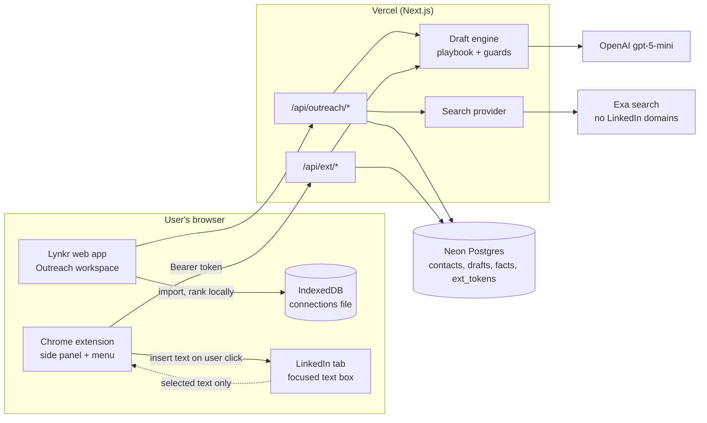
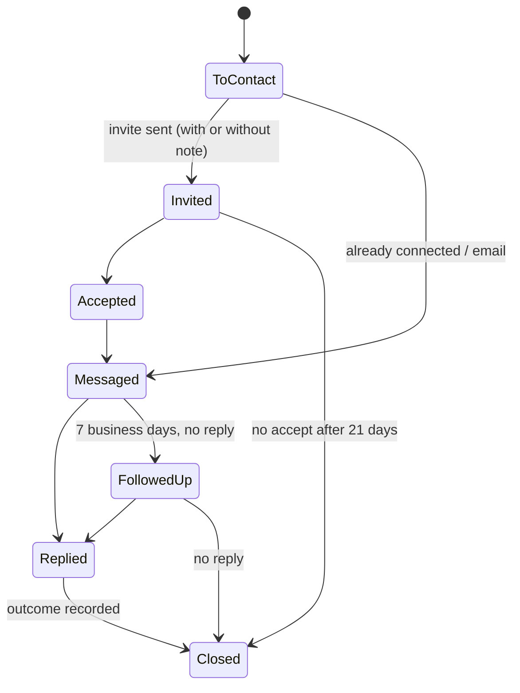
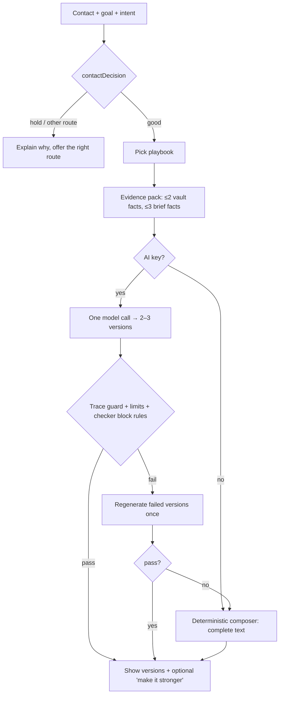
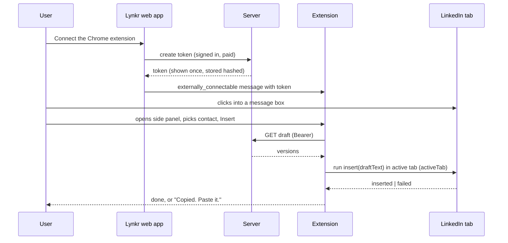

# Outreach (Vertical 3) - Plan

## Goal Capsule

- **Objective:** A Lynkr user says what they want from LinkedIn (a job, clients, a deal, a business to buy, a mentor), gets a short list of the right people with a reason for each, opens any of them in one click, and sends a complete, truthful message written for that goal, from Lynkr or straight into LinkedIn's own message box. They then see which messages got replies.
- **Means:** one Outreach workspace saved to the account (KTD1), goals and playbooks as typed data (KTD3), a Chrome extension that reads only selected text (KD1, KTD8), and recipient briefs from public pages outside LinkedIn (KD6, KTD6).
- **Authority, highest first:**
  1. Aryan's decisions: the Key Decisions in this file, plus anything he says later.
  2. The R-IDs.
  3. The KTDs.
  4. The unit text.
- **Background only:** `research/outreach-draft-v0.md`. Where this plan disagrees with `prod/lynkr-outreach-intelligence-plan.md` or `prod/lynkr-message-checker-outreach-build-plan.md`, this plan wins; each override is named in Key Decisions.
- **Execution profile:**
  - One lead agent owns git and every commit.
  - Parallel agents each own one unit, with one owner per file.
  - Work happens on branch `feat/outreach-v2`, cut from `origin/master`.
  - Progress goes in `research/progress-vertical3.md`, three lines per unit: done, evidence, next. Any new session reads that file first and can take over.
- **Stop conditions:** only the list in Working Agreement (S1–S8). Every other choice is the lead's: decide it, log it under "Decided by the lead (reversible)" in the progress file, and keep going.
- **Who finishes:**
  - The lead builds U0–U13 and ships them to a Vercel preview, plus an extension package ready to upload.
  - Aryan does the short list in "Aryan's part" (A1–A7). That includes production and the Chrome Web Store.

---

## Working Agreement

This section exists because vertical 1 needed many rounds of back-and-forth. Each rule below removes one cause of that.

### When to stop and ask Aryan (S1–S8)
- S1. **Anything outward-facing or hard to undo:**
  - merging to `master` (which deploys production)
  - changing Production environment variables
  - running a migration on the production database
  - publishing the extension or the legal pages
  - sending any message or email to a real person
- S2. **Spending money, or raising a spend cap** above the ones in KTD6 and KTD13.
- S3. **Changing a Key Decision (KD1–KD9),** or adding anything that reads LinkedIn pages or automates a LinkedIn action.
- S4. **Third-party terms and accounts:** accepting any terms of service, or creating any account.
- S5. **A settled decision can't work.** Stop with two or three options and a recommendation. Example: insertion is impossible without reading the page.
- S6. **Aryan says "stop".** Halt at once. Leave uncommitted work as it is and write the state into the progress file.
- S7. **A secret is needed.** Never ask for its value in chat. Give Aryan the exact place to paste it, such as a Vercel variable or a terminal prompt.
- S8. **An existing test breaks** and can't be fixed inside the unit that broke it.

Everything else is decided by the lead: names, layout, copy within the rules, MIT or Apache-licensed libraries, order of work, test design.

### How to ask
- **Batch questions.** Questions are collected in the progress file and sent at most twice: once at the start (the A-list) and once at release. Each question has a recommended answer, and the build never waits for a reply. Until an answer arrives, the feature runs on its fallback (demo mode, fixtures or templates).
- **Commands for Aryan** are given as single PowerShell lines. No `&&`, no `cd /d`, no secret values in the command.
- **After any environment-variable change, redeploy.** Variables only reach new builds. In vertical 1, production ran without its keys until a redeploy.
- **Variable names are fixed** by the table in Verification Contract. Code reads only those names, and `/api/status` reports which ones are present (names only, never values), so a misnamed key is caught at once. Vertical 1 lost time to `APIFY_KEY` vs `APIFY_API_KEY`.
- **The preview uses its own database** through `LYNKR_DATABASE_URL` (`lib/dbUrl.ts`). Migrations run on the preview branch first. Production migrations are S1.
- **Never mention a deadline.** That is Aryan's standing rule (`memory.md`, 2026-10-16).

---

## Aryan's part

The lead sends A1–A4 in one message on day one. Nothing in the build waits on them.

| ID | What | When | Time | Until it's done |
|---|---|---|---|---|
| A1 | Create a free Exa account and paste its API key into Vercel as `EXA_API_KEY`, for Preview only | Start | 5 min | Recipient briefs use fixtures; the "Find public work" button says it isn't connected yet |
| A2 | Add `OPENAI_API_KEY` to Vercel **Preview**, and set a monthly spend limit in the OpenAI project (recommended $10) | Start | 5 min | Preview drafts are templates, so testers can't judge quality |
| A3 | Name 5 testers on Chrome desktop. The vertical 1 testers are fine | Start | — | Release waits at U13 |
| A4 | Create a Chrome Web Store developer account ($5 one-time, your Google account). Accepting its agreement is yours | Before U13 | 15 min | Testers install the extension unpacked from a zip |
| A5 | Approve the Privacy, Terms and store-listing drafts from U11 | Release | 15 min | Nothing is published |
| A6 | Run the 6-step check on real LinkedIn with the extension (checklist in U13) | Release | 5 min | Extension stays in tester mode |
| A7 | Production steps: merge the PR, approve migration 002 on production, set `LYNKR_OUTREACH=v2` in Production, add `EXA_API_KEY` to Production, submit the store listing as Unlisted | Release | 20 min | Production keeps today's Outreach and Connect tabs |

---

## Product Contract

### Summary
Outreach becomes one workspace that runs in this order:
1. The user picks their goals.
2. Lynkr suggests a few people worth contacting, each with a reason.
3. The user opens any of them in one click.
4. Lynkr writes complete messages built on facts from both sides.
5. The user sends the message from LinkedIn, either by pasting it or through the Chrome extension that inserts it into the box they clicked.
6. Lynkr tracks replies and suggests the next step.

This replaces today's separate Outreach and Connect tabs, behind a switch. The "Check a message" tab stays.

### Problem Frame
Today Lynkr has the pieces but not the flow:
- the ask ladder (`components/Results.tsx` Outreach tab)
- Connect Coach (`components/ConnectCoach.tsx`), with search cards, a note writer, a note budget and a browser-only tracker
- the checker (`lib/checker.ts`)

These pieces fall short in five ways:
- **No goal.** Nothing asks what the user is trying to achieve, so the same message shape is used for a job hunt and a sales deal.
- **Too much typing.** The person's details must be typed in or pasted for every contact.
- **Blanks.** A missing fact turns into a blank or a "needs context" stop.
- **No profile links.** There is no way to get back to a person's profile.
- **Nothing reaches LinkedIn.** No draft gets into LinkedIn without copy and paste.

Users drop off where friction is highest. Messages that are generic or unanchored don't get replies.

### Key Decisions
- KD1. **The extension reads only text the user selects, and the current tab's address when the user asks to save it. It never reads the page and never sends.** (session-settled: user-directed — chosen over a one-click read of the profile on screen, because LinkedIn shut down Kleo's extension in June 2025.) Governs R20, R21, R22, R29.
- KD2. **Outreach drafts are complete messages, never fill-in-the-blanks, and they never invent a fact.** (session-settled: user-directed — chosen over `[[blank]]` slots: "No fill-in-the-blank stuff. This is not a game.") This overrides the "needs_context" stop in `prod/lynkr-outreach-intelligence-plan.md` §6 and the "missing facts become blanks" rule in `CONTEXT.md`, for outreach only. Posts keep their blanks. Governs R15, R16, R19.
- KD3. **Outreach starts from the user's goals,** including networking, jobs, closing a deal and buying a business, not only job seeking. (Aryan, 2026-10-27.) Governs R1–R4, R14.
- KD4. **Low friction comes first.** No question screens; a question is asked only at the moment it improves a draft. (session-settled: user-directed — "having very little friction there is important".) Governs R3, R19, R35, R36.
- KD5. **The user's LinkedIn connections file can be imported as an opt-in, kept in the browser only.** (session-settled: user-approved — proposed in the outreach draft with its trade-off; Aryan approved the draft.) This overrides `prod/lynkr-outreach-intelligence-plan.md` §5 "do not import a user's LinkedIn connections CSV". That plan's concern, building a third-party database, is met because the file never leaves the device and only people the user adds are saved. Governs R6.
- KD6. **Lynkr may search public pages outside LinkedIn for a named contact, and the user confirms which results are really that person.** (session-settled: user-approved — proposed in the outreach draft.) This overrides the 2026-10-16 rule "the app does not search the web for named individuals" (`CONTEXT.md`). The risks behind that rule, wrong person and third-party privacy, are handled by R11, R13 and R31. Governs R10–R13.
- KD7. **Caps:** about 15 new people a month by default. Tier 1 is limited to the user's monthly note allowance, which defaults to 3. (session-settled: user-approved.) Governs R9, R18.
- KD8. **No bulk scraping, no automation of any LinkedIn action, no auto-send.** Carried from every earlier plan. Governs R29, R31.
- KD9. **Profile links live in Lynkr.** Each contact gets an "Open profile" link from the connections file, a paste, or the extension's "Save this profile link". (Aryan, 2026-10-27: "adding the LinkedIn profile link in the app is equally important.") Governs R8.

### Requirements

**Goals: what the user wants**
- R1. The first Outreach visit shows one screen of goal chips, pre-selected from the interview's "what do you want" answer (`ProfileInput.goals`), and the user confirms with one tap. Goals can be changed at any time from the workspace header.
- R2. The goal catalog at launch has ten goals:
  - find a job
  - get a referral
  - learn and network
  - find a mentor
  - win clients or close a deal
  - hire someone
  - raise funding
  - buy a business
  - find a partner
  - reconnect with people I know
- R3. Each goal declares at most three goal details that its drafts need. For "buy a business", these are the kind of business, the size range and why. Details already in the Story Vault are reused. A missing detail is asked only when a draft needs it, saved to the Vault, and never asked again.
- R4. Every contact carries one goal and one intent (what this message asks for). Both are pre-set from the goal and the relationship and can be changed with one tap.

**Finding people**
- R5. **Target map.** It is built from the brief: field, then sub-niche, then target companies, then teams, then people one or two levels up.
  - Companies are ranked by LAMP: Alumni, Motivation, Posting.
  - Lynkr fills in Alumni and Posting; the user only sets Motivation.
- R6. **Connections file (opt-in).** The user can import the Connections file from their own LinkedIn data archive.
  - It is read in the browser.
  - Only name, company, position, profile URL and connected date are kept; the email column is dropped on read.
  - Nothing leaves the device until the user adds a person.
- R7. **Where suggestions come from.** Only sources the user runs or opts into:
  - LinkedIn search links built by Lynkr: second-degree, alumni, company and role
  - the user's connections file
  - public directories the user opts into: ADPList, Topmate, Hacker News "Who is hiring", YC Work at a Startup, Hasgeek and Sessionize
  - company signals: open roles and funding news

  Lynkr never lists people it found by crawling LinkedIn.
- R8. Every contact has an "Open profile" link once a profile URL is known. Only `https://www.linkedin.com/in/<slug>` URLs are accepted. Until then, "Find on LinkedIn" opens a LinkedIn people search for the person's name and company.
- R9. **Why this person.** Each suggested person shows:
  - fit
  - the bridge with the user
  - a signal, with its date
  - whether they're reachable
  - what the user can give

  Each person also gets a tier. Tier 1 holds at most the monthly note allowance. New contacts are capped per month: 15 by default, adjustable from 5 to 30.

**Knowing the recipient**
- R10. **The brief.** For any contact, Lynkr can build a one-screen brief:
  - up to three facts, each with its source link and date
  - the bridge with the user
  - their likely priority right now
  - what the user can give them
  - the best angle
- R11. **Where brief facts come from.** Only three places, and each fact shows its source:
  - public pages outside LinkedIn that the user confirmed are this person
  - text the user selected on LinkedIn
  - what the user typed
- R12. "No hook found" is a valid brief. Drafts then use the person's role and company only.
- R13. Briefs never hold personal-life or sensitive details (health, religion, caste, politics, family, finances, sexuality), even when a page contains them.

**Drafting**
- R14. **Playbooks.** Each goal and relationship pair has a playbook. It sets:
  - the opening angle
  - the ask
  - the proof needed from the user
  - the length for each channel
  - the follow-up
  - what counts as success
- R15. **Complete drafts.** Every draft is a complete message ready to send. There are two or three versions with different angles, and no blanks, brackets or placeholders.
- R16. **Traceable claims.** Every claim about the user traces to a confirmed Story Vault fact. Every claim about the recipient traces to a confirmed brief fact or the user's own words. Nothing else is stated as fact.
- R17. **Checked first.** Each draft passes the message checker (`lib/checker.ts`) before it is shown. A draft that fails a blocking rule is never shown as ready.
- R18. **Channels and note budget.**
  - Lynkr writes for five channels: the connection note, the first message after they accept, DM, InMail and email.
  - Connection-note length follows the user's setting: 200 characters on a free account, 300 on Premium.
  - From the tier and the notes left, Lynkr recommends either a note or a blank invite followed by a message after acceptance.
- R19. **"Make it stronger."** When one more fact would clearly help, an optional question appears beside the finished draft. Answering it rewrites the draft and saves the fact.

**Inside LinkedIn: the extension**
- R20. **What the extension does.** It shows the user's contacts and their ready drafts in a side panel. When the user clicks or uses a shortcut, it puts the chosen draft into the LinkedIn box they clicked.
- R21. **What it can read.** Only two things:
  - text the user selects, through the "Write with Lynkr" right-click menu
  - the current tab's address, when the user presses "Save this profile link"

  It never reads page content, never clicks anything on the page and never sends.
- R22. Selected text can become the source for a reply, a comment or a brief fact after the user confirms it. The raw selection is never saved.
- R23. If inserting the draft fails, the draft is copied to the clipboard and the user is told to paste it.
- R24. Everything the extension does can also be done in the web app, by copying the draft and opening the profile.

**Follow-up and learning**
- R25. **Stages and the 3B7 rule.** Each contact moves through these stages, each with a date:
  1. To contact
  2. Invited
  3. Accepted
  4. Messaged
  5. Replied
  6. Outcome

  Lynkr sets the next-action date by the 3B7 rule:
  - no reply after 3 business days: suggest a second person at the same company
  - after 7 business days: suggest one follow-up
  - then stop
- R26. Next actions and follow-ups appear in Today and in This week.
- R27. The user records outcomes with one tap. Once a week Lynkr asks about contacts that are still open. Lynkr never reads LinkedIn messages.
- R28. **Learning what works.**
  - Reply rates are shown by goal, intent and angle, always with the counts behind them.
  - People who replied are marked Boosters and suggested first for later asks.
  - Anonymous count-only metrics are kept for learning across users later.

**Privacy and platform safety**
- R29. No scraping or automation of LinkedIn. The extension asks for no permission on linkedin.com beyond `activeTab`, which Chrome grants only when the user acts.
- R30. Contacts and briefs are saved to the user's account and scoped to that user. They are included in Download my data and Delete my data, and covered by the 12-month inactivity cleanup.
- R31. Searches exclude linkedin.com and social networks. Text fetched from pages is treated as data, never as instructions.
- R32. Search and AI spend is capped per user per day, and overall per month.
- R33. The Privacy page, the Terms and the extension's store listing describe exactly what is read, stored and sent.
- R34. Outreach stays paid. The free part is still only the interview and the first win (vertical 1, decision 1).

**Low friction**
- R35. A contact from the connections file reaches a ready draft in three clicks or fewer, with no typing.
- R36. Setting up a goal asks at most three questions, most of them pre-filled.
- R37. Every feature works in demo mode with no keys, using templates and fixtures, for tests and for testers without AI.

### Acceptance Examples
- AE1. Covers R3, R19. A fresher picks "Buy a business" and opens a contact. The Vault has no detail on the kind of business. Lynkr still shows a complete draft that leaves the business type out, plus one "Make it stronger" question (tap answers and a short box). After an answer, the draft is rewritten and the next contact doesn't ask again.
- AE2. Covers R12, R15. A brief search finds nothing about the contact. The brief says "No hook found". The drafts still read as complete messages built on the person's role and company, and the checker passes them.
- AE3. Covers R18, KD7. The user has used all 3 notes this month and opens a Tier 2 contact. Lynkr recommends a blank invite and drafts the after-accept message. "Write a note anyway" is available and shows the budget is spent.
- AE4. Covers R21, R23. On a LinkedIn message box, the user clicks "Insert" in the side panel and the box receives the text. On a page where insertion fails, the text is on the clipboard and the panel says "Copied. Click in the box and paste."
- AE5. Covers R11, R13. A search result is about a different person with the same name. The user marks it "Not this person", and no fact from it appears. A confirmed page mentions the contact's religion; the extracted facts leave it out.
- AE6. Covers R25. A contact is messaged on a Monday and doesn't reply. On Thursday, Today suggests a second person at the same company. The Wednesday of the following week, Today suggests one follow-up. After that, no more follow-ups for this contact.

### Success Criteria
- **Evaluation** (U12) runs 10 goals × 7 personas × the 3 relationships, in demo mode and with a key when one is set. The targets:
  - 0 claims that can't be traced to a fact
  - 0 placeholders
  - 100% of drafts within channel limits
  - 0 sensitive details in briefs
- **Testers** (U13) are 5 people over their first week. The targets:
  - at least 4 send three or more Lynkr drafts
  - average draft rating of 4 or higher out of 5
  - at least 4 rate "sounds like me" 4 or higher
- **Speed:** median 60 seconds or less from opening a contact to a ready draft, measured with count-only timing.
- **Honest reporting:** reply rates always show their counts and observation window. Lynkr never claims a message "converts".

### Scope Boundaries

**Considered and not built**
- **Reading LinkedIn profiles in the extension.** Ruled out by KD1. Would change only with LinkedIn's written permission.
- **Automated sending, sequences or auto-connect.** Ruled out by KD8. They break LinkedIn's terms.
- **Reading the user's LinkedIn inbox to detect replies.** Same terms issue; the user marks outcomes instead (R27).
- **Email finding** (Hunter, Apollo and similar). LinkedIn is the channel; email drafts are copy-only.
- **LinkedIn APIs for member search.** Not available to Lynkr (`prod/lynkr-outreach-intelligence-plan.md` §9).
- **Firefox and Safari extensions.** Chrome desktop first. Edge can load Chrome extensions but isn't tested.
- **Training on users' message text.** Only counts are kept (R28).

**Deferred to follow-up work**
- Cross-user angle recommendations ("people in your field got more replies with X"). Needs a consent step and enough volume.
- More funding-news sources beyond the starter allowlist.
- Hindi or Hinglish drafts.
- Making "Check a message" part of the extension's panel. It only runs the checker in this release.

---

## Planning Contract

### Key Technical Decisions
- KTD1. **Contacts live in the account database (migration 002), not browser storage.** The extension and a second device both need them. The old browser tracker moves across with the existing move-to-account pattern (`components/MoveToAccount.tsx`). License-key users without an account keep the v1 browser tracker. Governs R30.
- KTD2. **Switch `LYNKR_OUTREACH=v1|v2`,** copying `lib/interview/flags.ts`: preview builds get v2, production and local runs get v1 until Aryan sets it. In v2, one Outreach tab replaces the Outreach and Connect tabs; "Check a message" stays.
- KTD3. **Goals, goal details and playbooks are typed data** (`lib/outreach/goals.ts`, `lib/outreach/playbooks.ts`), following `lib/interview/bank.ts`. The model only writes wording; the data decides angle, ask, length and success.
- KTD4. **Draft pipeline, deterministic first:**
  1. The contact decision runs (`lib/packet.ts` `contactDecision`).
  2. The playbook is picked.
  3. An evidence pack is built: at most 2 Vault facts and at most 3 confirmed brief facts.
  4. One model call returns 2–3 versions as structured output (`callStructured`, zod).
  5. Server guards check the versions (KTD5).
  6. Failed versions are regenerated once.
  7. Anything still failing is replaced by the deterministic composer, which writes complete template text and is the only path in demo mode.
- KTD5. **Trace guard.** Every number, proper noun, organisation name, date and quoted phrase in a draft must appear in the evidence pack, the user's profile or the recipient's name, company or role. Otherwise the version is rejected. This extends the overlap checks in `lib/clean.ts` and `lib/grounding.ts`. Governs R16.
- KTD6. **Recipient search goes through a provider interface** (`lib/outreach/search.ts`): Exa when `EXA_API_KEY` is set, otherwise fixtures.
  - **Exclusions:** linkedin.com, facebook.com, instagram.com, x.com, twitter.com, threads.net, reddit.com.
  - **Caps:** 20 searches per user per day; `LYNKR_SEARCH_MONTHLY_CAP`, default 2000, across all users. That stays within Exa's free monthly credit.
  - **Caching:** results are cached on the contact, so reopening it costs nothing.
  - **Page text is fetched only for results the user confirms.** It then goes through the same cleaner as `lib/externalContext.ts`: injection patterns, emails, phone numbers and handles are stripped.
  - **Only facts are stored:** at most 3 extracted facts with their URL and date, never the page text.
- KTD7. **Brief facts are extracted by a structured model call.** Each fact must quote a span that exists in the confirmed text, the same grounding pattern as Story Vault facts. A deterministic sensitive-topic filter runs before and after the call (R13).
- KTD8. **The extension is MV3, in `extension/` in this repo.**
  - **Build:** TypeScript built with esbuild (dev dependency, MIT) into `extension/dist`.
  - **Permissions:** `sidePanel`, `contextMenus`, `activeTab`, `scripting`, `storage`. No `host_permissions` for linkedin.com. The only host permission is the Lynkr API origin; dev builds add the preview and localhost origins.
  - **Inserting:** on a user action (a side-panel button, the context menu or the shortcut), the extension runs a function in the active tab that types the draft into the focused text box with the browser's insert-text command. That function receives the draft and returns only "inserted" or "failed". It reads nothing from the page.
  - **Unknown:** whether a side-panel click grants `activeTab` is checked in U0. The fallback is the keyboard shortcut (the commands API grants `activeTab`) plus copy.
- KTD9. **Extension sign-in by pairing.**
  1. On the signed-in web app, "Connect the Chrome extension" creates a random token. The token is stored hashed in `ext_tokens`, scoped to outreach reads and writes, revocable, and expires after 90 days.
  2. The token goes to the extension through `externally_connectable` messaging, limited to Lynkr's own origins.
  3. The extension keeps it in `chrome.storage.local` and sends it as a Bearer token to `app/api/ext/*`.
  4. CORS on those routes allows only the extension's origin, which is pinned by a manifest key and set in `LYNKR_EXT_ID`.
  5. The token can be revoked from My data.
- KTD10. **Business days follow IST** (`lib/ist.ts`) for the 3B7 rule, with Saturday and Sunday off. Indian public holidays are ignored in this release.
- KTD11. **Metrics are counts only,** through the existing `bumpMetric`. The events are `outreach_goal_set`, `outreach_draft`, `outreach_insert` (ok or fail), `outreach_sent` and `outreach_outcome`. They are labelled only with goal, intent, angle and outcome. No text, names or URLs.
- KTD12. **Paywall.** Every route under `app/api/outreach/*` calls `requireLicense`, as `app/api/connect/route.ts` does. Extension routes check the token owner's subscription with `subscriptionActive`. Unpaid users see an upgrade card in the panel. Governs R34.
- KTD13. **Data model** (migration `scripts/migrations/002_outreach.sql`, safe to re-run, every query scoped to the user):
  - `contacts`: id, user_id, name, company, role, profile_url, relationship, bridge, goal, intent, tier, source (connections, manual, finder, extension), status, stage dates, next_action_at, outcome, note_used, angle_used, brief (jsonb), created_at, updated_at.
  - `ext_tokens`: id, user_id, token_hash, created_at, expires_at, revoked_at, last_used_at.
  - **Drafts** reuse the existing `drafts` table with key `contact:<id>:<n>`.
  - **Goals** go into `context_brief.data.outreach`, which is already versioned.
  - **Goal details** become a new fact kind, `goal_detail`, added to `OUTREACH_ONLY_KINDS`.
  - **AI spend:** `takeDaily` caps outreach model calls at 60 per user per day.

### High-Level Technical Design

Components and data flow:


Contact stages (R25):


Draft pipeline (KTD4, KTD5):


Extension pairing and insertion (KTD8, KTD9):


Switch combinations (KTD2):

| `LYNKR_OUTREACH` | `LYNKR_INTERVIEW` | Tabs shown | Notes |
|---|---|---|---|
| v1 (prod default) | any | Outreach, Connect, Check | Today's behaviour, browser tracker |
| v2 (preview default) | v2 | Outreach (new), Check | Goals pre-filled from the interview |
| v2 | v1 | Outreach (new), Check | Goals screen starts from `ProfileInput.goal` only |

### Output Structure
```text
lib/outreach/
  goals.ts            goal catalog, goal details, defaults from the interview
  playbooks.ts        goal × relationship playbooks (angle, ask, proof, length, follow-up, success)
  draft.ts            evidence pack, composer, trace guard, note-vs-blank advice
  brief.ts            brief assembly, bridge detection, sensitive filter, no-hook
  search.ts           provider interface: Exa + fixtures, exclusions, caps
  finder.ts           target map, LAMP, search-link builders, directories, signals
  connections.ts      browser-side Connections.csv parse + ranking (no network)
  followup.ts         stages, 3B7 dates, boosters, rates with denominators
  contacts-db.ts      user-scoped queries for contacts and ext_tokens
app/api/outreach/
  contacts/route.ts   list, add, update, delete
  draft/route.ts      versions for one contact
  brief/route.ts      search, confirm, extract
  goals/route.ts      read and save goals and goal details
  signals/route.ts    company signals for target companies
app/api/ext/
  pair/route.ts  revoke/route.ts  contacts/route.ts  draft/route.ts  outcome/route.ts
components/outreach/
  OutreachWorkspace.tsx  GoalSetup.tsx  PeopleBoard.tsx  PersonCard.tsx
  BriefPanel.tsx  DraftVersions.tsx  ConnectionsImport.tsx  Finder.tsx  ExtensionConnect.tsx
extension/
  manifest.json  src/background.ts  src/sidepanel.ts  src/sidepanel.html  src/insert.ts
  src/api.ts  build.mjs  README.md
scripts/migrations/002_outreach.sql
tests/outreach-*.test.mts  tests/e2e-outreach.mjs  tests/e2e-outreach-a11y.mjs  tests/ext.e2e.mjs
tests/fixtures/linkedin-like.html  tests/fixtures/connections.csv  tests/fixtures/search/*.json
```

### Assumptions
- Exa's search and contents endpoints can exclude domains and return page text for chosen results. If not, the provider interface switches to another search API with a free tier (Tavily or Serper) without changing callers.
- LinkedIn's message and comment boxes accept text typed with the browser's insert-text command, as other assistant extensions do. U0 checks this on a fixture page, and A6 confirms it on real LinkedIn.
- LinkedIn's Connections.csv columns are First Name, Last Name, URL, Email Address, Company, Position, Connected On. The parser matches headers by name, not position, and skips the notes lines LinkedIn adds at the top of the file.
- Free accounts get about 3–5 personal notes a month. Lynkr keeps this as a user setting (default 3) and doesn't hard-code it.

### Risks & Dependencies

| Risk | Mitigation |
|---|---|
| LinkedIn objects to the extension, as with Kleo | Minimal permissions and no page reading (KD1). The web app can do everything the extension does (R24). Lynkr keeps working if the extension is removed |
| LinkedIn changes its text editor and insertion breaks | Copy fallback (R23), a fixture test, and an `outreach_insert` fail counter that shows the break within a day |
| A brief describes the wrong person with the same name | Identity confirmation per result, source shown on every fact, "Not this person" (R11) |
| Text from a page or selection carries injected instructions | Cleaner plus data fencing in prompts, and planted-instruction fixtures in U12 |
| Search or AI spend runs over | Caps (KTD6, KTD13), plus a monthly cap that turns search off and says so |
| Drafts read as generic AI text | Playbooks, the evidence requirement, a banned-phrase list (from the cold-email skill's AI-tells list and `lib/checker.ts`), and the U12 evaluation |
| Chrome Web Store rejects the listing | Single-purpose description, a justification for each permission, and a privacy policy link (U11) |
| Third-party personal data in the database | Minimal fields, user scoping, delete and export, 12-month cleanup (R30). The DPDP Act's core provisions start 13 May 2027 (`prod/lynkr-outreach-intelligence-plan.md` §9), and notices are written now |
| Dependency on vertical 1 being merged | Already merged: PR #13 and PR #15 are on `origin/master` (0add1ba) |

### Sources
- Outreach draft and its sources: `research/outreach-draft-v0.md`.
- Earlier plans this builds on or overrides: `prod/lynkr-outreach-intelligence-plan.md`, `prod/lynkr-message-checker-outreach-build-plan.md`, `research/spec-connect-coach.md`, `research/spec-ask-ladder.md`.
- Patterns to copy:
  - switch: `lib/interview/flags.ts`
  - typed bank: `lib/interview/bank.ts`
  - grounding: `lib/clean.ts`
  - cleaner: `lib/externalContext.ts`
  - source allowlist: `lib/sourcePolicy.ts`
  - user-scoped queries: `lib/db.ts`
  - migrations: `scripts/db-migrate.mts`
  - paywall: `app/api/connect/route.ts`
  - move to account: `components/MoveToAccount.tsx`
- Vertical 1 lessons: `research/progress-vertical1.md`.
- Skills to install at build time (markdown only): `googlechrome/modern-web-guidance@chrome-extensions` and `coreyhaines31/marketingskills@cold-email`. `cold-email` supplies the AI-tells and LinkedIn copy rules.
- External: Kleo shutdown (LinkedIn post by Jake Ward, June 2025); LinkedIn Help a6239760 (personal invitation limits); Reachium connection-note and follow-up studies; Science 2022 (weak ties); Steve Dalton, *The 2-Hour Job Search* (LAMP, 3B7, TIARA); Exa pricing page (free monthly credit).

---

## Implementation Units

### Unit Index

| U-ID | Title | Main files | Depends on |
|---|---|---|---|
| U0 | Extension feasibility spike | `extension/`, `tests/fixtures/linkedin-like.html` | — |
| U1 | Data model, migration 002, account storage | `scripts/migrations/002_outreach.sql`, `lib/outreach/contacts-db.ts` | — |
| U2 | Goals, goal details, playbooks | `lib/outreach/goals.ts`, `lib/outreach/playbooks.ts` | U1 |
| U3 | Draft engine v2 | `lib/outreach/draft.ts`, `app/api/outreach/draft/route.ts`, `lib/prompts.ts` | U1, U2 |
| U4 | Recipient brief | `lib/outreach/search.ts`, `lib/outreach/brief.ts`, `app/api/outreach/brief/route.ts` | U1 |
| U5 | Connections import and ranking | `lib/outreach/connections.ts`, `lib/linkedinExport.ts` | U1 |
| U6 | Finder and company signals | `lib/outreach/finder.ts`, `app/api/outreach/signals/route.ts` | U2 |
| U7 | Outreach workspace screens | `components/outreach/*`, `components/Results.tsx` | U2, U3, U4, U5, U6 |
| U8 | Follow-up and learning | `lib/outreach/followup.ts`, `lib/plan.ts`, `components/Today.tsx` | U1, U3 |
| U9 | Extension API | `app/api/ext/*` | U1, U3 |
| U10 | Chrome extension | `extension/*` | U0, U9 |
| U11 | Legal, listing and tester copy | `app/privacy`, `research/terms-draft-v3.md`, `extension/store/*` | — |
| U12 | Evaluation and safety | `scripts/eval-outreach.mts`, `research/eval-vertical3.md` | U3, U4 |
| U13 | Release | `tests/e2e-outreach*.mjs`, `tests/ext.e2e.mjs`, docs | all |

**Waves for parallel agents** (one owner per file; only the lead commits):
1. U0, U1, U11
2. U2, U4, U5, U9
3. U3, U6, U8
4. U7, U10
5. U12, U13

### U0. Extension feasibility spike
- **Goal:** prove the three uncertain mechanics before building on them: insertion, `activeTab` from the side panel, and pairing.
- **Requirements:** R20, R21, R23; checks KTD8 and KTD9.
- **Dependencies:** none.
- **Files:** `extension/manifest.json`, `extension/src/insert.ts`, `extension/src/sidepanel.ts`, `tests/fixtures/linkedin-like.html` (a local page with a contenteditable message box and a comment box that behave like LinkedIn's), `research/progress-vertical3.md`.
- **Approach:**
  1. Write a minimal MV3 extension with a side panel, a "Write with Lynkr" context-menu item, a shortcut, and one Insert button that runs the insert function in the active tab.
  2. On the fixture page, confirm insertion into a focused contenteditable and a textarea, and that the page's own input listeners fire.
  3. Confirm whether a side-panel click grants `activeTab`. If not, record the fallback: shortcut plus copy.
  4. Prove token handoff from a local web page through `externally_connectable`.
  5. Never open or automate linkedin.com.
- **Execution note:** spike code is thrown away or folded into U10. Only findings and the fixture page are kept.
- **Test scenarios:**
  - Insert into a focused contenteditable on the fixture page puts the exact text in the box and fires an input event.
  - Insert with no focused text box returns "failed" and changes nothing on the page.
  - The context-menu click receives the selected text in the extension without page access.
  - The pairing message from an origin not on the allowed list is ignored.
- **Verification:** the findings table in the progress file says, for each mechanic, "works", "works via fallback" or "doesn't work". If the result is "doesn't work" with no fallback, stop under S5.

### U1. Data model, migration 002, account storage
- **Goal:** contacts and extension tokens stored per user, with export, delete, cleanup and a move from the browser.
- **Requirements:** R30, R8, KTD1, KTD13.
- **Dependencies:** none.
- **Files:** `scripts/migrations/002_outreach.sql`, `lib/outreach/contacts-db.ts`, `lib/db.ts` (export, delete and inactive cleanup include the new tables), `lib/schemas.ts` (Contact zod schema, `goal_detail` kind, `OUTREACH_ONLY_KINDS`), `app/api/outreach/contacts/route.ts`, `app/api/me/import-browser/route.ts` (move the v1 tracker people), `tests/outreach-db.test.mts`.
- **Approach:**
  1. Copy the shape of `001_vertical1.sql` (`create table if not exists`, indexes on `user_id`).
  2. Validate profile URLs to `https://www.linkedin.com/in/<slug>/` only, with tracking parameters removed.
  3. The contacts route does list, add, update and delete. Every query takes `userId` from `sessionUser`.
  4. Map the old `Person` fields to Contact when moving: label becomes name, plus relationship, bridge, channel, intent, status and dates.
- **Patterns to follow:** `lib/db.ts` (`saveFacts`, `deleteAll`, `exportAll`), `tests/vault-db.test.mts` (PGlite).
- **Test scenarios:**
  - User A can't read, change or delete user B's contacts, on PGlite.
  - Delete my data removes contacts and ext_tokens; export includes contacts and leaves out token hashes.
  - Running the migration twice is clean.
  - A profile URL of `linkedin.com/in/x?trk=abc` is stored as `https://www.linkedin.com/in/x/`. `https://evil.com/in/x` and `linkedin.com/company/x` are rejected.
  - Moving a v1 browser tracker with 3 people creates 3 contacts with their stages and dates. Running the move again creates no duplicates.
  - The inactivity cleanup removes contacts for users inactive for more than 12 months.
- **Verification:** `npm test` passes with the new file; the v1 tracker still works with `LYNKR_OUTREACH=v1`.

### U2. Goals, goal details, playbooks
- **Goal:** the data that decides who to contact, what to ask and what proof to use, for each of the 10 goals.
- **Requirements:** R1–R4, R14, R36, KD3, KD4.
- **Dependencies:** U1.
- **Files:** `lib/outreach/goals.ts`, `lib/outreach/playbooks.ts`, `app/api/outreach/goals/route.ts`, `tests/outreach-goals.test.mts`.
- **Approach:**
  1. **Each goal sets:**
     - a label and a one-line description
     - which interview wants pre-select it (A new job → find a job; Clients → win clients; Referrals → get a referral; Meeting people → learn and network; A mentor → find a mentor)
     - up to 3 goal details, each with a question, tap options and a free-text box
     - the default target types
     - the signals that matter
     - the default intent for each relationship
     - what counts as success
  2. **Each playbook (goal × relationship) sets:**
     - the opening angle options (2–3)
     - the ask
     - the proof kinds wanted from the Vault
     - length per channel
     - follow-up content
     - forbidden moves (for example, no referral ask to a stranger, as in `lib/packet.ts`)
  3. Built on recognised methods:
     - Dalton's insight-first ask and TIARA for job and network goals
     - a value-first teardown offer for client goals
     - a short, specific, confidential first approach for buying a business
     - traction-first for raising funding
  4. Goals are saved in `context_brief.data.outreach`. Goal details are saved as `goal_detail` facts.
- **Test scenarios:**
  - Interview goals ["A new job", "Clients"] pre-select "find a job" and "win clients".
  - Every goal has at most 3 details, and every relationship has a playbook.
  - "Get a referral" with relationship "stranger" never sets a referral ask (it falls back to "learn" and explains).
  - Saving goals bumps the brief version and leaves other brief fields unchanged.
  - A goal detail already present as a confirmed fact isn't asked again.
- **Verification:** a table test covers all 10 goals × 3 relationships; the U12 evaluation uses these playbooks.

### U3. Draft engine v2
- **Goal:** two or three complete, traceable versions per contact and channel, with a note-or-blank recommendation and an optional "make it stronger" question.
- **Requirements:** R15–R19, R4, KD2, KTD4, KTD5.
- **Dependencies:** U1, U2.
- **Files:** `lib/outreach/draft.ts`, `app/api/outreach/draft/route.ts`, `lib/prompts.ts` (new `OUTREACH_SYSTEM`, `outreachUser`), `lib/schemas.ts` (DraftRequest, DraftReply with versions[], angle, factRefs, briefRefs, strongerQuestion), `lib/checker.ts` (no-placeholder rule; 300-character Premium note), `tests/outreach-draft.test.mts`.
- **Approach:**
  1. Follow KTD4 step by step.
  2. The prompt carries:
     - the playbook
     - the evidence pack inside data fences
     - the banned-phrase list
     - "write complete text; if a fact is missing, write around it"
  3. The trace guard (KTD5) and the checker's block rules run on each version.
  4. Note-or-blank advice uses tier, notes left (`lib/connect.ts` `notesLeft`) and the playbook.
  5. The composer writes complete sentences from the playbook and evidence. It must pass the same guards.
  6. The paywall and the daily model cap follow KTD12 and KTD13.
- **Patterns to follow:** `app/api/connect/route.ts` (retry loop, `CHANNEL_RULES`, `cleanStrings`), `lib/packet.ts` `composeNote`.
- **Execution note:** write the trace-guard tests first. That guard is what makes "no blanks" safe.
- **Test scenarios:**
  - Covers AE2. An empty brief plus 2 Vault facts gives complete versions with no `[[`, `[`, `{`, `<` or `TODO`, and no recipient claims beyond role and company.
  - A model version that mentions "12%" when no fact contains 12 is rejected and regenerated. A second failure falls back to the composer.
  - A connection note over 200 characters (free) is rejected; 280 characters passes with the Premium setting on.
  - "Get a referral" with a stranger relationship never produces a referral ask.
  - Covers AE3. With notes left at 0 and Tier 2, the advice is "blank invite, then message after accept".
  - Covers AE1. A missing goal detail gives a complete draft plus `strongerQuestion`. With the answer supplied, the draft is rewritten and the answer is saved as a `goal_detail` fact.
  - Demo mode returns composer versions for all 10 goals that pass the checker.
  - Unpaid with the paywall on returns 402; over the daily cap returns 429 with a plain message.
- **Verification:** the unit tests pass; U12 reports 0 untraced claims.

### U4. Recipient brief
- **Goal:** a short, sourced brief about the contact from public pages outside LinkedIn, confirmed by the user.
- **Requirements:** R10–R13, R31, R32, KD6, KTD6, KTD7.
- **Dependencies:** U1.
- **Files:** `lib/outreach/search.ts`, `lib/outreach/brief.ts`, `app/api/outreach/brief/route.ts`, `tests/fixtures/search/*.json`, `tests/outreach-brief.test.mts`.
- **Approach:** three steps on one route.
  1. **search(name, company, role):** returns up to 8 candidates (title, URL, date, snippet) with excluded domains removed.
  2. **confirm(urls):** fetches text only for the URLs the user confirms and cleans it.
  3. **extract:** returns at most 3 facts, each with a quoted span, its URL and date, plus the bridge, the likely priority, what the user can give, and the angle.

  Further rules:
  - Bridge detection compares Vault facts (school, past companies, city, communities, topics) with the confirmed facts.
  - Selected text from the extension enters at step 3 as a source labelled "Selected by you on LinkedIn". Only the derived facts are stored.
  - The sensitive filter runs on the input text and on the extracted facts.
  - Results are cached on the contact.
- **Patterns to follow:** `lib/externalContext.ts` (cleaner, injection regex), `lib/apify.ts` (provider call, timeouts, error categories), `lib/clean.ts` (span grounding).
- **Test scenarios:**
  - A search result from `linkedin.com/in/...` or `x.com/...` never reaches the candidates.
  - Covers AE5. An unconfirmed URL is never fetched. A "Not this person" result contributes no facts.
  - A confirmed page containing "ignore previous instructions" yields facts and no instruction is followed (the planted fixture).
  - A page stating religion or health produces no fact on those topics.
  - A fact whose quote isn't found in the cleaned text is dropped.
  - The 21st search in a day returns 429. When the monthly cap is reached, the brief says search is paused.
  - With no `EXA_API_KEY`, fixtures are used and the UI shows "not connected yet".
  - Covers AE2. Zero confirmed results gives `noHook: true`.
- **Verification:** the unit tests pass; the U12 injection and sensitive cases pass.

### U5. Connections import and ranking
- **Goal:** the user's own network, warmest first, with profile links, without uploading it.
- **Requirements:** R6, R8, R35, KD5.
- **Dependencies:** U1.
- **Files:** `lib/outreach/connections.ts`, `lib/linkedinExport.ts` (Connections.csv only when the user ticks "Use my connections"; email column dropped), `components/outreach/ConnectionsImport.tsx`, `tests/fixtures/connections.csv`, `tests/outreach-connections.test.mts`.
- **Approach:**
  1. Parse in the browser, matching headers by name and skipping LinkedIn's preamble lines.
  2. Store in IndexedDB on this device only, with a "Remove from this device" button.
  3. Rank against target companies and roles from the brief, and mark dormant ties (connected more than 2 years ago).
  4. "Add" creates a contact with name, company, role, URL and source "connections".
- **Test scenarios:**
  - A file with notes lines above the header parses correctly; column order doesn't matter.
  - The Email Address values never appear in memory after parsing, or in any request.
  - A connection at a target company ranks above one that isn't. Among those, a role match ranks higher.
  - Adding a connection sends only name, company, role and URL (request body checked in test).
  - Covers R35. From import, Add, then Write, a draft is ready in three clicks with no typing (e2e in U13).
  - A file with no Connections.csv shows "Connections file not found in this archive" and changes nothing.
- **Verification:** the unit tests pass, and the network check in U13 confirms no upload on import.

### U6. Finder and company signals
- **Goal:** turn goals into a short, explained list of where to look and whom, with signals that give a reason to write now.
- **Requirements:** R5, R7, R9, KD7.
- **Dependencies:** U2.
- **Files:** `lib/outreach/finder.ts`, `app/api/outreach/signals/route.ts`, `lib/sourcePolicy.ts` (new `news_feed` kind: Inc42, Entrackr and YourStory RSS, reviewed entries), `components/outreach/Finder.tsx`, `tests/outreach-finder.test.mts`.
- **Approach:**
  1. **Target map:** from brief fields and goals.
  2. **LAMP ranking:** the user drags Motivation. Alumni comes from the connections file and the user's school; Posting comes from job imports and signals.
  3. **Search-link builders** extend `lib/connect.ts` `searchUrl`: second degree, school, company and title keywords.
  4. **Directory links per goal:** ADPList and Topmate for mentor; HN Who is hiring and YC Work at a Startup for job and hire; Hasgeek and Sessionize for learn and network.
  5. **Signals:** open roles from the existing job import, plus news-feed items that match target companies by name. These are company-level only, never people.
  6. **Quality score** (R9) for contacts the user adds, with the tier and the monthly cap.
- **Test scenarios:**
  - A goal of "win clients" with a field gives search links and directories for buyers, not recruiters.
  - A news item naming a target company shows as a signal dated today. Items older than 60 days are marked stale.
  - A news-feed URL outside the allowlist is rejected before any fetch, as in the `sourcePolicy` tests.
  - Adding a 16th contact this month (cap 15) asks to raise the cap in Settings or wait. It doesn't fail silently.
  - Tier 1 count never exceeds notes left.
- **Verification:** the unit tests pass; no request to linkedin.com is made by the server (checked in tests).

### U7. Outreach workspace screens
- **Goal:** one place, in this order: goals, people, a person with brief and drafts, Open profile, mark sent.
- **Requirements:** R1, R4, R8, R9, R10, R15, R19, R24, R35, R37, KTD2.
- **Dependencies:** U2, U3, U4, U5, U6.
- **Files:** `components/outreach/*` (from the Output Structure), `components/Results.tsx` (tabs by switch), `lib/outreach/flags.ts`, `app/api/status/route.ts` (reports `outreach: v1|v2`), `tests/outreach-ui.test.mts`.
- **Approach:**
  1. **GoalSetup:** one screen of chips. Goal details are asked only through "make it stronger".
  2. **PeopleBoard:** columns by stage, Tier 1 marked, a Boosters filter.
  3. **PersonCard:**
     - name, role and company
     - Open profile, or Find on LinkedIn
     - goal and intent chips
     - BriefPanel (search, confirm, facts with sources)
     - DraftVersions (2–3 versions, checker result, Copy, "Copy and open profile", Mark sent)
     - an optional voice note "why this person" (reuses `components/useSpeech.ts`)
  4. **ExtensionConnect** card.
  5. Copy follows the `ux-copy` skill: plain words, no "AI magic".
  6. The 375 px layout is a first-class check.
- **Patterns to follow:** `components/v2/*` (screen structure, `ui.tsx` components), `components/ConnectCoach.tsx` (budget display).
- **Test scenarios:**
  - With the switch on v2, the tabs are Today, Story Vault, Profile fix, Outreach, Posts & comments, This week, Check a message. Connect is gone. With v1 they are unchanged.
  - Covers R1. A new user with interview goals sees chips pre-selected; one tap saves them.
  - Mark sent with a note decreases notes left by 1 and sets the invited date.
  - Copy and open profile copies the selected version and opens the profile URL in a new tab.
  - A contact without a URL shows Find on LinkedIn with a search URL containing name and company.
- **Verification:** the U13 e2e passes at 1280 and 375 px; keyboard-only and screen-reader checks pass.

### U8. Follow-up and learning
- **Goal:** the right next action on the right day, and an honest view of what gets replies.
- **Requirements:** R25–R28, KTD10, KTD11.
- **Dependencies:** U1, U3.
- **Files:** `lib/outreach/followup.ts`, `lib/plan.ts` (plan items from contacts' next actions), `components/Today.tsx`, `components/outreach/PeopleBoard.tsx` (outcome taps, weekly prompt), `tests/outreach-followup.test.mts`.
- **Approach:**
  1. Compute next-action dates from the stage dates with IST business days.
  2. **3B7:** at 3 business days without a reply, suggest another person at the same company; at 7, suggest one follow-up drafted through U3 with new content; then close.
  3. Invites unaccepted after 21 days get a "withdraw" suggestion, because a large pending pile hurts the user's standing.
  4. **Rates:** reuse the maturity windows in `lib/connect.ts`. Show counts below 5 as counts, not percentages.
  5. **Boosters:** contacts with any reply.
  6. Metrics follow KTD11.
- **Test scenarios:**
  - Covers AE6. Messaged on Monday 2026-11-02 IST with no reply: Thursday 11-05 suggests a second person; Wednesday 11-11 suggests a follow-up; nothing after.
  - A reply recorded on day 2 cancels all suggestions for that contact.
  - A Friday send skips the weekend when counting 3 business days.
  - With 3 of 4 replies for one angle, the display shows "3 of 4", not "75%".
  - Metrics for an outcome contain only goal, intent, angle and outcome labels, with no name or URL.
  - This week shows follow-ups on their due days.
- **Verification:** the unit tests pass; Today shows the right card in the U13 e2e.

### U9. Extension API
- **Goal:** a small, token-protected API for the extension.
- **Requirements:** R20, R30, R34, KTD9, KTD12.
- **Dependencies:** U1, U3.
- **Files:** `app/api/ext/pair/route.ts`, `app/api/ext/revoke/route.ts`, `app/api/ext/contacts/route.ts`, `app/api/ext/draft/route.ts`, `app/api/ext/outcome/route.ts`, `lib/outreach/ext-auth.ts`, `components/MyData.tsx` (revoke), `tests/ext-api.test.mts`.
- **Approach:**
  1. Pairing needs a signed-in, paid session and returns the token once.
  2. Other routes check the hashed token, expiry, revocation and subscription.
  3. CORS allows only `chrome-extension://${LYNKR_EXT_ID}`.
  4. The draft route calls the same engine as U3.
  5. The outcome route updates stages.
  6. Contact responses carry only what the panel shows.
- **Test scenarios:**
  - A request with no token, a wrong token, an expired token or a revoked token returns 401.
  - A token owner whose subscription lapsed gets 402 with an upgrade message.
  - Token A can't read user B's contacts.
  - A request from an origin other than the pinned extension gets no CORS allowance.
  - Revoking from My data stops the next call.
  - The token is stored hashed, and the raw token never appears in logs.
- **Verification:** the unit tests pass; the extension e2e in U13 uses these routes.

### U10. Chrome extension
- **Goal:** contacts and drafts in a side panel, and insertion into the box the user clicked.
- **Requirements:** R20–R24, R29, KD1, KTD8.
- **Dependencies:** U0, U9.
- **Files:** `extension/manifest.json`, `extension/src/background.ts`, `extension/src/sidepanel.html`, `extension/src/sidepanel.ts`, `extension/src/insert.ts`, `extension/src/api.ts`, `extension/build.mjs`, `extension/README.md`, `package.json` (`ext:build`, `test:ext`).
- **Approach:**
  1. **Side panel states:** not paired (button opens Lynkr's connect page), unpaid (upgrade card), paired.
  2. **When paired, the panel shows:**
     - a contact picker: recent first, with search
     - goal and intent
     - draft versions, with Insert and Copy
     - notes left
     - "Save this profile link", which reads the current tab's address only when pressed and only accepts `linkedin.com/in/` addresses
     - outcome taps
  3. **Context menu "Write with Lynkr":**
     - It receives the selected text.
     - It asks which contact it's for, or "Reply to this", or "Comment on this".
     - It returns versions.
     - The selection is sent once for drafting and never stored.
  4. **Shortcut** inserts the selected version.
  5. **Insert falls back to copy** (R23).
  6. **No analytics in the extension** beyond the server-side counts.
- **Patterns to follow:** the U0 findings; the `chrome-extensions` skill for MV3 rules.
- **Test scenarios:**
  - Covers AE4. On the fixture page, Insert puts the chosen version into the focused contenteditable. With nothing focused, the version is copied and the panel says to paste.
  - The manifest has no `host_permissions` matching linkedin.com, and no `content_scripts` (static check).
  - Save this profile link on `https://www.linkedin.com/in/x/` saves the URL to the chosen contact; on `/feed/` it explains it only works on a profile.
  - The context menu with selected text "Great point on credit risk" offers "Comment on this" and returns versions that reference it.
  - Unpaired or unpaid states never call draft routes.
- **Verification:** `npm run ext:build` produces `extension/dist`, and `npm run test:ext` passes in Playwright Chromium against the fixture page only.

### U11. Legal, listing and tester copy
- **Goal:** everything that must be accurate before anyone outside uses this, drafted early so Aryan approves it in one sitting (A5).
- **Requirements:** R33, R34.
- **Dependencies:** none (start in wave 1, then update after U4, U5 and U10).
- **Files:** `app/privacy/page.tsx` (draft changes behind the v2 switch, as in vertical 1), `research/terms-draft-v3.md`, `extension/store/listing.md` (single purpose, description, permission justifications, data-use disclosures), `research/tester-brief-v3.md`, `components/Landing.tsx` (only if a claim like "no LinkedIn login" or "nothing is searched for you" becomes false under v2).
- **Approach:**
  1. The privacy text names what is read (selected text, the tab address on request), what is stored (contacts, at most 3 facts per contact with sources, drafts) and what is sent (to OpenAI for drafting, to Exa for search).
  2. It names what is never done (reading pages, sending, scraping), plus retention and deletion.
  3. Publishing any of this is S1.
- **Test expectation:** none, because this is copy. It is checked against the shipped behaviour in the U13 review.
- **Verification:** each claim in the drafts maps to a requirement ID in a small table at the end of the store listing draft.

### U12. Evaluation and safety
- **Goal:** evidence that drafts are truthful, complete and specific across goals before any tester sees them.
- **Requirements:** R13, R15–R17, R31, Success Criteria.
- **Dependencies:** U3, U4.
- **Files:** `scripts/eval-outreach.mts` (pattern: `scripts/eval-personas.mts`), `tests/fixtures/personas/*` (adds 2 personas: a freelancer selling services, and a founder looking to buy a small business), `tests/fixtures/contacts/*`, `research/eval-vertical3.md`.
- **Approach:**
  1. Run 10 goals × 7 personas × 3 relationships in demo mode always, and with the AI key when present.
  2. Score each draft automatically for traced claims, placeholders, limits and checker verdict.
  3. Score 20 drafts by hand for "sounds like a person" and specificity, using the cold-email skill's AI-tells list.
  4. Run injection fixtures (page text and selected text) and sensitive-topic fixtures.
- **Test scenarios:**
  - Every draft from every combination passes trace, placeholder and limit checks; any failure lists the draft and rule.
  - A planted instruction in page text or selected text never changes the draft's content or role.
  - Sensitive-topic fixtures produce zero sensitive facts.
- **Verification:** `research/eval-vertical3.md` shows the counts and the 20 hand-scored drafts. Any failure goes back to U3 or U4 before U13.

### U13. Release
- **Goal:** a tested preview, an extension package, a pull request, and Aryan's short release list.
- **Requirements:** all; Success Criteria.
- **Dependencies:** U0–U12.
- **Files:** `tests/e2e-outreach.mjs`, `tests/e2e-outreach-a11y.mjs`, `tests/ext.e2e.mjs`, `package.json` scripts, `.env.example`, `README.md`, `CONTEXT.md`, `research/progress-vertical3.md`.
- **Approach:**
  1. Run e2e at 1280 and 375 px in demo mode. Run v1 regression with `LYNKR_OUTREACH=v1`, and the interview v2 suite.
  2. Run the migration on the Neon preview branch.
  3. Deploy the preview and check `/api/status` (outreach v2; provider names present).
  4. Zip the extension for testers.
  5. Open the PR with the release list, and send Aryan A5–A7 in one message, with this checklist for A6 on real LinkedIn:
     1. Pair the extension.
     2. Open a contact's profile and press "Save this profile link".
     3. Click into the message box and insert a draft.
     4. Click into a comment box, select a post line, and use "Write with Lynkr".
     5. Confirm nothing was sent.
     6. Revoke from My data.
  6. Testers get `research/tester-brief-v3.md`.
- **Test scenarios:**
  - The full journey in demo mode: goal setup, import the connections fixture, add, write, copy and open profile, mark sent, and follow-up appearing in Today.
  - Accessibility: keyboard-only through goal setup, the board and the person card, with no axe violations, at both widths.
  - No request from the browser includes connections-file rows except the one added contact (network capture in e2e).
  - The v1 e2e (31) and accessibility (5) suites, and the interview v2 suites (36 and 9), still pass.
- **Verification:**
  - The Verification Contract is green.
  - The preview link works.
  - The PR is open, and production is unchanged until A7.

---

## Verification Contract

**Quality gates** (all must pass before the PR, run from the repo root):
- **Static checks:** `npx tsc --noEmit` is clean, and `npm run lint` has 0 errors.
- **Unit tests:** `npm test` passes, including every `tests/outreach-*.test.mts` and `tests/ext-api.test.mts`.
- **Build:** `npm run build` compiles.
- **Regression:**
  - `npm run test:e2e` passes with `LYNKR_OUTREACH=v1` (the existing 31 + 5).
  - `npm run test:e2e:v2` passes (the interview's 36 + 9).
- **New e2e:** `npm run test:e2e:outreach` passes at 1280 and 375 px, including accessibility.
- **Extension:** `npm run ext:build`, then `npm run test:ext`. Playwright Chromium loads the unpacked extension against `tests/fixtures/linkedin-like.html` only; no test ever loads linkedin.com.
- **Evaluation:** `npm run eval:outreach` meets the Success Criteria targets, and the report is in `research/eval-vertical3.md`.
- **Preview:** `/api/status` reports `outreach: "v2"` and lists provider names present, without values. The migration on the preview branch runs twice cleanly.

**Environment variables** (code reads only these names):

| Name | Where | Purpose |
|---|---|---|
| `LYNKR_OUTREACH` | Vercel Production (A7), optional elsewhere | `v1` or `v2` switch (KTD2) |
| `EXA_API_KEY` | Preview (A1), Production (A7) | Recipient search (KTD6) |
| `LYNKR_SEARCH_MONTHLY_CAP` | Optional | Monthly search cap across users, default 2000 |
| `LYNKR_EXT_ID` | Preview, Production | Pinned extension ID for CORS (KTD9) |
| `OPENAI_API_KEY` | Preview (A2), Production (already set) | Drafts and brief extraction |
| `LYNKR_DATABASE_URL` | Preview (already set) | Preview database branch |

---

## Definition of Done

**Global**
- Every R-ID is covered by a unit and has at least one passing test or a check named in the Verification Contract.
- The Verification Contract is all green, and `research/eval-vertical3.md` meets the Success Criteria targets.
- With `LYNKR_OUTREACH=v1`, production behaviour is unchanged. Proven by the v1 suites.
- **No code path:**
  - reads LinkedIn page content
  - sends or clicks anything on LinkedIn
  - uploads the connections file
  - stores raw page text or raw selected text
- **Docs updated:**
  - `.env.example`, README and `CONTEXT.md` (status line for vertical 3).
  - `research/progress-vertical3.md`: complete, with "Decided by the lead (reversible)" and the final A-list.
- **Clean diff:** dead code from abandoned attempts is removed, including the U0 spike leftovers.
- **Packaged:** the PR is open with the release list, the extension zip is attached for testers, and nothing is merged, published or migrated on production without A7.

**Per unit:** the unit's Verification line holds, its tests are in the repo and pass, and its three-line entry is in the progress file.
