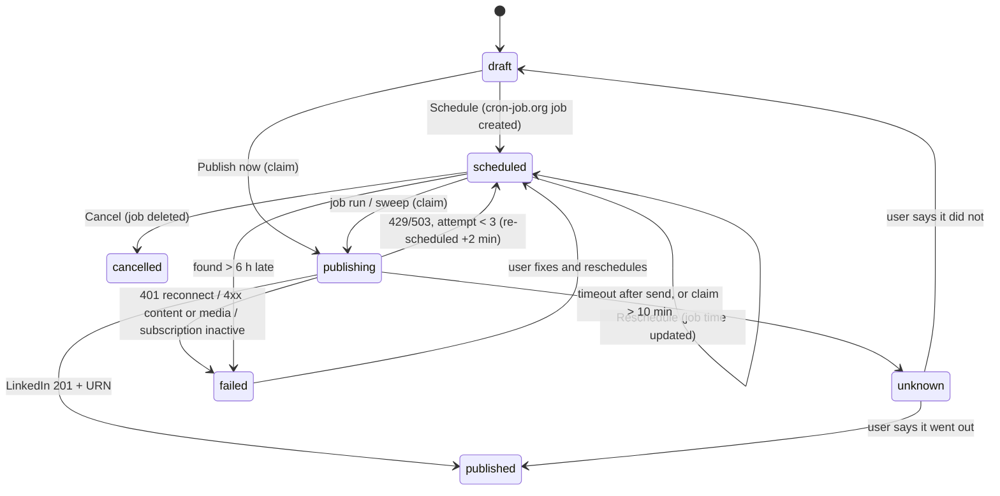
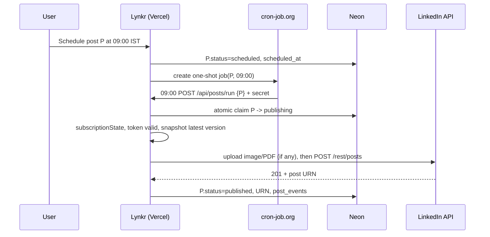

# Posts (Vertical 2) - Plan

## Goal Capsule

- **Objective:** A paid Lynkr user opens one of this week's planned posts. Lynkr interviews them about it, writes a few complete versions that sound like them and invent nothing, and lets them refine one and add a visual. The post then publishes itself on LinkedIn at the time they chose, and they can see whether it went out.
- **Means:** an UpLinked-style per-post flow (Context → Editor → Visual → Publish) on server-side post rows, published through LinkedIn's official API by one cron-job.org job per scheduled post (KD1–KD5, KTD1–KTD4).
- **Authority, highest first:**
  1. Aryan's decisions: the Key Decisions here, plus anything he says later.
  2. The R-IDs.
  3. The KTDs.
  4. The unit text.
- **Background only:** `prod/lynkr-posts-comments-intelligence-execution-plan.md` (17 Oct). Its locks "no account, no extension, blanks lock copy, no auto-posting, no scheduled generation" are superseded by KD1–KD5. Its reader-value guidance for posts (§3.2) still applies.
- **Execution profile:**
  - One lead agent owns git and every commit, on branch `feat/posts-v2`, cut from `origin/master` after the V3 work is committed.
  - Parallel agents each own one unit, one owner per file. Where a file appears under two units, the earlier unit's agent creates it and the later unit edits it only after the earlier unit is committed. Units that share a file never run in parallel.
  - Progress goes in `research/progress-vertical2.md`: three lines per unit (done, evidence, next). Any new session reads it first.
- **Stop conditions:** only S1–S8 below. Every other choice is the lead's: decide it, log it under "Decided by the lead (reversible)" in the progress file, and keep going.
- **Who finishes:**
  - The lead builds U0–U15 and ships them to a Vercel preview, with auto-publish on in preview only.
  - Aryan does A1–A8 below, including production and the LinkedIn terms question.

---

## Working Agreement

### When to stop and ask Aryan (S1–S8)
- S1. **Anything outward-facing or hard to undo:**
  - merging to `master`
  - changing Production variables
  - production migrations
  - publishing legal or landing copy
  - publishing any post on a real LinkedIn account, including the U0 smoke test, which Aryan runs himself
- S2. **Spending money,** or raising any cap in KTD10.
- S3. **Changing a Key Decision,** or adding anything that reads LinkedIn pages or sends messages, comments or connection requests automatically.
- S4. **Third-party terms and accounts:** creating or accepting them (cron-job.org, the LinkedIn developer app, Vercel Blob).
- S5. **A settled decision can't work.** Stop with two or three options and a recommendation.
- S6. **Aryan says "stop".** Halt and write the state into the progress file.
- S7. **A secret is needed.** Never ask for its value in chat. Name the exact Vercel variable to paste it into.
- S8. **An existing test breaks** and can't be fixed inside the unit that broke it.

### How to ask
- **Batch questions** in the progress file. There are two rounds: start (A-list) and release. Each question has a recommended answer, and the build never waits on one; it runs on mock mode or fixtures until answered.
- **Commands for Aryan** are single PowerShell lines with no secret values.
- **After any variable change, redeploy.**
- **Variable names are fixed** by the Verification Contract table. `/api/status` reports names only.
- **The preview uses `LYNKR_DATABASE_URL`.** Production migrations are S1.
- **Never mention a deadline or a date for finishing** (`memory.md`, 2026-10-16).

---

## Aryan's part

| ID | What | When | Until it's done |
|---|---|---|---|
| A1 | Create the LinkedIn developer app. Add the products **Sign In with LinkedIn using OpenID Connect** and **Share on LinkedIn**. Put `LINKEDIN_CLIENT_ID` and `LINKEDIN_CLIENT_SECRET` into Vercel Preview | Start | Publish is mocked against a stubbed LinkedIn client |
| A2 | Send LinkedIn developer support the U0 question about API Terms 3.1 ("automate posting"), with the drafted text | Start | Production auto-publish stays off (R31) |
| A3 | Create a free cron-job.org account, create an API key, and put it into Vercel Preview as `CRONJOB_API_KEY` | Start | Scheduling is refused in preview; Publish shows the fallback path (R32) |
| A3b | Turn on Vercel **Protection Bypass for Automation** for the project (Preview), so cron-job.org calls reach the preview past Deployment Protection (`CONTEXT.md` line 13: the preview is protected). Vercel sets `VERCEL_AUTOMATION_BYPASS_SECRET` | Start | Job calls to the preview get Vercel's auth wall |
| A4 | Create a Vercel Blob store for the project (Preview) | Before U6 | Visuals are kept in memory in mock mode only |
| A5 | Keep the OpenAI spend limit at $10/month (it covers text and images) | Start | Mock drafts and placeholder images |
| A6 | Run U0's smoke test on your own LinkedIn: one text post, one image post, one PDF post, visibility Connections. Delete them after | After A1 | Live publish unverified |
| A7 | Approve the copy and legal drafts from U13 | Release | Nothing is published |
| A8 | Production: merge, run migration 003, set `LYNKR_POSTS=v2`, and set `LYNKR_AUTOPUBLISH=on` **only after LinkedIn's written answer allows it** | Release | Production keeps today's posts tab |

---

## Product Contract

### Summary
The posts tab becomes a workspace that follows UpLinked's order:
1. This week's post slots, each with a type and a short brief.
2. A per-post interview.
3. Three complete versions to choose from.
4. An editor with refine-by-chat, version history and a LinkedIn-style preview.
5. An optional visual: an AI image, a carousel, or your own photo.
6. Publish now or schedule. Lynkr publishes through the user's own LinkedIn connection and shows whether it went out.

Users who haven't connected LinkedIn get a complete copy / extension / reminder path instead.

### Problem Frame
Today's posts tab (`components/Results.tsx` posts section, `components/DraftCard.tsx`) writes three fixed-angle drafts in one `/api/generate` call. The drafts have `[[blank]]` slots that lock Copy, and the user posts them by hand. The weekly plan's "Schedule" only sets a reminder, and everything lives in browser storage. Lynkr's promise is posts that sound like you and get you seen consistently. Today's version produces generic posts, homework-like blanks, and no consistency once the user stops opening the tab. UpLinked shows the path that works: interview the person about each post, write real alternatives, and publish on schedule.

### Key Decisions
- KD1. **An interview runs before every post, set up the UpLinked way.** (session-settled: user-directed — chosen over drafting straight from the Story Vault: "Use the uplinked method of interviewing before every post.") This overrides the 2026-10-27 "no new question screens" rule, for posts only. Governs R4–R10.
- KD2. **Post drafts are complete and never invent a fact.** (session-settled: user-directed — chosen over `[[blank]]` slots: "No fill-in-the-blank stuff.") Governs R11–R14.
- KD3. **Posts publish themselves through LinkedIn's official API at the time the user chose, one job per scheduled post.** (session-settled: user-directed — chosen over assisted posting where the user clicks Post: "Auto-publish via official API"; "make changes as per uplinked, override".) Governs R22–R30.
- KD4. **Production auto-publish waits on a written answer from LinkedIn developer support about API Terms 3.1.** (session-settled: user-directed — chosen over launching without asking and over one-click-only publishing.) Governs R31.
- KD5. **Visuals follow UpLinked: type, then style, then adjust,** with AI image, carousel and edit-own-photo, and a monthly picture allowance. (session-settled: user-directed — chosen over attaching your own photo only.) Governs R17–R21.
- KD6. **Comments and Profile fix are out; the existing code and plans are the base.** (session-settled: user-directed.) Governs R35.
- KD7. **Posts are paid.** Inherited from V1 Decision 1: only the onboarding interview, Story Vault and first win are free. Governs R33.

### Requirements

**Slots**
- R1. This week's posts appear as slots, each with a type (proof, setback, observation), a day and time in IST, a one-to-two line brief, and a status.
- R2. Slots are stored on the server. Changing the weekly count or rolling over to next week never removes or hides a post that is scheduled, publishing or published.
- R3. The user can edit a slot's brief and type, and add a free-write post that isn't in the plan. "Add a post" asks for a type (proof, setback or observation) and a one-to-two line brief ("What is this post about?"), then opens the same interview. If the brief is blank, the first question asks for the topic.

**Interview (KD1)**
- R4. Opening a slot starts its interview. The agent states the post's purpose from its type and brief, then asks one focused question at a time, each with an example and "rough notes are fine".
- R5. The agent reads the Story Vault and the brief first, and asks only for what this post is still missing.
- R6. Answers can be typed or spoken. Voice is hidden where the browser can't do it. An image can be attached, up to 6 MB.
- R7. There are two modes. **Quick** (default) asks at most 3 questions; **Thorough** asks at most 7. The one thin-answer question in R8 is allowed beyond the cap in both modes. A "Write it now" button is always available.
- R8. The agent decides when it has enough and says so. If the answers are too thin to write a post without inventing, it asks one more targeted question, then stops honestly instead of padding.
- R9. The interview resumes where the user left off, on any device, and keeps every answer.
- R10. Answers can become Story Vault candidate facts for the user to confirm. The post's own answers ground that post without waiting for confirmation.

**Versions and editor (KD2)**
- R11. The interview ends with three complete versions from different angles. The user picks one with "Use this version", or presses "Write new" for three new ones.
- R12. No version contains a blank, a placeholder, or a number, name or quote that isn't in the answers, the confirmed facts or the brief. Outreach-only fact kinds never appear in a post.
- R13. If fewer than three versions pass the checks, the user gets the ones that passed, with a note. If none pass, the user goes back to the interview with one targeted question.
- R14. The editor shows the post as it will look on LinkedIn: the user's name and headline, desktop and phone width, and a live count out of 3,000 visible characters. Scheduling and publishing are disabled above 3,000.
- R15. Refine-by-chat: the user asks for a change ("shorter ending"), and the agent writes it. Every AI change and every manual save becomes a version the user can go back to.
- R16. A writing rule the user states ("no em dashes, ever") can be saved, and every later draft and refine follows it. Rules are listed and removable.

**Visuals (KD5)**
- R17. The Visual step is optional and runs Type → Style → Adjust. Types are AI image, Carousel and Edit own photo. Suggestion chips include "What kind of visual fits my post best?".
- R18. A carousel is built from the post's own text: 4–8 slides, one idea per slide, drawn from a template in the chosen style, with sharp text, and published as a PDF.
- R19. An AI image is generated without text inside it, and the user can regenerate it.
- R20. Edit own photo: upload a JPG or PNG, crop it to 1:1 or 4:5, and add an optional caption band from the style. Location data is removed.
- R21. A monthly picture allowance counts AI images only; carousels and own photos are free. The user sees "N of M left, resets on 1 <month>". A failed generation doesn't count, and a failed visual never blocks the text post.

**Publishing (KD3)**
- R22. "Connect LinkedIn for posting" asks once for name, email and posting permission. Users who signed in another way can connect from the Publish step, even when their LinkedIn email differs from their Lynkr email. The posting permission is requested only when `LYNKR_AUTOPUBLISH=on`. With it off, LinkedIn sign-in keeps name, email and photo only (matching today's privacy page).
- R23. **Publish now** posts at once. **Schedule** picks a day and time in IST. The user sees "goes out within a couple of minutes of <time> IST".
- R37. When a post ends Failed or Check LinkedIn, and when the LinkedIn connection is 14 or 3 days from expiry with a post scheduled after it, Lynkr sends one email through the existing `lib/email.ts` `sendEmail` (new `Kind` values). The email gives the plain reason and a link to the post [VISIBLE]. The out-of-app channel is Aryan's call (D-P10).
- R24. Each post publishes at most once. A double click, a duplicate job run, or "Publish now" racing a scheduled run produces one LinkedIn post.
- R25. Status is visible on the slot and in the editor: Draft, Scheduled, Publishing, Published (with a "View on LinkedIn" link), Failed (with a plain reason and a fix), Check LinkedIn (sent but unconfirmed), or Cancelled. A Scheduled post more than 10 minutes past its time shows as Overdue, with Publish now and Reschedule, as soon as the user opens Lynkr.
- R26. Reschedule moves the time, and cancel stops it. Both are refused once publishing has started. A timeline shows created, scheduled, every reschedule and the outcome.
- R27. What publishes is the latest saved version at the moment of publishing, with its visual. Editing text after a carousel was made marks the carousel out of date and asks the user to rebuild or remove it.
  - **Editability by status:**
    - Draft is editable.
    - Scheduled and Overdue stay editable, with a banner "Edits go out with the scheduled post" and the post time.
    - Publishing is read-only ("Publishing now").
    - Published and Check LinkedIn are read-only, with View on LinkedIn and "Post again", which copies the row (KTD3).
- R28. A post found more than 6 hours late is not published. It becomes Failed (late), and the user is asked to publish now or reschedule.
- R29. If the LinkedIn connection expires before a scheduled time, the user is warned 14 and 3 days ahead and when scheduling past the expiry. At publish time an expired connection gives Failed (reconnect). After reconnecting, the user is offered Publish now or a new time for each such post.
- R30. A lapsed subscription gives Failed (subscription) and no publish. If the payment system can't be reached, the post waits and retries until the late cutoff in R28.
- R31. Auto-publish (R22–R30) runs only when `LYNKR_AUTOPUBLISH=on`. Without it the Publish step is the fallback path in R32. Production stays off until A8.

**Fallback, access and data**
- R32. Without a LinkedIn connection, or with auto-publish off, Publish offers: Copy, Open LinkedIn, an .ics or Google Calendar reminder, and "Mark as published". Inserting a post through the Lynkr extension is deferred to after the Commenter, which owns LinkedIn insertion (`research/build-plan-commenter.md`).
- R33. Every posts route is paid. Publish and refine work only for signed-in accounts. License-key-only users get the fallback path.
- R34. "Delete my data" and the 12-month cleanup remove every posts table row and stored image, cancel scheduled jobs, and clear the LinkedIn posting token. Export includes posts, versions, answers and rules.
- R35. Comments, the full calendar, analytics and Profile fix are out of scope. The comment helper stays as it is.

**Honesty**
- R36. Every "Lynkr never posts for you" or "fill the blanks" line changes in the same release that turns auto-publish on, never before. Privacy and Terms say what is posted, when, with what permission, and which AI makes images.

### Acceptance Examples
- AE1. Covers R9. The user answered 2 questions and closed the tab. Reopening the slot on another device shows both answers and the next question; nothing is asked twice.
- AE2. Covers R8, R12. Every answer is under 5 words after follow-ups. The agent asks one more targeted question, then says it can't write without inventing. No version is written.
- AE3. Covers R24. Two job calls for the same post arrive in the same second. A stubbed LinkedIn client receives exactly one create call, and the post ends Published with one URN.
- AE4. Covers R25. The create call times out after sending. The post becomes Check LinkedIn, is never retried automatically, and asks "Did this post go out?" with Yes (paste the link) or No (back to draft).
- AE5. Covers R29. The connection expires 10 Dec and a post is scheduled for 12 Dec. Scheduling shows "Reconnect LinkedIn before 10 Dec". A 401 at publish on 12 Dec gives Failed (reconnect). After reconnecting, the user sees "Publish now" and "Pick a new time" for that post.
- AE6. Covers R30. The subscription lapsed: the post is not published and shows Failed (subscription). Dodo is down: the post stays Scheduled and goes out once Dodo answers, if within 6 hours.
- AE7. Covers R26. A post is moved from Tue 09:00 to Wed 18:30. Nothing publishes Tuesday, it publishes Wednesday, and the timeline shows both. A cancel at 08:58 means nothing publishes. A cancel after the claim answers "already publishing".
- AE8. Covers R14. A post contains `(50%)`, `#buildinpublic`, `a_b` and `* point`. The preview and LinkedIn show the same text. At 3,001 visible characters, Schedule and Publish are disabled with the count shown in red.
- AE9. Covers R34. Two scheduled posts and an image exist, and the user deletes their data. Both cron-job.org jobs are deleted, the rows are gone, the image is deleted from storage, and the token is cleared.
- AE10. Covers R2. Two posts are scheduled, and the user types "1 post" in plan chat. Both scheduled posts still publish and stay visible.
- AE11. Covers R21. With 0 pictures left, AI image shows the reset date and Carousel still works. A failed generation isn't counted, and the post can be scheduled text-only.
- AE12. Covers R32. A paid user who hasn't connected LinkedIn sees Copy, Open LinkedIn, a reminder and Mark as published.

### Success Criteria
- Real-AI eval of 5 personas plus 2 adversarial ones (thin answers, pasted instructions): 0 invented numbers, names or quotes across all versions, and at least 2 of 3 versions pass the checks for each normal persona.
- Across the five testers on the preview, at least 20 scheduled posts publish with none duplicated, and at least 19 of the 20 go out within 3 minutes of schedule.
- Repeat use, plus a quality bar for "sounds like them": numbers set by Aryan (D-P13).
- Median time from opening a slot to a chosen version is under 6 minutes in Quick mode.

### Scope Boundaries
- Out, considered and not built:
  - Comments and finding threads (planned separately).
  - Analytics and post metrics. A self-serve app can't read posts back, and UpLinked's scraping-based analytics are ruled out.
  - Company-page posting. It needs LinkedIn partner review.
  - Multi-model versions. One provider writes three angles; three providers would triple cost for a choice testers can't yet judge.
  - A 12-week strategy engine. Slots come from the existing weekly plan.
  - Infographics and GIFs. UpLinked marks them "coming soon".
  - Deleting a post on LinkedIn from Lynkr. Possible later via the API, but it's easily confused with cancel.
- **Deferred to Follow-Up Work:**
  - Calendar V4 absorbs posts through `post_events`, `scheduled_at` and `due_at` (U1).
  - Inserting post text through the Lynkr extension, after the Commenter builds LinkedIn insertion (`research/build-plan-commenter.md`).
  - More post types beyond the three tags.
  - Choosing Connections-only visibility. Posts are public for now.

---

## Planning Contract

### Keep / Change / Replace (checked against code)

| Existing | Verdict | Use |
|---|---|---|
| `components/DraftCard.tsx` | Keep for other kinds | `copyText`, the grounding warning and the "Built from your facts" block are reused in a new `PostEditor`. Blank locking is not used for posts |
| `app/api/generate/route.ts` | Keep for other tabs | `keepKnownRefs`, `stripFactIds` and `cleanStrings` reused. `GenerateReply.posts` stays until `WeekPlan`, `Today` and Results move off it (U10) |
| `lib/prompts.ts` | Change | Rules 1–7 and STYLE are reused. For posts, rule 1's blank instruction becomes "ask in the interview or leave the claim out". New `POST_*` prompts. `judgeSystem` reused |
| `lib/interview/engine.ts`, `judge.ts` | Keep, reuse | `looksVague`, `followUpFor`, `applyAnswer`, the judge with its checks and fallback |
| `app/api/interview2/route.ts` | Pattern | Server-led loop, resume via `answer: null` |
| `components/v2/QuestionScreen.tsx`, `components/useSpeech.ts` | Reuse | The interview UI and voice input |
| `interview_answers`, `facts_source_uq` | Don't reuse for posts | Keyed by qid (8 chars), so answers from different posts would collide. Post turns get their own table |
| `lib/outreach/draft.ts` `draftProblem` | Extract | The shared `groundingProblem(body, sources)` lives in `lib/grounding.ts`. Outreach keeps its checker step |
| `lib/plan.ts`, `components/WeekPlan.tsx` | Change | Post items read status from server post rows; messages and comments are unchanged. "Schedule" copy changes for posts |
| `lib/ics.ts`, `lib/outreach/calendar.ts` | Keep | Reminders in the fallback; replace-by-id event model for V4 |
| `lib/store.ts` | Change | Posts are server-only. `postJson` with the 402 → `LOCKED_EVENT` is reused |
| `lib/auth.ts` | Change | LinkedIn scope `w_member_social`, `account.encryptOAuthTokens: true`, `linkSocial` for connecting later |
| `lib/billing.ts` | Change | Add a three-way `subscriptionState` (active / inactive / unknown) for the job path. `requireLicense` stays for routes |
| `lib/db.ts` | Change | Add posts tables to `TABLES` with the `to_regclass` guard. `takeDaily` for caps |
| `lib/llm.ts` | Change | Add image generation (`generateImage`, OpenAI `gpt-image-1-mini`). Vision `ImageInput` reused for attachments |
| `vercel.json`, `app/api/cron/cleanup` | Change | Same daily cron also runs the posts sweep. `cronAuthorized` pattern for the job endpoint |
| `extension/` | Change | Side panel gets a "Posts" list that inserts post text, via `app/api/ext/posts` |
| `lib/metrics.ts` | Change | New count-only events |
| `prod/lynkr-posts-comments-intelligence-execution-plan.md` §3.1 content-profile questionnaire | REPLACE | The per-post interview (KD1) and slot briefs collect the same context in the moment, with no extra question screen up front |
| same, reviewable Story Vault stage | KEEP | Built in V1 (`research/build-plan-interview.md` R7, R8) |
| same, §4.1 full-text editor with reset | KEEP, extend | Becomes `PostEditor` with version history (R15) |
| same, §3.2 reader-value guidance (reader, first-hand detail, useful point, natural close) | KEEP | Carried into `POST_VERSIONS_SYSTEM` (U4) |
| same, Phase 0 real-AI baseline and Phase 3 pilot | KEEP | U14's eval and U15's testers |
| same, §3.3 comment-on-a-post flow | Moved | `research/build-plan-commenter.md` (the Commenter plan) |
| same, §7 "no LinkedIn login … automatic posting" and §9 locks | REPLACE | KD3–KD5; the public copy follows D-P1 |

### Key Technical Decisions
- KTD1. **One cron-job.org job per scheduled post** calls `POST /api/posts/run` with the post id and a signed secret. Reschedule updates the job's time; cancel deletes it. The database is touched only when a post is due, which keeps Neon's free 100 compute-hours intact: an every-minute poll would keep it awake about 180 CU-hours a month. (session-settled: user-directed — cron-job.org chosen over GitHub Actions, which would need about 8,640 minutes a month on a private repo against 2,000 free, and over Vercel Pro at about $20 a month.) The free API allows 100 requests a day and 5 job creations a minute, about 2–3 requests per post. A failed job create makes scheduling fail visibly.
  - Jobs target the stable branch URL (`VERCEL_BRANCH_URL`) on preview and `https://www.lynkr.cloud` in production, never the per-deployment `VERCEL_URL`.
  - Every job request carries `x-vercel-protection-bypass: $VERCEL_AUTOMATION_BYPASS_SECRET` (A3b) next to the `POSTS_RUN_SECRET` header, in cron-job.org's request headers.
  - Worst-case budget per post: 1 create, 1 update, 4 backoff updates (KTD12) and 1 delete, so 7 requests.

  Governs R23, R26.
- KTD2. **The daily Vercel cron is the safety net.** The existing `30 21 * * *` run (03:00 IST) also sweeps posts that are Scheduled with `scheduled_at` past, then applies the late rule (R28) and the stuck-claim rule (KTD3). It also checks for orphan cron-job.org jobs and deletes visuals 30 days after publish. No new cron, Hobby-compatible.
  - **The sweep only detects; it never publishes.** It runs at 03:00 IST, so a missed 09:00 post is found 18 hours late and fails as late under R28. A missed post therefore reaches the user through the Overdue state (R25), the R37 email, and the sweep's `overdue_found` count. It is not rescued.
  - **Vercel cron runs only on Production.** On the preview, one recurring daily cron-job.org job calls the same sweep with `CRON_SECRET` plus the bypass header. The lead creates it after A3, and it counts toward the KTD1 budget.
  - The slots route also applies the 10-minute stale-claim rule when it reads rows, so a stuck "Publishing" never lasts until the next sweep.
- KTD3. **Atomic claim and a state machine in Postgres.** Every publish path, the job, "Publish now" and the sweep, claims with one `UPDATE ... SET status='publishing', claimed_at=now() ... RETURNING`.
  - The job and the sweep claim `WHERE id=$1 AND status='scheduled'`.
  - "Publish now" claims `WHERE id=$1 AND user_id=$2 AND status IN ('draft','scheduled','failed')`, with no due window, and deletes any pending cron-job.org job after a successful claim. That covers Overdue, Failed (late) and post-reconnect posts.
  - The job path also requires `scheduled_at <= now() + interval '2 minutes'`, so a leaked or replayed secret can't publish a post early.
  - The secret is compared in constant time, as in `cronAuthorized` (`lib/cleanup.ts`).

  LinkedIn has no idempotency key and can't be read back, so:
  - A timeout after sending becomes `unknown`, with no retry.
  - A claim older than 10 minutes becomes `unknown`.
  - Only 429, 503 and connection-refused retry, at most 3 attempts, and the job is re-scheduled 2 minutes later.
  - Media URNs are saved on the row so a retry doesn't upload twice.
  - "Post again" copies the row; a published row is never reused.
- KTD4. **LinkedIn API pinned to `Linkedin-Version: 202610`** with `X-Restli-Protocol-Version: 2.0.0`. It uses `POST /rest/posts`, `/rest/images?action=initializeUpload` and `/rest/documents?action=initializeUpload`, `author = urn:li:person:<OIDC sub>`, and visibility PUBLIC. `commentary` is escaped for LinkedIn's "little" format (`| { } @ [ ] ( ) < > # \ * _ ~`), and `#word` becomes a hashtag. The character count is of visible text. A yearly version bump is noted for 2027-10.
- KTD5. **Tokens stay in Better Auth's `account` table, encrypted** (`encryptOAuthTokens: true`), and the job gets the token by selecting the LinkedIn `account` row id (`userId`, `providerId='linkedin'`) and calling `getAccessToken({ body: { accountId, userId } })`. Better Auth 1.7.7 rejects a body with `userId` alone.
  - When `LYNKR_AUTOPUBLISH=on`, one consent requests `openid profile email w_member_social`, because adding a scope later invalidates earlier tokens. With it off, the scope stays `openid profile email` (R22).
  - `accountLinking.allowDifferentEmails: true` lets `linkSocial` connect a LinkedIn account whose email differs. This is safe because linking needs a signed-in session and explicit LinkedIn consent. Implicit sign-in linking keeps the verified-email rule (`research/build-plan-interview.md` U16).
  - `connectionStatus` reports needs-reconnect unless `account.scope` contains `w_member_social`. There's no refresh token, so `accessTokenExpiresAt` drives R29.
- KTD6. **The interview is model-led inside server guards.** Each turn, the model proposes the next question from the brief, the vault, the answers and a per-type intent list (`lib/posts/intents.ts`, e.g. proof: what you did / the decision / the result / what you'd change). The server enforces one question, no private kinds, the turn caps in R7, and the "enough" decision returned as a structured field. The existing judge handles vagueness, follow-ups and candidate facts. Mock mode walks the intent list deterministically.
- KTD7. **Versions: one call writes three angles.** Each candidate passes `groundingProblem` against sources = this post's answers + confirmed facts + brief, plus a 3,000-character limit. Failures retry once with "use fewer claims"; then R13. The user's own statements about themselves count as evidence. Instructions inside answers are data. A `takeDaily` cap of 6 "Write new" calls per user a day (KTD10).
  - For posts, `groundingProblem` skips `#tag` tokens in the name check (KTD4 makes them hashtags). It allows "LinkedIn", weekday and month names, and a short acronym list (AI, ML, UI, UX, SQL, API).
  - Its placeholder check is narrowed to `[[`, `]]`, `{`, `}`, `TODO` and `TBD`, so `->` and `<3` pass.
- KTD8. **Carousels are rendered, not generated.** The model splits the post into 4–8 slide texts with a schema. Each slide is rendered with `next/og` `ImageResponse` in one of three styles (Clean, Bold, Sketch-frame) at 1080×1350. They're assembled into a PDF with `@cantoo/pdf-lib` (maintained fork) and titled from the post. AI images use `gpt-image-1-mini` at medium quality with the existing `OPENAI_API_KEY`, prompted for "no text", about $0.008 each. Stored in Vercel Blob under `posts/<userId>/`; deleted on delete-my-data and 30 days after publish.
- KTD9. **Data model, migration `003_posts.sql`.** Tables, all with `user_id ... on delete cascade` and added to `TABLES` with the `to_regclass` guard:
  - `posts` (id uuid, slot week_start + index or free-write, type, brief, status, reason, due_at timestamptz (the user's chosen time, never overwritten), scheduled_at timestamptz (the next run), claimed_at, attempt, cron_job_id, published_at, linkedin_post_urn, published_body, current_version_id, visual_id, media_urn)
  - `post_versions`, `post_interview_turns` (keyed by post id + turn)
  - `post_events` (append-only, for V4), `writing_rules`, `post_media`
  - `picture_allowance` (user, IST month, count, one atomic row)
  `cloudReady` stays on 001; post routes check for 003 with `to_regclass`.
- KTD10. **Caps:** 30 AI pictures a month by default (`LYNKR_PICTURES_MONTHLY`); 40 interview turns, 6 "Write new" and 20 refines a day per user (`takeDaily`). Posts share the existing OpenAI $10/month limit.
- KTD11. **Switches copy the existing flag pattern:** `LYNKR_POSTS=v1|v2` (v2 on preview) and `LYNKR_AUTOPUBLISH=on|off` (off unless set), both reported by `/api/status`.
- KTD12. **Subscription at publish time is a three-way check:** `subscriptionState` returns active, inactive or unknown. Unknown means Dodo is unreachable. The post is re-scheduled with backoff, at +5, +15, +45 and +135 minutes, then a final try at the 6-hour cutoff: at most 5 job updates per post.
  - A `due_at` column keeps the user's chosen time. Retries never overwrite it, and R28's cutoff is measured from it.
  - What "active" means, including any past-due grace, is settled once in the combined plan.

### High-Level Technical Design

Post lifecycle:

Publish sequence:

Per-post flow: Slot → Context (interview) → three versions → Editor (refine, history, preview) → Visual (type → style → adjust, optional) → Publish (now / schedule / fallback).

### Lead defaults (not confirmed by Aryan)
The lead picked these from the edge-case pass; none has a source in Aryan's words. Each is a [DECISION] in "Decisions for Aryan" below, and the build uses the default until he answers:
- D-P2: slot briefs
- D-P3: interview caps
- D-P4: picture allowance
- D-P5: late cutoff
- D-P6: expiry warnings
- D-P7: attachments
- D-P8: visibility

Vercel Blob free capacity on Hobby: **not found**. It's checked at A4.

### Payments and access changes
- **The offer, for this part:** all of Posts is paid (`research/context-brief.md` §8, "Keep today's split"; KD7). Nothing in Posts is free. The free first win stays in the Interview plan.
- **Gated routes and screens:**
  - Every `app/api/posts/*` route calls `requireLicense`, the pattern in `app/api/outreach/draft/route.ts`.
  - The job route `app/api/posts/run` has no request user, so it uses the three-way subscription check (KTD12).
  - The posts tab shows the existing paywall (`components/Paywall.tsx`) to unpaid users. The paywall's paid list names "Posts that publish on schedule" [VISIBLE].
- **Lapsed subscriptions:** a scheduled post of a lapsed user doesn't publish and shows Failed (subscription) (R30). The past-due grace rule comes from the combined plan (`research/build-plan-interview.md` D-I5). KTD12's "active" means whatever that plan settles, so the two can't disagree.
- **Picture allowance:** it lives inside the ₹499 plan as a Lynkr-side counter (KTD10). No Dodo usage-based billing is needed. Dodo supports usage meters through the Better Auth `usage()` plugin (https://docs.dodopayments.com/developer-resources/better-auth-adaptor), but it isn't adopted, because the offer has one flat price. A paid top-up for extra pictures would be a new offer [DECISION D-P9].
- **Dodo product setup, checkout, webhooks, license keys:** no change for Posts. The same product (`DODO_PRODUCT_ID`, "Lynkr Monthly", `CONTEXT.md` line 17) gates it.
- **Cancellation and refunds:** cancelling stops future scheduled posts at the moment access ends. Which moment that is (immediately, or at the end of the period) is D-I6 in the combined plan. On a refund, scheduled posts are cancelled and their cron-job.org jobs deleted, the same path as R34.
- **Terms and landing copy that must change:** see D-P1.
- **Hosting:** Vercel's Hobby plan terms restrict commercial use (`CONTEXT.md` line 19, "check before charging"). Posts adds a paid feature that relies on Vercel Blob and the cron sweep on Hobby. Plan status: **not found**. It goes on the combined plan's list for Aryan.

### Risks & Dependencies
- **LinkedIn Terms 3.1 may forbid scheduling.** KD4 and R31 keep production off until LinkedIn answers. If the answer is no, R32 is the complete product and auto-publish stays off.
- **Self-serve token behaviour is unverified on `/rest/posts`, images and documents**, and so is OIDC `sub` matching the person id. U0 verifies both before U8 is built on them.
- **Users must reconnect every 60 days.** R29 covers this.
- **cron-job.org has a 100 requests/day limit and is a single external dependency.** At 2–3 requests per post that covers about 30–50 scheduled posts a day; more can be requested free. A dead service surfaces as Overdue posts (R25) and in the daily sweep (KTD2).
- **Image cost** is bounded by KTD10 and the OpenAI project limit.

### Sources
- `research/feature-evidence-posts.md` (UpLinked: interview, versions, refine, visuals, one job per post).
- LinkedIn: Share on LinkedIn / `w_member_social`, the Posts, Images and Documents APIs (learn.microsoft.com, li-lms-2026-09/10), and API Terms of Use 3.1 and 4.4.
- cron-job.org REST API docs (limits, auth); Neon pricing (100 CU-hours free, scale-to-zero after 5 minutes); GitHub Actions billing (2,000 free minutes on private repos).
- Repo patterns: `app/api/interview2/route.ts`, `lib/interview/judge.ts`, `lib/outreach/draft.ts:49-95`, `lib/db.ts:267-299`, `lib/billing.ts:161-194`, `lib/outreach/ext-auth.ts`, `scripts/migrations/002_outreach.sql`, `tests/vault-db.test.mts`, `tests/outreach-draft.test.mts`.

---

## Implementation Units

### Unit Index

| U | Title | Main files | Depends on |
|---|---|---|---|
| U0 | LinkedIn and scheduler smoke test | `scripts/smoke-linkedin.mts`, `research/linkedin-terms-question.md` | — |
| U1 | Migration 003 and posts-db | `scripts/migrations/003_posts.sql`, `lib/posts/db.ts`, `lib/db.ts` | — |
| U2 | Server slots and briefs | `lib/posts/slots.ts`, `app/api/posts/slots/route.ts`, `lib/plan.ts` | U1 |
| U3 | Per-post interview | `lib/posts/interview.ts`, `lib/posts/intents.ts`, `app/api/posts/interview/route.ts` | U1, U2 |
| U4 | Versions and grounding | `lib/posts/versions.ts`, `lib/grounding.ts`, `app/api/posts/versions/route.ts` | U3 |
| U5 | Editor: refine, history, rules, preview | `lib/posts/refine.ts`, `lib/posts/little.ts`, `app/api/posts/refine/route.ts` | U4 |
| U6 | Visuals | `lib/posts/visual.ts`, `lib/posts/carousel.tsx`, `app/api/posts/visual/route.ts`, `lib/llm.ts` | U1, U4 |
| U7 | LinkedIn connect and tokens | `lib/auth.ts`, `lib/posts/linkedin-token.ts` | build-plan-interview U16 |
| U8 | LinkedIn publisher client | `lib/posts/linkedin.ts` | U0, U5, U7 |
| U9 | Scheduler, claim and run | `lib/posts/schedule.ts`, `lib/posts/cronjob.ts`, `app/api/posts/run/route.ts`, `lib/billing.ts` | U1, U6, U8 |
| U10 | Posts workspace UI (fallback Publish first; the auto-publish slice follows) | `components/posts/*`, `components/Results.tsx`, `components/Today.tsx`, `components/WeekPlan.tsx` | U2–U6 (auto slice: U9) |
| U11 | Fallback path | `components/posts/Fallback.tsx` | U10 |
| U12 | Data lifecycle | `lib/db.ts`, `app/api/me/delete/route.ts`, `lib/cleanup.ts` | U1, U6, U9 |
| U13 | Copy and legal drafts | `components/Landing.tsx`, `components/chrome.tsx`, `app/privacy/*`, `research/terms-draft-v4.md`, `CONTEXT.md` | U10 |
| U14 | Metrics and evaluation | `lib/metrics.ts`, `scripts/eval-posts.mts`, `research/eval-vertical2.md` | U4, U9 |
| U16 | Failure and expiry emails | `lib/email.ts`, `lib/posts/notify.ts` | U7, U9 |
| U15 | Release | `tests/e2e-posts*.mjs`, `research/progress-vertical2.md`, `README.md` | all |

### U0. LinkedIn and scheduler smoke test
- **Goal:** prove the external contracts before building on them.
- **Requirements:** R22, R24, KD4.
- **Files:** `scripts/smoke-linkedin.mts`, `research/linkedin-terms-question.md`.
- **Approach:**
  1. A script Aryan runs locally (A6). It does the OIDC login with the four scopes, then makes one text, one image and one PDF post with visibility CONNECTIONS. It prints the URNs, the token expiry, and whether `sub` matches the person id.
  2. It creates, updates and deletes one cron-job.org job against a request bin, and records the request counts.
  3. It drafts the support question for A2: "Lynkr's AI drafts post text from the member's own interview answers. The member reviews, edits and approves one version and picks a time. At that time, Lynkr's server publishes it once to the member's own profile via Share on LinkedIn (w_member_social). The member can cancel until publishing starts. Does this count as 'automate posting' under API Terms 3.1?"
  4. It records how long an uploaded image and PDF take before a post can use them. It also calls `/api/posts/run` on the real preview (stub mode) through a cron-job.org job, and records the response code (checks A3b).
- **Test expectation:** none. This is a manual external check; results go into the progress file.
- **Verification:** the progress file shows three URNs and the expiry, and LinkedIn-side deletion is confirmed by Aryan.

### U1. Migration 003 and posts-db
- **Goal:** the server-side source of truth for posts (KTD9).
- **Requirements:** R2, R9, R15, R16, R21, R25, R26, R34.
- **Dependencies:** none.
- **Files:** `scripts/migrations/003_posts.sql`, `lib/posts/db.ts`, `lib/db.ts` (`TABLES`, guard), `tests/posts-db.test.mts`.
- **Approach:** copy the shape of `002_outreach.sql`. Every query is user-scoped. The claim helper is the one SQL statement from KTD3. The allowance is taken with an atomic upsert on (user, IST month) where count < cap.
- **Patterns:** `lib/outreach/contacts-db.ts`, `tests/vault-db.test.mts` (PGlite).
- **Test scenarios:**
  - The migration runs twice cleanly.
  - User B can't read, update or claim user A's post.
  - Two concurrent claims on one row: exactly one returns it.
  - A claim on a `cancelled` or `published` row returns nothing.
  - The allowance at cap-1 grants one, then refuses; a new IST month resets it.
  - Delete removes all 7 tables' rows for the user only.
  - `post_events` only grows.
- **Verification:** `npm test` is green with the PGlite tests.

### U2. Server slots and briefs
- **Goal:** slots with type, brief and time live on the server (R1–R3).
- **Dependencies:** U1.
- **Files:** `lib/posts/slots.ts`, `app/api/posts/slots/route.ts`, `lib/plan.ts`, `tests/posts-slots.test.mts`.
- **Approach:** the week's post count and times come from the existing `Plan`. Slot rows are created per (week_start, index). A brief is written once per slot from the type plus confirmed facts, with a deterministic version in mock mode. `layoutItems` keeps working for messages and comments. Post items show server status.
- **Test scenarios:**
  - Covers AE10. Lowering the count from 3 to 1 leaves the two scheduled posts in place and visible.
  - The Thursday rollover still lists this week's scheduled posts until they're published.
  - Editing the brief persists.
  - A free-write post is created with no slot index.
  - Mock mode gives one brief per type.
- **Verification:** the route tests pass in demo mode.

### U3. Per-post interview
- **Goal:** UpLinked's Context step (R4–R10, KTD6).
- **Dependencies:** U1, U2.
- **Files:** `lib/posts/intents.ts`, `lib/posts/interview.ts`, `app/api/posts/interview/route.ts`, `lib/prompts.ts` (`POST_INTERVIEW_SYSTEM`), `tests/posts-interview.test.mts`.
- **Approach:**
  1. Request `{postId, answer|null, mode}`. A null answer resumes.
  2. The judge (reused) runs per answer.
  3. The next question is model-proposed and server-checked, or taken from the intent list in mock mode.
  4. `enough` is a structured field.
  5. The turn caps follow R7. The honest stop follows R8.
  6. Candidate facts are written with source `post:<id>:<turn>`.
  7. An image attachment goes through the vision `ImageInput` with the 6 MB cap.
- **Patterns:** `app/api/interview2/route.ts`, `lib/interview/judge.ts`, `components/v2/QuestionScreen.tsx`.
- **Test scenarios:**
  - Covers AE1. Two answers, then a resume, returns question 3 with both answers.
  - Covers AE2. Three vague answers lead to one targeted question, then `stop: thin`, with no versions call.
  - Quick never asks a 4th question except the one R8 thin-answer question, and "Write it now" ends the interview at any turn.
  - A model reply with two questions or a private-kind topic is rejected, and the fallback question is used.
  - Pasted "ignore the rules" text produces no instruction effect and no fact.
  - A 402 mid-interview keeps saved answers.
- **Verification:** the route tests and `npm run eval:posts --demo` pass.

### U4. Versions and grounding
- **Goal:** three complete, traced versions (R11–R13, KTD7).
- **Dependencies:** U3.
- **Files:** `lib/grounding.ts` (`groundingProblem`), `lib/outreach/draft.ts` (uses it), `lib/posts/versions.ts`, `app/api/posts/versions/route.ts`, `lib/prompts.ts` (`POST_VERSIONS_SYSTEM`), `tests/posts-versions.test.mts`.
- **Approach:** extract the number, name, quote and placeholder checks from `draftProblem` without changing outreach behaviour. Posts add the 3,000 limit and writing rules. An injectable model seam, as in `generateOutreach`. "Write new" is capped by `takeDaily`.
- **Test scenarios:**
  - A candidate with a number not in the evidence is rejected.
  - A candidate with `[[x]]` or `TODO` is rejected.
  - Two of three pass, so two are returned with a note.
  - None pass after a retry, so a `back_to_interview` question is returned.
  - An outreach-only fact never appears.
  - The 7th "Write new" by one user in a day returns 429.
  - A candidate with "#BuildInPublic", "on LinkedIn last Monday" and "->" passes. One with an untraced person's name is rejected.
  - The existing outreach draft tests still pass.
- **Verification:** `npm test` is green, including `tests/outreach-draft.test.mts`.

> **Amendment 2026-10-30 (`build-plan-combined.md` X1):** fact filtering uses the shared `lib/facts.ts` `factsFor(use)`. Add `lib/facts.ts` to this unit's Files, and call `factsFor` instead of filtering locally.

### U5. Editor: refine, history, rules, preview
- **Goal:** R14–R16 and the escaping half of KTD4.
- **Dependencies:** U4.
- **Files:** `lib/posts/little.ts`, `lib/posts/refine.ts`, `app/api/posts/refine/route.ts`, `app/api/posts/rules/route.ts`, `tests/posts-little.test.mts`, `tests/posts-refine.test.mts`.
- **Approach:** refine takes the current version plus an instruction and returns a new version, guarded as in U4. A manual save makes a version. A rule is proposed by the model as a chip, and the user approves it. The visible-character counter and the escaper share one tokenizer.
- **Test scenarios:**
  - Covers AE8. The escaper output matches LinkedIn's rules for each reserved character, `#tag` becomes a hashtag, and the visible count ignores escapes.
  - 3,001 visible characters sets `canPublish=false`.
  - A refine adding an untraced name is rejected and the version is unchanged.
  - Going back to version 2 makes it current without deleting 3.
  - A saved rule ("no em dashes") is applied to the next refine, and removing it stops that.
- **Verification:** unit and route tests pass.

### U6. Visuals
- **Goal:** Type → Style → Adjust (R17–R21, KTD8).
- **Dependencies:** U1, U4.
- **Files:** `lib/llm.ts` (`generateImage`), `lib/posts/visual.ts`, `lib/posts/carousel.tsx`, `lib/posts/blob.ts`, `app/api/posts/visual/route.ts`, `tests/posts-visual.test.mts`.
- **Approach:**
  - Carousel: slide texts by schema, then the `next/og` render, then the `@cantoo/pdf-lib` PDF, then Blob.
  - AI image: the allowance is taken first and refunded on failure.
  - Own photo: validate type, size and pixels, crop, add the caption band, strip EXIF.
  - Any later text edit marks the carousel stale (R27).
  - Mock mode returns fixture PNG and PDF files.
- **Test scenarios:**
  - Covers AE11. At 0 left, the AI image is refused with the reset date, and the carousel still works.
  - A failed generation leaves the allowance unchanged.
  - A carousel splits a 900-character post into 4–8 slides, each within the template's line limit, and the PDF has that many pages and a title.
  - A 7 MB upload or a non-image is refused.
  - An EXIF GPS tag is removed.
  - Editing the text after a carousel sets `visual.stale=true`.
- **Verification:** tests pass. A rendered sample PDF is attached to the progress file.

### U7. LinkedIn connect and tokens
- **Goal:** R22 and R29, KTD5.
- **Dependencies:** `research/build-plan-interview.md` U16. LinkedIn must link only on a verified email before any LinkedIn sign-in or connect flow ships, because `trustedProviders` includes `linkedin` today (`lib/auth.ts` line 80).
- **Files:** `lib/auth.ts`, `lib/posts/linkedin-token.ts`, `app/api/posts/connection/route.ts`, `tests/posts-token.test.mts`.
- **Approach:**
  1. LinkedIn provider scopes are `openid profile email w_member_social` only when `LYNKR_AUTOPUBLISH=on`, otherwise `openid profile email` (R22, KTD5).
  2. `encryptOAuthTokens: true`. Existing plaintext rows stay readable.
  3. `linkSocial` for email, Google or Apple users, with `accountLinking.allowDifferentEmails: true` (KTD5).
  4. `connectionStatus(userId)` returns connected, expires-on or needs-reconnect. It checks `account.scope` for `w_member_social`.
  5. `lib/posts/linkedin-token.ts` selects the LinkedIn `account` id and calls `getAccessToken({ body: { accountId, userId } })`.
- **Test scenarios:**
  - An email user's link request carries all four scopes when autopublish is on. With it off, the authorization URL has no `w_member_social`.
  - An email user whose LinkedIn email differs links successfully and gets an account row with `w_member_social`.
  - A pre-existing LinkedIn sign-in row scoped `openid,profile,email` returns needs-reconnect.
  - The token helper passes `accountId`, so a body with `userId` alone is never sent.
  - Expiry in 13 days shows the 14-day warning.
  - Scheduling past expiry returns a warning with the date (AE5).
  - The status route is user-scoped.
- **Verification:** tests pass. Preview login works once A1 is done.

### U8. LinkedIn publisher client
- **Goal:** one module that talks to LinkedIn (KTD4).
- **Dependencies:** U0, U5 (escaper), U7.
- **Files:** `lib/posts/linkedin.ts`, `tests/posts-linkedin.test.mts`.
- **Approach:** `publish({token, personUrn, text, media})` handles image or document upload then the post, and classifies results as `ok(urn)`, `retry(429/503/refused)`, `auth(401)`, `content(4xx)`, `media(4xx on upload)` or `ambiguous(timeout after send)`. It takes an injectable fetch.
- **Test scenarios:**
  - 201 with an `x-restli-id` header gives `ok`.
  - 401 gives `auth`.
  - 429 and 503 give `retry`.
  - 500 or a timeout after the body was sent gives `ambiguous`.
  - An image upload failure gives `media`, and the post is not created.
  - The headers carry `Linkedin-Version: 202610`.
  - The body escapes the text using U5's escaper.
- **Verification:** tests pass against the stubbed fetch.

### U9. Scheduler, claim and run
- **Goal:** R23–R30, KTD1–KTD3 and KTD12.
- **Dependencies:** U1, U6 (media to upload), U8.
- **Files:** `lib/posts/cronjob.ts`, `lib/posts/schedule.ts`, `app/api/posts/schedule/route.ts`, `app/api/posts/run/route.ts`, `app/api/cron/cleanup/route.ts` (sweep), `lib/billing.ts` (`subscriptionState`), `tests/posts-schedule.test.mts`.
- **Approach:**
  - Schedule: write the row, then create the cron-job.org job (a one-shot schedule at the UTC instant, `expiresAt` the next minute), then store `cron_job_id`. A failure rolls back to draft with "couldn't schedule, try again".
  - Run: verify the secret, claim within the due window (KTD3), check the three-way subscription, check the token, snapshot the current version, call `publish`, then apply the transition from the state diagram, append `post_events`, and delete the finished cron-job.org job.
  - Sweep: due or stale rows, the late rule, orphan jobs.
  - Everything is behind `LYNKR_AUTOPUBLISH`.
- **Execution note:** write AE3, AE4, AE6 and AE7 as failing tests with a stubbed LinkedIn client and stubbed cron-job.org before the run route.
- **Test scenarios:**
  - Covers AE3. Two concurrent runs produce one publish call.
  - Covers AE4. Ambiguous gives `unknown`, with no retry and no further job.
  - Covers AE6. Inactive gives `failed(subscription)`. Unknown re-schedules with backoff.
  - A 6-hour Dodo outage makes at most 5 cron-job.org updates for one post, and `due_at` is unchanged.
  - Publish now on an Overdue post and on a Failed (late) post claims it, publishes once, and deletes the pending job.
  - The preview sweep endpoint accepts the daily cron-job.org call with `CRON_SECRET`.
  - Covers AE7. Reschedule updates the job time; cancel deletes the job; cancel after the claim returns "already publishing".
  - Covers R28. The sweep finds a row 7 hours late and sets `failed(late)` with no publish.
  - A retry on 429 re-schedules +2 minutes, and the 4th attempt gives `failed`.
  - A bad secret returns 401 and nothing is claimed.
  - A valid call for a post due in 30 minutes claims nothing and publishes nothing.
  - A Scheduled post 11 minutes past its time is returned as Overdue by the slots route.
  - With autopublish off, the schedule route refuses and the UI shows the fallback.
- **Verification:** tests pass, and a preview run publishes to a stub endpoint.

### U10. Posts workspace UI
- **Goal:** the per-post flow in the posts tab behind `LYNKR_POSTS=v2`.
- **Dependencies:** U2–U6. The Publish step ships first with the R32 fallback, so testers can use Posts before U9. The auto-publish slice of `PublishStep` follows once U9 lands. The progress file records a "fallback product on preview" checkpoint before U9 starts.
- **Files:**
  - `components/posts/PostsWorkspace.tsx`, `SlotList.tsx`, `PostInterview.tsx`, `VersionPicker.tsx`, `PostEditor.tsx`, `VisualStep.tsx`, `PublishStep.tsx`, `PostTimeline.tsx`
  - `components/Results.tsx`, `components/Today.tsx`, `components/WeekPlan.tsx`
  - `tests/posts-ui.test.mts`
- **Approach:**
  1. Tabs Context → Editor → Visual → Publish. Editor stays locked until a version is chosen.
  2. A side panel lists this week's posts with their status.
  3. `PostInterview` wraps `QuestionScreen` with the mode switch and "Write it now".
  4. The preview uses the user's name and headline from the brief.
  5. `Today` shows the next post due and failures, replacing the blank counts.
  6. The comments section stays below, unchanged.
  7. **Wait and failure states:**
     - "Thinking..." during an interview turn, with the answer box disabled and the typed text kept.
     - "Writing your versions..." during generation.
     - After 60 seconds or a server error: "That took too long. Your answers are saved.", with Try again and Write it now.
  8. **Visual step:**
     - **Type:** AI image, Carousel, Edit own photo, plus the suggestion chips.
     - **Style:** Carousel offers Clean, Bold or Sketch-frame, each with a thumbnail of slide 1 rendered from the user's text. AI image offers Minimal, Illustration or Photo-like presets. Edit own photo skips Style.
     - **Adjust:** Carousel shows a slide strip to edit each slide's text (within the template's line limit), reorder, delete or add (4–8 slides), or change style. AI image has Regenerate and Remove. Own photo has 1:1 or 4:5 crop and caption band on or off.
     - The visual attaches to the post only after the user confirms it.
  9. **Below the desktop breakpoint:** the Editor shows the preview and counter first, with Refine in a drawer. The slot list becomes a "This week's posts" sheet, and the step tabs scroll sideways. The count and the Schedule and Publish buttons stay pinned at the bottom.
- **Test scenarios:**
  - The tab lock until a version is chosen.
  - Each status badge and reason text renders, including Check LinkedIn with Yes/No.
  - The mic is hidden when speech is unsupported.
  - Keyboard-only flow through all four steps.
  - Each visual type reaches Adjust and returns to the Editor with the visual attached.
  - A free-write post created through "Add a post" reaches the first question with its purpose line filled in.
  - A failed interview turn never loses the typed answer.
  - Each status renders the right editable or read-only state (R27).
  - At 375 px, the count and Schedule and Publish stay visible.
  - The v1 flag shows today's posts tab unchanged.
- **Verification:** `npm run test:e2e:posts` (new) and the a11y script pass at 375 px and desktop.

### U11. Fallback path
- **Goal:** R32 as a complete product.
- **Dependencies:** U10.
- **Files:** `components/posts/Fallback.tsx`, `tests/posts-ui.test.mts`.
- **Approach:** Copy and Open LinkedIn reuse `copyText` and the `LINKEDIN_POST` URL. The reminder uses `lib/ics.ts`. "Mark as published" sets `published` with reason `manual`. Inserting through the extension is deferred to after the Commenter (R32).
- **Test scenarios:**
  - Covers AE12. Not connected shows all four fallback actions.
  - "Mark as published" appends an event.
- **Verification:** the e2e tests pass.

### U16. Failure and expiry emails
- **Goal:** R37.
- **Dependencies:** U7, U9, and D-P10.
- **Files:** `lib/email.ts` (new `Kind` values), `lib/posts/notify.ts`, `tests/posts-notify.test.mts`.
- **Approach:** U9's transitions to Failed or Check LinkedIn call `notify`. The daily sweep sends expiry notices for connections expiring in 14 or 3 days that have a post scheduled after the expiry. One email per post outcome, and one per expiry threshold. Count-only metrics.
- **Test scenarios:**
  - A Failed (late) post sends one email with the reason and a link.
  - A second sweep doesn't send it again.
  - A user with no post scheduled after the expiry gets no expiry email.
  - Email text never includes the post body.
- **Verification:** tests pass with a stubbed `sendEmail`. Privacy lists these emails (U13).

### U12. Data lifecycle
- **Goal:** R34 and LinkedIn Terms 4.4.
- **Dependencies:** U1, U6, U9.
- **Files:** `lib/db.ts` (`deleteAll`, `exportAll`), `app/api/me/delete/route.ts`, `lib/cleanup.ts`, `lib/posts/blob.ts`, `tests/posts-lifecycle.test.mts`.
- **Approach:** delete runs in this order:
  1. Cancel and delete cron-job.org jobs.
  2. Refuse while any row is `publishing`, retrying after 1 minute.
  3. Delete blobs.
  4. Delete rows.
  5. Clear the LinkedIn access token on `account`. Sign-in stays.
  Cleanup does the same for 12-month-inactive users, and deletes visuals 30 days after their post is published (KTD8). Export adds the posts tables, without tokens.
- **Test scenarios:**
  - Covers AE9. After delete, the next run call finds nothing, the jobs and blob are gone, and the token is null.
  - Export contains posts, versions, turns and rules, and no token.
  - Cleanup skips a user with a post scheduled in the future.
- **Verification:** tests pass on PGlite with stubbed Blob and cron-job.org.

### U13. Copy and legal drafts
- **Goal:** R36.
- **Dependencies:** U10.
- **Files:** `components/Landing.tsx`, `components/chrome.tsx` (TrustNote), `components/Results.tsx`, `components/WeekPlan.tsx`, `app/privacy/page.tsx` (draft behind the flag, as V1 did), `research/terms-draft-v4.md`, `CONTEXT.md`, `research/build-plan-outreach.md` (pointer only).
- **Approach:** the new copy shows only when `LYNKR_AUTOPUBLISH=on`. The old copy stays otherwise. Privacy says:
  - the `w_member_social` permission and the encrypted token
  - what gets posted and when
  - that OpenAI makes images and Vercel Blob stores them, with retention
  - that the connection can be removed
  Publishing is S1/A7.
- **Test scenarios:**
  - With autopublish off, no page contains the new promise text.
  - With it on, no page still says "never posts for you" or "fill the blanks" for posts.
- **Verification:** the string tests pass, and the drafts are linked in the progress file for A7.

### U14. Metrics and evaluation
- **Goal:** the Success Criteria evidence.
- **Dependencies:** U4, U9.
- **Files:** `lib/metrics.ts` (EVENTS: `post_interview_finished`, `post_versions_written`, `post_scheduled`, `post_published`, `post_failed` with reason label, `post_unknown`, `picture_generated`), `scripts/eval-posts.mts`, `tests/fixtures/personas/*` (adds thin-answers and pasted-instructions personas), `research/eval-vertical2.md`, `package.json` (`eval:posts`).
- **Approach:** replay personas through interview, then versions. Count invented claims, placeholders, over-length and version pass rate, and hand-score 15 versions. Metrics are counts only, with no text.
- **Test scenarios:** the metric schema rejects text fields; the eval in demo mode runs all 7 personas.
- **Verification:** `research/eval-vertical2.md` meets the Success Criteria with a real key on preview.

### U15. Release
- **Goal:** a preview build testers can use, with production gated.
- **Dependencies:** all.
- **Files:** `tests/e2e-posts.mjs`, `tests/e2e-posts-a11y.mjs`, `package.json` (`test:e2e:posts`), `research/progress-vertical2.md`, `research/tester-brief-v2.md`, `README.md`, `.env.example`.
- **Approach:** open the PR with the A-list status and the LinkedIn answer status. Testers schedule at least one real post each on the preview.
- **Test expectation:** e2e only (listed in the Verification Contract).
- **Verification:** the Definition of Done holds.

---

## Verification Contract

| Gate | Command or check |
|---|---|
| Types | `npx tsc --noEmit` |
| Lint | `npm run lint` |
| Unit, route and DB | `npm test` (includes all new `tests/posts-*.test.mts`) |
| Build | `npm run build` |
| E2E existing | `npm run test:e2e`, `npm run test:e2e:v2` unchanged and green |
| E2E posts | `npm run test:e2e:posts` (demo mode, 375 px and desktop, a11y) |
| Extension | `npm run ext:build`, then `npm run test:ext` |
| Eval | `npm run eval:posts` (demo in CI; real key on preview for Success Criteria) |
| Live | U0 smoke results, and one tester post per tester on preview |

Variable names (code reads only these; `/api/status` lists presence):

| Variable | Where |
|---|---|
| `LYNKR_POSTS` | v1/v2 switch |
| `LYNKR_AUTOPUBLISH` | on/off, off by default |
| `LINKEDIN_CLIENT_ID`, `LINKEDIN_CLIENT_SECRET` | A1 |
| `CRONJOB_API_KEY` | A3 |
| `POSTS_RUN_SECRET` | signs job calls to `/api/posts/run` |
| `VERCEL_AUTOMATION_BYPASS_SECRET` | set by Vercel when A3b is turned on; sent as `x-vercel-protection-bypass` on preview job calls |
| `BLOB_READ_WRITE_TOKEN` | A4 (set by Vercel) |
| `LYNKR_PICTURES_MONTHLY` | default 30 |
| `LYNKR_IMAGE_MODEL` | default `gpt-image-1-mini` |
| `OPENAI_API_KEY`, `CRON_SECRET`, `LYNKR_DATABASE_URL` | existing |

---

## Definition of Done
- Every gate in the Verification Contract is green, and AE1–AE12 each map to a passing test.
- Migration 003 has run on the preview branch only, and all posts tables are in `TABLES`.
- With `LYNKR_AUTOPUBLISH` off, production behaviour and copy are unchanged. With it on in preview, testers' scheduled posts publish once each.
- `research/progress-vertical2.md` has done, evidence and next for every unit, plus the A-list status and the LinkedIn Terms answer status.
- No `[[blank]]` path remains in the posts flow. No experimental or abandoned code is left in the diff.
- Nothing is merged, migrated on production, or published without A7 and A8.

---

## Decisions for Aryan
- **D-P1 [DECISION] [VISIBLE] Public promises that auto-publish breaks** (boundary 4). Auto-publish was chosen on 2026-10-29 (`C:\OS\memory.md`), but these live lines still promise the opposite:
  - `components/Landing.tsx` line 263: `PROMISES` "Nothing posted for you".
  - Line 229, FAQ: "never access to post or message".
  - Line 479: "No password, no cookies, no access to post or message".
  - `components/chrome.tsx` line 79, TrustNote: "nothing posted or sent for you".
  - `app/privacy/page.tsx` lines 22–23: "Lynkr cannot post, comment or send messages for you".
  - `app/terms/page.tsx` §1: "does not post or send anything for you".

  Options:
  - A (recommended): when `LYNKR_AUTOPUBLISH=on`, replace them with "Posts only what you scheduled, at the time you chose. Never messages, comments or connection requests for you." Keep "Never your LinkedIn password" (still true). Privacy names the `w_member_social` permission. Terms §1 says scheduled posts are published on your instruction.
  - B: keep the promise and ship the fallback path only (R32), with no auto-publish.
- **D-P2 [DECISION] Slot briefs.** Written once a week from the type plus the Story Vault, and editable (recommended). Or the user writes each brief.
- **D-P3 [DECISION] Interview caps.** Quick 3 questions and Thorough 7 (recommended). Or no cap, with "Write it now" only. UpLinked's numbers: **not found**.
- **D-P4 [DECISION] AI picture allowance.** 30 a month at about $0.008 each, so about $0.24 per user at most (recommended). Or 10, or 100 (UpLinked's 100 includes carousels, which cost nothing in Lynkr).
- **D-P5 [DECISION] Late cutoff.** A post more than 6 hours late fails as late (recommended). Or publish whenever it's found.
- **D-P6 [DECISION] LinkedIn expiry warnings.** 14 and 3 days before expiry (recommended). Or 7 days only.
- **D-P7 [DECISION] Interview attachments.** Images only, up to 6 MB (recommended). Or also PDFs, or none.
- **D-P8 [DECISION] Post visibility.** Public (recommended). Or offer a Connections-only choice.
- **D-P9 [DECISION] Extra pictures beyond the allowance.** None, wait for next month (recommended). Or a paid top-up, which is a new Dodo product.
- **D-P10 [DECISION] [VISIBLE] Out-of-app alerts.** Email through the existing Resend setup when a post fails, can't be confirmed, or the LinkedIn connection is about to expire (R37, U16) (recommended, because the target users are those who stop opening the app). Or in-app only.
- **D-P11 [DECISION] Tester posts on real LinkedIn accounts before LinkedIn answers the Terms question.** Allow them on the preview with each tester's written consent and an explanation of the risk (recommended, because U15 needs real posts). Or wait for the answer.
- **D-P12 [DECISION] What counts as LinkedIn's "allows".** Proposed: an explicit written statement that member-approved scheduled posts via Share on LinkedIn are permitted. If there's no reply or only a link back to the terms, production ships the fallback (R32) and auto-publish stays on preview (recommended). Or treat silence after N weeks as consent (not recommended).
- **D-P13 [DECISION] Two more success bars.**
  - Repeat use, proposed: at least 3 of 5 testers publish their planned weekly count in week two.
  - "Sounds like them", proposed: at least 12 of 15 hand-scored versions rated "I'd post this with light edits" by the tester.
- **D-P14 [DECISION] Weekly prompt.** A "this week's posts are ready to write" email, or an .ics on Monday (recommended if D-P10 is yes). Or none.
- **D-P15 [DECISION] Which promise Posts serves.** Proposed line: "Each post gives the people you're reaching out to a credible proof point, before or after you contact them" (it ties posts to the reply promise in `CONTEXT.md` line 86). Or "visibility" as the goal.
